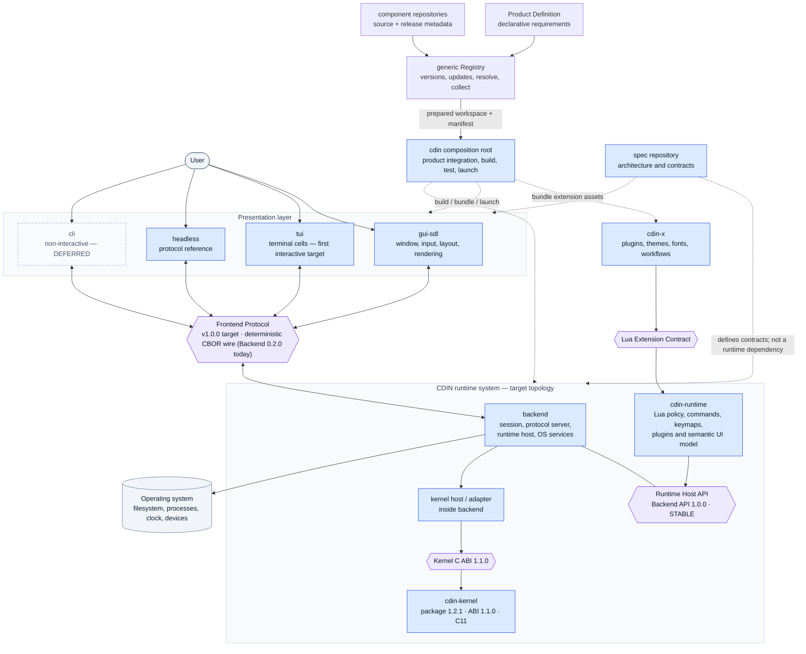

# CDIN Specification

This repository is the formal architecture and system-design specification of **CDIN**, a modular text editor. It defines component ownership, the stable kernel boundary, the Frontend Protocol model, and the rules that keep those contracts compatible.

**Specification release: `1.4.0` (stable Runtime Host API contract release).** The inspected `cdin-editor/kernel` package is `1.2.1` and publishes C ABI `1.1.0`, whose header declares Spec target `1.1.0`. Frontend Protocol wire/client/driver decisions are accepted in ADR-0018 and a partial standalone reference codec/server is implemented in the Backend; model projection, live Runtime dispatch, concrete OS transports and cross-platform integration remain incomplete. This repository remains design-only and contains no production implementation. Cross-repository verification evidence is recorded in [kernel implementation status](docs/kernel/implementation-status.md), the Frontend Protocol decisions and the delivered Backend traceability report.

Language: English. Normative text is English only for now.

---

## What CDIN is

CDIN is a modular text editor with intentionally separate **presentation**, **policy**, **coordination**, and **document-engine** responsibilities. Contracts—not private headers—connect the layers. The diagram below is the target architecture; dashed relationships are build-time or packaging relationships, not runtime calls.



**Read the diagram in four passes:**

1. **Presentation:** frontends own visual layout and environment-specific input/output. They use the Frontend Protocol; they never call the kernel or Lua runtime directly.
2. **Policy:** `cdin-runtime` owns commands, keymaps, plugins, logical views and the semantic UI model. It reaches document operations through the backend-provided Runtime Host API—not through private kernel symbols.
3. **Coordination and document state:** the backend hosts the runtime, manages sessions and OS services, and is the direct client of the kernel C ABI. `cdin-kernel` alone owns canonical document bytes, versions and undo/redo history.
4. **Composition and extensions:** `cdin` assembles and releases the product. `cdin-x` provides extension assets through the Lua extension contract and is not a privileged part of the core.

### Product composition and component delivery

The product is assembled from independently released components. A generic, data-driven Registry manages component discovery, version selection, update tracking and source collection. Product requirements are supplied as data (a Product Definition), not hardcoded into the Registry. The Registry prepares a reproducible workspace and manifest; CDIN remains responsible for integration, build, tests, packaging and launch.

**Core principle:** *Registry must understand requirements, not consumer identity.* The accepted architecture and Registry data-contract baseline `1.0.0` allow the same engine to serve CDIN Editor and unrelated products through different Product Definitions, without product-specific Registry code. The implementation is maintained separately in [`cdin-editor/registry`](https://github.com/cdin-editor/registry); this Spec defines its architecture and contracts, not implementation status. See [Registry architecture](docs/architecture/registry.md), [Registry data contracts](docs/architecture/registry-contracts.md) and [ADR-0022](docs/adr/ADR-0022-minimal-static-release-catalog.md).

The drawing is a **target model**, not a claim that every layer has already been extracted. The owner-approved TUI is the first interactive Frontend target, but it has not yet shipped. The legacy GUI path and portions of Backend integration remain in `cdin`; the Runtime source is separately extracted, while live Backend→Runtime integration remains a release gate. Protocol 1.0.0 is the accepted wire target and the companion Backend source implements the codec/server and Runtime projection boundary; live native integration and concrete process transports remain incomplete. The owner-approved standalone Frontend repository contains peer `core`, `gui-sdl`, `tui` and `headless` adapters; TUI is the first interactive target, not a shipped implementation. Runtime is a separately extracted repository (latest Runtime candidate package `1.0.0-rc.1`); the Backend-provided Host API `1.0.0` is now a frozen stable contract; live native integration remains a separate Runtime package release gate. For dependency maps, edit flow and lifecycle detail, see [System maps](docs/architecture/system-maps.md).

### Version map for the current kernel release

| Version label | Value | Meaning |
|---|---:|---|
| `cdin-kernel` package | `1.2.1` | Current package inspected in `cdin-editor/kernel`. |
| Public C ABI | `1.1.0` | Current ABI major 1 contract; ABI 1.1 adds the Kernel logger API. |
| CDIN Spec release | `1.3.0` | Runtime ownership/contract release; see `CHANGELOG.md`. |
| Kernel-declared Spec target | `1.1.0` | Compatibility target declared by the current kernel public header; not a claim that application-level components conform. |

The full release-specific evidence and limits are recorded in [kernel implementation status](docs/kernel/implementation-status.md).

### Cross-component version baseline

| Contract / package | Audited version | Owner / meaning |
|---|---:|---|
| Runtime package | `1.0.0-rc.1` | Release candidate; stable tag remains gated by native and extension/migration conformance |
| Runtime Host API | `1.0.0` | Stable Backend-provided service contract; additive minor compatibility within major 1 |
| Backend | `1.0.0` | Audited Backend source/release snapshot |
| Frontend Foundation Core | `1.0.0` | Standalone Frontend core package |
| Frontend Protocol | `1.0.0` | Accepted semantic/wire contract; implementation conformance is a separate gate |
| Extension Contract | separately versioned | Runtime-owned compatibility identity; manifest metadata details remain a pre-release decision |

These version axes are independent. Runtime does not negotiate the Kernel ABI or Frontend Protocol; Backend validates those boundaries and exposes effective descriptors/capabilities to Runtime.

## Where to start

The whole map is [docs/README.md](docs/README.md). Short version:

| If you want to | Open |
| --- | --- |
| understand the system in ten minutes | [architecture/overview](docs/architecture/overview.md), then [module-boundaries](docs/architecture/module-boundaries.md) |
| know what any word means | [reference/glossary](docs/reference/glossary.md) |
| read a requirement correctly | [reference/conventions](docs/reference/conventions.md) |
| know what is decided and what is not | [reference/status](docs/reference/status.md), [adr/open-decisions](docs/adr/open-decisions.md) |
| trace Runtime and Backend ownership boundaries | [Backend component](docs/components/backend.md), [Runtime component](docs/components/runtime.md), and [migration gates](docs/architecture/migration.md) |
| build one component | the page under [docs/components/](docs/components/) or [docs/kernel/](docs/kernel/) |
| plan the move from today's code | [architecture/migration](docs/architecture/migration.md) |

## How to tell what is real

This specification mixes four kinds of statement and always labels them (see [conventions.md](docs/reference/conventions.md)):

- `EXISTING`: behaviour verified in a specifically identified repository snapshot or its documents, with a code anchor.
- `ACCEPTED`: a decision the project owner explicitly made.
- `PROPOSED`: a recommendation awaiting acceptance.
- `DEFERRED`: intentionally postponed.

Unresolved questions are not requirements. They live in the [Open Decisions Register](docs/adr/open-decisions.md) with options and trade-offs.

**A `PROPOSED` item is never promoted to `ACCEPTED` without an owner decision. Runtime v1 ownership decisions and the stable Host API 1.0.0 contract do not imply that the Runtime package or full product integration is production-ready.** The currently inspected Kernel package `1.2.1` publishes C ABI `1.1.0`; this Spec does not infer whole-product conformance from the Kernel implementation. The Backend snapshot contains a tested partial Protocol codec/server, but the full Runtime bridge and frontend execution path remain release blockers.


## Release reporting

Generate a current inventory and status summary (this reports counts; it does not lint or test the specification):

```sh
python3 scripts/spec_report.py
```

Preview release notes for a version already documented in `CHANGELOG.md`:

```sh
python3 scripts/spec_report.py --release-version 1.3.0 --output release-notes.md
```

GitHub Actions is intentionally release-only. Pushing a `vX.Y.Z` tag creates a GitHub Release whose body contains the Spec inventory and the matching version's Changelog entry. The workflow does not run on ordinary branch pushes or pull requests.

For example, after updating `CHANGELOG.md` and the version in `docs/reference/status.md`:

```sh
git tag -a v1.3.0 -m "CDIN Spec v1.3.0"
git push origin v1.3.0
```

## License

GNU GPL v3 or later, the same as `cdin` — see [LICENSE](LICENSE) and [NOTICE](NOTICE).
