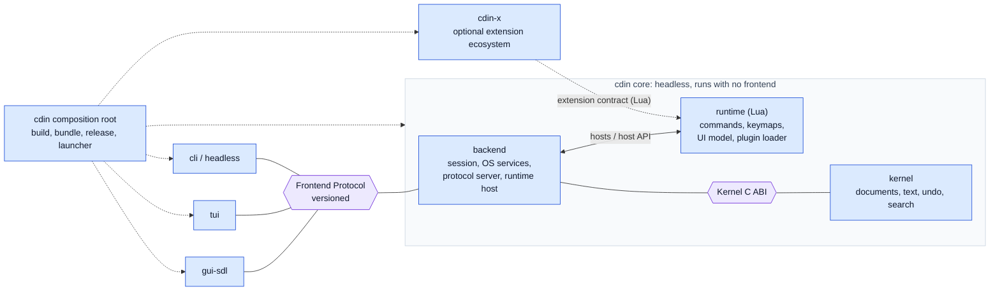

# CDIN Specification

This repository is the formal architecture and system-design specification of **CDIN**, a modular text editor. It defines the components, their responsibilities, the contracts between them, and the rules that keep those contracts stable.

**Scope of this repository: design only.** It contains no implementation and no executable test code. It does describe, for every normative requirement, *how that requirement will be verified*, so that implementations can be built and checked against it later.

Language: English. Normative text is English only for now.

---

## 1. What CDIN is

CDIN is an editor built from components with explicit ownership boundaries and stable contracts. Any component can be reimplemented, in any language, behind its contract, without touching the others.



The picture in one paragraph: the **kernel** owns documents and knows nothing about who uses it. The **backend** hosts the kernel, the **runtime** (Lua) and the OS services, and talks to any number of **frontends** through one versioned **Frontend Protocol**. **cdin** is the composition root that builds and bundles all of it. **cdin-x** is a completely separate ecosystem that only sees the Lua extension contract.

## 2. Where to start

The whole map is [docs/README.md](docs/README.md). Short version:

| If you want to | Open |
| --- | --- |
| understand the system in ten minutes | [architecture/overview](docs/architecture/overview.md), then [module-boundaries](docs/architecture/module-boundaries.md) |
| know what any word means | [reference/glossary](docs/reference/glossary.md) |
| read a requirement correctly | [reference/conventions](docs/reference/conventions.md) |
| know what is decided and what is not | [reference/status](docs/reference/status.md), [adr/open-decisions](docs/adr/open-decisions.md) |
| build one component | the page under [docs/components/](docs/components/) or [docs/kernel/](docs/kernel/) |
| plan the move from today's code | [architecture/migration](docs/architecture/migration.md) |

## 3. How to tell what is real

This specification mixes four kinds of statement and always labels them (see [conventions.md](docs/reference/conventions.md)):

- `EXISTING`: behaviour verified in the current `cdin` source or its documents, with a code anchor.
- `ACCEPTED`: a decision the project owner explicitly made.
- `PROPOSED`: a recommendation awaiting acceptance.
- `DEFERRED`: intentionally postponed.

Unresolved questions are not requirements. They live in the [Open Decisions Register](docs/adr/open-decisions.md) with options and trade-offs.

**A `PROPOSED` item is never promoted to `ACCEPTED` without a decision, and a component section is not considered settled until a prototype has exercised it** (see [docs/components/spec.md](docs/components/spec.md), "Implementation feedback gates"). That gate is how this specification stays honest against real code instead of drifting into paper.

## 4. Repository layout

```
README.md  CHANGELOG.md  CONTRIBUTING.md  AGENTS.md  SECURITY.md  CODE_OF_CONDUCT.md
LICENSE  NOTICE  CODEOWNERS  psx.yml
docs/
  README.md        the index: which page to open for what
  reference/       how to read the spec: conventions, glossary, status
  architecture/    system-level design
  components/      one document per component
  kernel/          the kernel in detail
  testing/         verification design (no test code)
  adr/             the ADRs and the Open Decisions Register
scripts/
  check.py         structural checks: IDs, links, references, index, diagrams
.github/           issue and pull-request templates, the check workflow
```

## 5. Checking it

```sh
python3 scripts/check.py     # every requirement ID, link, reference and diagram
psx check                    # the repository's own structure, against psx.yml
```

## 6. License

GNU GPL v3 or later, the same as `cdin` — see [LICENSE](LICENSE) and [NOTICE](NOTICE).
