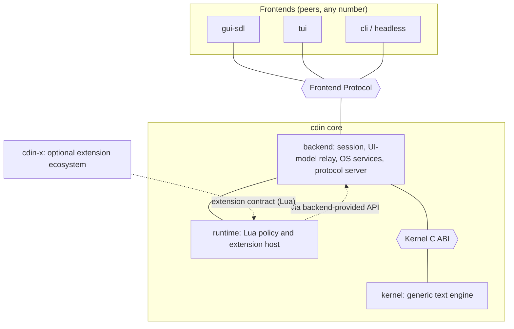

# CDIN Specification

This repository is the formal architecture and system-design specification of **CDIN**, a modular text editor. It defines the components, their responsibilities, the contracts between them, and the rules that keep those contracts stable.

**Scope of this repository: design only.** It contains no implementation and no executable test code. It does describe, for every normative requirement, *how that requirement will be verified*, so that implementations can be built and checked against it later.

Language: English. Normative text is English only for now.

---

## 1. What CDIN is

CDIN is an editor built from components with explicit ownership boundaries and stable contracts. Any component can be reimplemented, in any language, behind its contract, without touching the others.



The picture in one paragraph: the **kernel** owns documents and knows nothing about who uses it. The **backend** hosts the kernel, the **runtime** (Lua) and the OS services, and talks to any number of **frontends** through one versioned **Frontend Protocol**. **cdin** is the composition root that builds and bundles all of it. **cdin-x** is a completely separate ecosystem that only sees the Lua extension contract.

## 2. Reading guide

| Read this | To learn |
|---|---|
| [CONVENTIONS.md](CONVENTIONS.md) | Status labels, requirement IDs, verification methods, ADR format. Read first. |
| [GLOSSARY.md](GLOSSARY.md) | Exact meaning of every term (notably `data`, `backend`, `view`, `position`). |
| [STATUS.md](STATUS.md) | What has been inspected, what is decided, what is open, what contradicts what. |
| [docs/architecture/overview.md](docs/architecture/overview.md) | Goals, principles, system context. |
| [docs/architecture/repositories.md](docs/architecture/repositories.md) | The components, which repository each lives in, and when that changes. |
| [docs/architecture/module-boundaries.md](docs/architecture/module-boundaries.md) | Who may depend on whom, who owns which state. |
| [docs/architecture/abi-and-compatibility.md](docs/architecture/abi-and-compatibility.md) | The C ABI rules every binary boundary follows. |
| [docs/architecture/frontend-protocol.md](docs/architecture/frontend-protocol.md) | How GUI, TUI, CLI and future frontends attach. |
| [docs/architecture/concurrency.md](docs/architecture/concurrency.md) | Threads, FIFO, snapshots, shutdown. |
| [docs/architecture/lifecycle.md](docs/architecture/lifecycle.md) | Process, module and document lifecycles. |
| [docs/architecture/error-model.md](docs/architecture/error-model.md) | Status codes and error structure. |
| [docs/architecture/extension-model.md](docs/architecture/extension-model.md) | How cdin-x and plugins relate to the core. |
| [docs/architecture/migration.md](docs/architecture/migration.md) | How today's code becomes this architecture without breaking the editor. |
| [docs/components/](docs/components/) | One document per component: cdin, backend, runtime, frontend, data, cdin-x, spec. |
| [docs/kernel/](docs/kernel/) | The kernel in full: documents, text, positions, edits, transactions, undo, notifications, search. |
| [docs/testing/](docs/testing/) | How each requirement is to be verified; the conformance-suite design. |
| [docs/decisions/](docs/decisions/) | The Open Decisions Register and every ADR. |

## 3. How to tell what is real

This specification mixes four kinds of statement and always labels them (see [CONVENTIONS.md](CONVENTIONS.md)):

- `EXISTING`: behaviour verified in the current `cdin` source or its documents, with a code anchor.
- `ACCEPTED`: a decision the project owner explicitly made.
- `PROPOSED`: a recommendation awaiting acceptance.
- `DEFERRED`: intentionally postponed.

Unresolved questions are not requirements. They live in the [Open Decisions Register](docs/decisions/open-decisions.md) with options and trade-offs.

**A `PROPOSED` item is never promoted to `ACCEPTED` without a decision, and a component section is not considered settled until a prototype has exercised it** (see [docs/components/spec.md](docs/components/spec.md), "Implementation feedback gates"). That gate is how this specification stays honest against real code instead of drifting into paper.

## 4. Repository layout

```
README.md  STATUS.md  GLOSSARY.md  CONVENTIONS.md
docs/
  architecture/   system-level design
  components/     one document per component
  kernel/         the kernel in detail
  testing/        verification design (no test code)
  decisions/      open decisions register and ADRs
```
