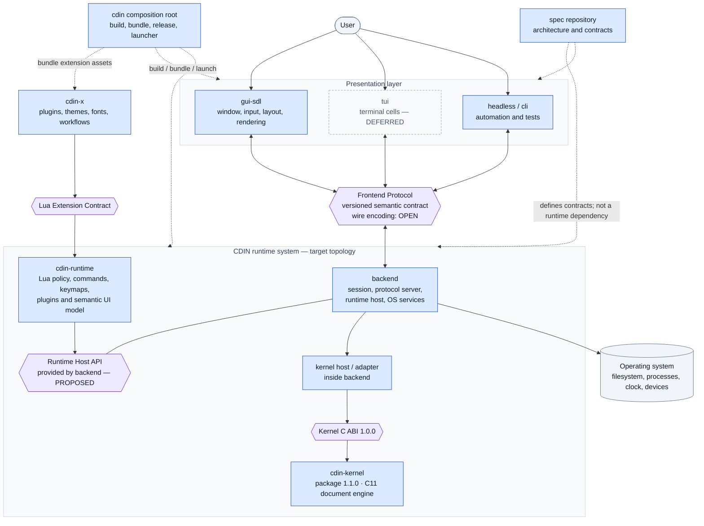

# CDIN Specification

This repository is the formal architecture and system-design specification of **CDIN**, a modular text editor. It defines component ownership, the stable kernel boundary, the Frontend Protocol model, and the rules that keep those contracts compatible.

**Specification release: `1.1.0` (compatible architecture and documentation release).** The `cdin-kernel` package still publishes C ABI `1.0.0` and declares compatibility with the Spec `1.0.0` baseline. This repository remains design-only: the runtime, backend integration, Frontend Protocol wire encoding and several advanced features are proposed or deferred where explicitly marked. It contains no production implementation or executable test suite. Cross-repository verification evidence is recorded in [implementation status](docs/kernel/implementation-status.md).

Language: English. Normative text is English only for now.

---

## What CDIN is

CDIN is a modular text editor with intentionally separate **presentation**, **policy**, **coordination**, and **document-engine** responsibilities. Contracts—not private headers—connect the layers. The diagram below is the target architecture; dashed relationships are build-time or packaging relationships, not runtime calls.



**Read the diagram in four passes:**

1. **Presentation:** frontends own visual layout and environment-specific input/output. They use the Frontend Protocol; they never call the kernel or Lua runtime directly.
2. **Policy:** `cdin-runtime` owns commands, keymaps, plugins, logical views and the semantic UI model. It reaches document operations through the backend-provided Runtime Host API—not through private kernel symbols.
3. **Coordination and document state:** the backend hosts the runtime, manages sessions and OS services, and is the direct client of the kernel C ABI. `cdin-kernel` alone owns canonical document bytes, versions and undo/redo history.
4. **Composition and extensions:** `cdin` assembles and releases the product. `cdin-x` provides extension assets through the Lua extension contract and is not a privileged part of the core.

The drawing is a **target model**, not a claim that every layer has already been extracted. The current GUI, Lua runtime and much of the backend remain integrated in `cdin`; the Frontend Protocol's wire encoding and the Runtime Host API remain proposed/open where called out in the component pages. For a dependency map, an end-to-end edit sequence and lifecycle detail, see [System maps](docs/architecture/system-maps.md).

### Version map for the current kernel release

| Version label | Value | Meaning |
|---|---:|---|
| `cdin-kernel` package | `1.1.0` | Distribution, documentation and internal search-path improvements in this package release. |
| Public C ABI | `1.0.0` | Stable binary contract; public names, layouts and status values remain governed by `include/cdin/kernel.h`. |
| CDIN Spec release | `1.1.0` | Current compatible specification release; see `CHANGELOG.md`. |
| Kernel-declared Spec target | `1.0.0` | Compatibility target declared by the current kernel public header. This does not claim conformance to unimplemented application-level components. |

The full release-specific evidence and limits are recorded in [kernel implementation status](docs/kernel/implementation-status.md).

## Where to start

The whole map is [docs/README.md](docs/README.md). Short version:

| If you want to | Open |
| --- | --- |
| understand the system in ten minutes | [architecture/overview](docs/architecture/overview.md), then [module-boundaries](docs/architecture/module-boundaries.md) |
| know what any word means | [reference/glossary](docs/reference/glossary.md) |
| read a requirement correctly | [reference/conventions](docs/reference/conventions.md) |
| know what is decided and what is not | [reference/status](docs/reference/status.md), [adr/open-decisions](docs/adr/open-decisions.md) |
| build one component | the page under [docs/components/](docs/components/) or [docs/kernel/](docs/kernel/) |
| plan the move from today's code | [architecture/migration](docs/architecture/migration.md) |

## How to tell what is real

This specification mixes four kinds of statement and always labels them (see [conventions.md](docs/reference/conventions.md)):

- `EXISTING`: behaviour verified in a specifically identified repository snapshot or its documents, with a code anchor.
- `ACCEPTED`: a decision the project owner explicitly made.
- `PROPOSED`: a recommendation awaiting acceptance.
- `DEFERRED`: intentionally postponed.

Unresolved questions are not requirements. They live in the [Open Decisions Register](docs/adr/open-decisions.md) with options and trade-offs.

**A `PROPOSED` item is never promoted to `ACCEPTED` without an owner decision.** For `cdin-kernel`, package `1.1.0` retains the public C ABI and supported behaviour `1.0.0`; that ABI is checked against a separate implementation and its conformance suite. No such implementation claim is made for runtime, backend or frontend-protocol features that remain unbuilt.


## Release reporting

Generate a current inventory and status summary (this reports counts; it does not lint or test the specification):

```sh
python3 scripts/spec_report.py
```

Preview release notes for a version already documented in `CHANGELOG.md`:

```sh
python3 scripts/spec_report.py --release-version 1.1.0 --output release-notes.md
```

GitHub Actions is intentionally release-only. Pushing a `vX.Y.Z` tag creates a GitHub Release whose body contains the Spec inventory and the matching version's Changelog entry. The workflow does not run on ordinary branch pushes or pull requests.

For example, after updating `CHANGELOG.md` and the version in `docs/reference/status.md`:

```sh
git tag -a v1.1.0 -m "CDIN Spec v1.1.0"
git push origin v1.1.0
```

## License

GNU GPL v3 or later, the same as `cdin` — see [LICENSE](LICENSE) and [NOTICE](NOTICE).
