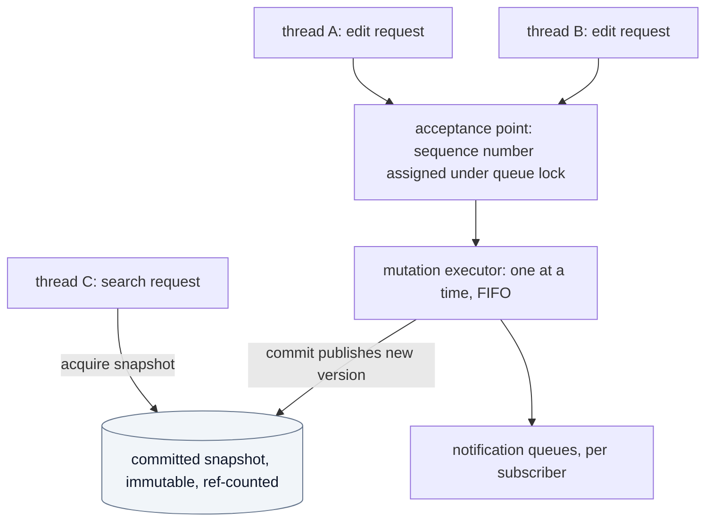
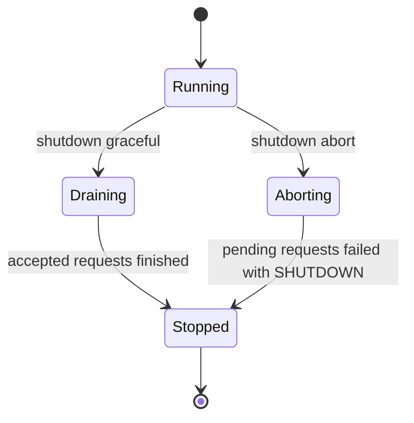

# Concurrency

How threads interact across components. The kernel may receive requests from several threads; mutations are serialized in FIFO order; reads use immutable snapshots. The Lua state stays single-threaded.

## 1. Threads in the system

| Thread kind | Where | May call |
|---|---|---|
| Main/event thread | backend | everything; owns the Lua state and the frontend connections |
| Worker threads | backend job system | kernel ABI (read via snapshots, search); never Lua |
| Frontend threads | frontend | the Frontend Protocol only |

- **CONC-009** `EXISTING` The Lua state is single-threaded and workers never touch it; workers operate on immutable, reference-counted snapshots. — *Verify:* SAN, INSPECT — *Anchor:* `AGENTS.md §2.3`; the job layer is `src/loop/loop.c` and `src/loop/loop.h`

## 2. Kernel concurrency model

*Caption: `PROPOSED` model. Mutations are serialized by the executor; readers never wait for it beyond the instant of snapshot acquisition.*

- **CONC-001** `ACCEPTED` The kernel MUST accept requests from multiple threads. — *Verify:* SAN, CONF
- **CONC-002** `ACCEPTED` Mutations MUST execute serially, one at a time. — *Verify:* SAN, CONF
- **CONC-003** `ACCEPTED` Accepted mutation requests MUST execute in FIFO order. — *Verify:* CONF
- **CONC-004** `PROPOSED` The *acceptance point* is the moment a request is assigned a sequence number under the queue lock. Order is by sequence number. The successful return of a submit call reports that sequence number. A request that fails validation before acceptance has no sequence number and does not take part in the order. — *Verify:* CONF, INSPECT
- **CONC-005** `PROPOSED` Reads MUST use immutable, reference-counted snapshots of a committed version. A read MUST NOT observe a partially applied mutation or a tentative transaction state of another caller. — *Verify:* CONF, SAN
- **CONC-006** `PROPOSED` Acquiring a snapshot is the only point where a reader synchronizes with mutations. The number of live snapshots per document is bounded by configuration; exceeding it returns `LIMIT_EXCEEDED`. Snapshots are released explicitly. — *Verify:* CONF, PERF
- **CONC-007** `PROPOSED` Long operations (search, large conversions) run on a snapshot, MUST be cancellable, and MUST have a resource limit expressed in steps, not time (the kernel does not read the clock). — *Verify:* CONF
- **CONC-010** `PROPOSED` Version checks are atomic with mutation: the expected-version comparison and the application of the edit occur within the same serialized step. — *Verify:* CONF (see EDIT-006)
- **CONC-011** `PROPOSED` A caller that holds a snapshot while submitting a mutation sees the mutation only in snapshots acquired after it commits. — *Verify:* CONF

### Reads during an active transaction

- **CONC-012** `PROPOSED` While a transaction is active on a document, reads by other callers observe the last committed version. Only the transaction's own handle MAY read tentative content. (Closes the proposed answer to open item 7 of the original list; see [OD-07](../adr/open-decisions.md).) — *Verify:* CONF

### Transactions and other writers

- **CONC-013** `PROPOSED` While a transaction is active on a document, mutation requests on that document that do not belong to the transaction are rejected with `BUSY` rather than queued, so that no long transaction can stall every other writer silently. Other documents are unaffected. This is `PROPOSED`; the alternative (queue behind the transaction) is recorded in [OD-21](../adr/open-decisions.md). — *Verify:* CONF

## 3. Shutdown

*Caption: `PROPOSED`. Pending requests at shutdown are the subject of [OD-18](../adr/open-decisions.md).*

- **CONC-020** `PROPOSED` Shutdown has two modes. *Graceful*: stop accepting new requests (they return `SHUTDOWN`), finish every accepted request in FIFO order, then stop. *Abort*: stop accepting, fail every request not yet started with `SHUTDOWN`, finish only the request currently executing, then stop. — *Verify:* CONF
- **CONC-021** `PROPOSED` Active transactions at shutdown are aborted and rolled back in both modes. — *Verify:* CONF
- **CONC-022** `PROPOSED` After shutdown completes, all handles are invalid and all snapshots MUST have been released by their holders; the kernel reports leaked snapshots at destruction as a diagnostic status, never by crashing. — *Verify:* SAN, CONF

## 4. Backend concurrency

- **CONC-030** `PROPOSED` The backend serializes its interaction with the runtime on the main thread. Anything a worker produces for Lua is posted to the main thread as a message. — *Verify:* SAN, INSPECT (restates CONC-009 from the backend's side)
- **CONC-031** `PROPOSED` Frontend connections are serviced without blocking the main thread; a slow frontend MUST NOT stall the backend (see PROTO-021). — *Verify:* PERF, INTEG

## 5. Frontend concurrency

- **CONC-040** `PROPOSED` The protocol is message-ordered per connection. Messages from one connection are processed in the order sent. Ordering across connections is by arrival at the backend and is not otherwise guaranteed. — *Verify:* CONF, INTEG
