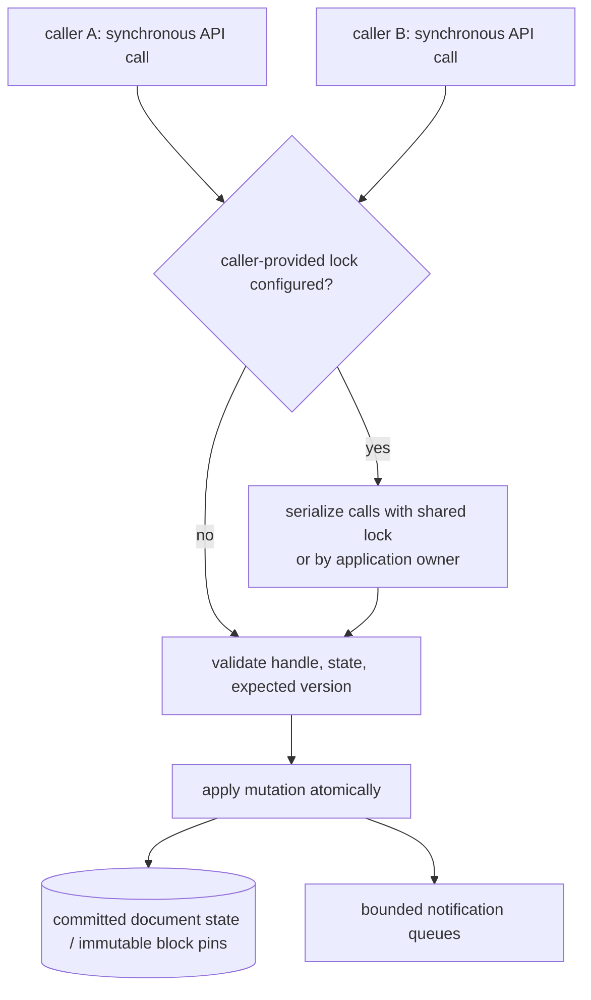

# Concurrency

The `cdin-kernel` 1.0.0 API is synchronous: each function runs on the calling thread and returns before that call completes. There is no hidden mutation executor or request FIFO. A caller-provided lock vtable can serialize API entries; without one, the application must ensure only one thread at a time calls a given kernel. The Lua state remains single-threaded.

## 1. Threads in the system

| Thread kind | Where | May call |
|---|---|---|
| Main/event thread | backend | kernel and runtime APIs; owns the Lua state |
| Worker threads | backend job system | kernel API only when a lock vtable is configured, or under application-level serialization; never Lua |
| Frontend threads | frontend | the Frontend Protocol only |

- **CONC-009** `EXISTING` The Lua state is single-threaded and worker code must not touch it; worker results intended for Lua are posted to the main/event thread. — *Verify:* INSPECT — *Anchor:* `AGENTS.md §2.3`; `src/loop/loop.c` and `src/loop/loop.h` in the supplied `cdin` snapshot.

## 2. Kernel concurrency model

*Caption: implemented ABI 1.0.0 call model. Calls execute inline. When configured, the caller-supplied lock serializes kernel entry; otherwise the caller must serialize access. The order is lock/linearization order, not a promise of FIFO by wall-clock arrival or thread start time.*

- **CONC-001** `ACCEPTED` The kernel MUST support calls made from multiple threads when a valid caller-provided lock/unlock pair serializes entry; without that pair the caller MUST ensure calls do not overlap. — *Verify:* SAN, CONF
- **CONC-002** `ACCEPTED` Mutations MUST execute serially, one at a time, with each successful mutation exposing an atomic committed state. — *Verify:* SAN, CONF
- **CONC-003** `ACCEPTED` Accepted mutation sequence numbers identify the order established at the kernel's serialized acceptance point. ABI 1.0.0 MUST NOT claim FIFO by wall-clock request arrival, scheduler order or thread start time. — *Verify:* CONF, INSPECT
- **CONC-004** `ACCEPTED` For a version-checked mutation, the stale-version check occurs atomically while the API call is serialized and before mutation preparation. A stale request is rejected without a document change. Sequence values are implementation ordering metadata, not a cross-thread arrival-time guarantee; later preparation failures may leave gaps. — *Verify:* CONF, INSPECT
- **CONC-005** `ACCEPTED` Explicit snapshots expose immutable content and a fixed document version until released. APIs operating on a document directly synchronize through the kernel lock; clients needing stable multi-call reads MUST acquire a snapshot. — *Verify:* CONF, SAN
- **CONC-006** `ACCEPTED` Snapshot and notification allocations are bounded by the per-kernel/per-document limits documented in the ABI header; excess requests fail or notifications collapse to `RESYNC` rather than allowing an unbounded event queue. — *Verify:* CONF, PERF
- **CONC-007** `PROPOSED` Future long-running operations SHOULD accept deterministic step limits and cancellation rather than wall-clock timeouts; the kernel must not read the clock for editor policy. — *Verify:* CONF
- **CONC-010** `ACCEPTED` A version check and its associated mutation are atomic with respect to other calls serialized on the same kernel. — *Verify:* CONF (see EDIT-006)
- **CONC-011** `ACCEPTED` A snapshot acquired before a mutation remains unchanged; a later snapshot may observe the committed mutation. — *Verify:* CONF

### Reads during an active transaction

- **CONC-012** `ACCEPTED` While a transaction is active on a document, ordinary reads by other callers observe the last committed version. Only the transaction handle reads tentative content. — *Verify:* CONF

### Transactions and other writers

- **CONC-013** `ACCEPTED` While a transaction is active on a document, an unrelated mutation on that document is rejected with `BUSY`; mutations on other documents are not blocked by the active transaction merely because they share a kernel. — *Verify:* CONF

## 3. Shutdown

Kernel ABI 1.0.0 has no internal pending request queue to drain. `cdin_kernel_shutdown` stops new content mutations and aborts active transactions; allowed teardown/read operations remain available until handles are explicitly released or the kernel is destroyed. The graceful/abort enum values are accepted for API compatibility, but both modes have the same behavior in this release.

- **CONC-020** `ACCEPTED` Shutdown MUST reject new content mutations, abort active transactions and provide deterministic teardown; graceful and abort mode values are behaviorally equivalent in ABI 1.0.0 because API calls execute synchronously and there is no queued work to drain or cancel. — *Verify:* CONF
- **CONC-021** `ACCEPTED` Active transactions are aborted and rolled back during shutdown. — *Verify:* CONF
- **CONC-022** `PROPOSED` After kernel destruction all handles are invalid; callers MUST release snapshots and stop concurrent API calls before destruction. — *Verify:* SAN, CONF

## 4. Backend concurrency

- **CONC-030** `PROPOSED` The backend serializes its interaction with the runtime on the main/event thread. Worker results intended for Lua are posted to the main/event thread. — *Verify:* SAN, INSPECT
- **CONC-031** `PROPOSED` Frontend connections SHOULD be serviced without blocking the main thread; a slow frontend MUST NOT indefinitely stall unrelated backend work. — *Verify:* PERF, INTEG

## 5. Frontend concurrency

- **CONC-040** `PROPOSED` The protocol is message-ordered per connection. Messages from one connection are processed in send order. Ordering across connections is established by backend serialization and is not otherwise guaranteed. — *Verify:* CONF, INTEG
