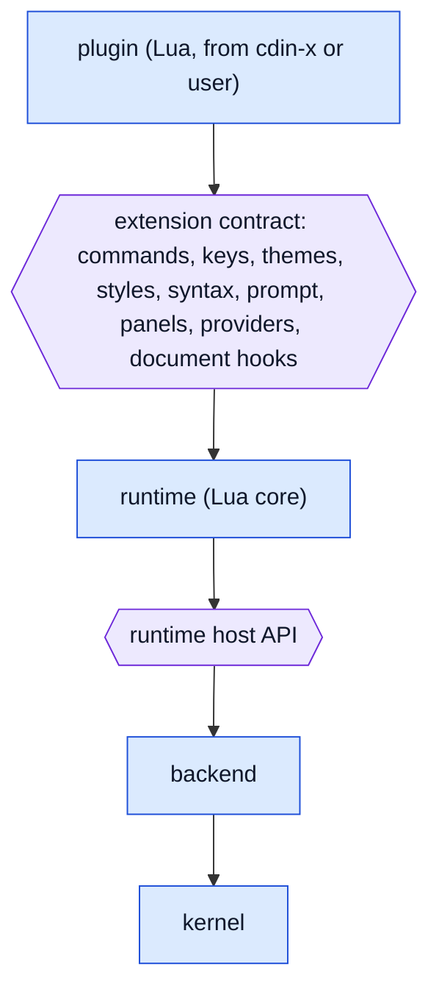

# Extension model

How `cdin-x` and plugins relate to the core. The extension surface is the **Lua extension contract**, which already exists and is guarded by an explicit rule: a change to it needs an owner-approved decision. This specification keeps that contract and adds one rule above it: **extensions never touch the kernel.**

## 1. Layers

*Caption: `PROPOSED` layering. A plugin has no arrow to the kernel or backend.*

- **EXT-001** `ACCEPTED` Extensions MUST NOT have direct access to the kernel. — *Verify:* INSPECT, STATIC (same as ARCH-006)
- **EXT-002** `EXISTING` The extension contract is the whole of what `cdin` guarantees to extensions and therefore the whole of what `cdin-x` may assume; anything not in it is not a contract. — *Verify:* INSPECT — *Anchor:* `docs/architecture/extension-contract.md` (introduction)
- **EXT-003** `EXISTING` `cdin` knows nothing about any particular extension and runs with an empty site directory. — *Verify:* INTEG — *Anchor:* `AGENTS.md §1`, `docs/architecture/overview.md` ("Two repositories")
- **EXT-004** `PROPOSED` Extension access to document content goes through runtime-level document hooks and the runtime's document API, which in turn use the kernel ABI. An extension never receives a kernel handle. — *Verify:* INSPECT, STATIC

## 2. The mandatory set

- **EXT-010** `ACCEPTED` A standalone `cdin` build ships with the vim plugin as the mandatory plugin. Its source lives in the `cdin-x` repository, not in `cdin`. A build bundles it. — *Verify:* INTEG
- **EXT-011** `EXISTING` The bundle step takes a checkout of `cdin-x` as a path (`CDINX_DIR`, default `../cdin-x`), copies the mandatory set (vim, the extension manager, the default theme, the fonts) and writes a bundle index. Nothing is fetched and no submodule or sibling lookup occurs at run time. — *Verify:* INTEG — *Anchor:* `mk/bundle.mk`, `scripts/assemble_data.py`

## 3. Installing extensions

These are the owner's stated requirements for the `cdin-x` side. They are recorded so the runtime contract does not make them impossible.

- **EXT-020** `ACCEPTED` Installing a plugin or theme MUST download only that plugin or theme, never clone the whole `cdin-x` repository. — *Verify:* INTEG
- **EXT-021** `ACCEPTED` The extension panel's search MUST only check whether a plugin is available; it MUST NOT install it and MUST NOT clone the repository. — *Verify:* INTEG
- **EXT-022** `ACCEPTED` A just-downloaded plugin moves into the panel's installed section with its state (installed, enabled, disabled). — *Verify:* INTEG

## 4. Extensions and the UI model

The extension contract lets plugins add side panels, a prompt and views, and some plugins draw custom views directly. Under the Frontend Protocol, drawing is the frontend's job.

- **EXT-030** `PROPOSED` Plugins express UI through declarative widgets (lists, trees, styled text, inputs) that every frontend can render. — *Verify:* INSPECT, INTEG
- **EXT-031** `PROPOSED` Plugins that need free-form drawing use an optional `canvas` capability that only frontends declaring it receive. A plugin MUST degrade gracefully (or report unavailability) when the capability is absent. — *Verify:* INTEG
- **EXT-032** `PROPOSED` These changes alter the extension contract. They MUST be made only through an owner-approved ADR with shims and one deprecation log per process for each changed API (ARCH-027). — *Verify:* INSPECT

See [ADR-0011](../adr/ADR-0011-extension-ui.md) for options and trade-offs.

## 5. Contract versioning

- **EXT-040** `PROPOSED` The extension contract carries a version, separate from the ABI and protocol versions. A plugin may declare the contract range it supports; the loader refuses plugins outside it with a clear message. — *Verify:* INTEG
- **EXT-041** `EXISTING` The contract document already includes a section "Changing any of this", which defines how changes are made. This specification does not replace it. — *Verify:* INSPECT — *Anchor:* `docs/architecture/extension-contract.md` ("Changing any of this")
