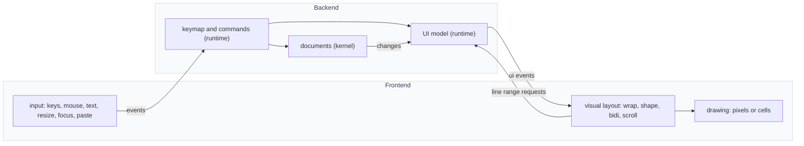
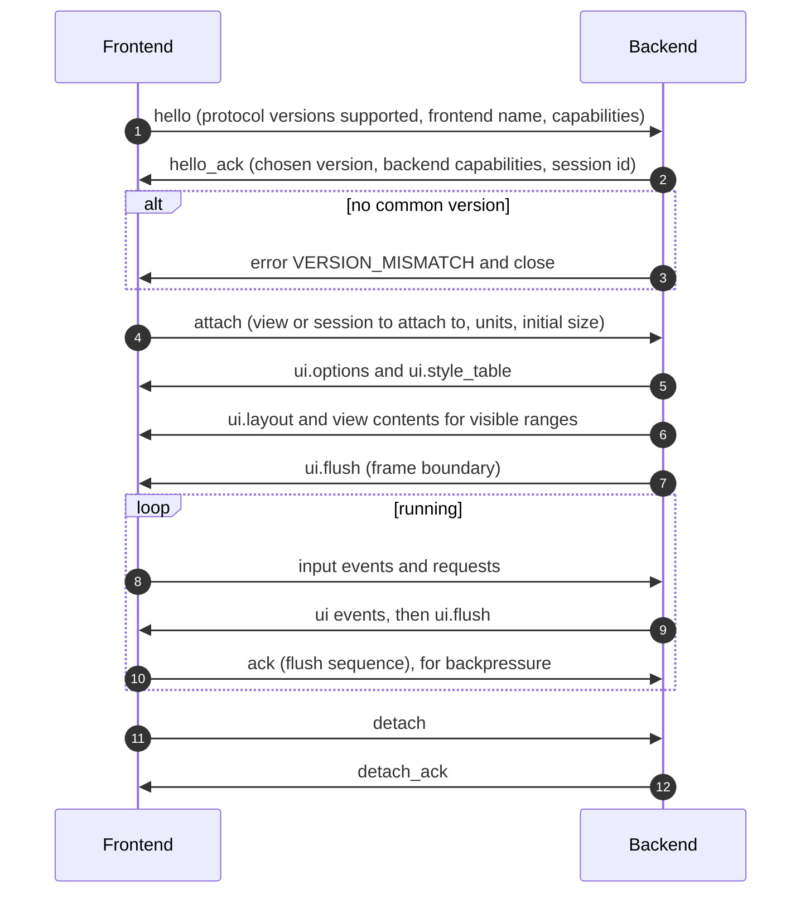

# Frontend Protocol

The contract between the backend and any number of frontends (GUI, TUI, CLI, headless, a different GUI toolkit, web). Status of this whole document: **`PROPOSED`**. The model (backend owns state, frontends own presentation) is the recommendation behind [ADR-0005](../adr/ADR-0005-frontend-protocol.md); it awaits owner acceptance.

## 1. Model

The backend keeps all editor state and produces a **semantic UI model**: which windows and views exist, which lines of which document are visible, which style role each span has, where selections are, what the status line and prompt say. A frontend renders that model in its environment and sends back **input events** and **requests**. The model contains no pixels and no cells.

## 2. Roles and ownership

- **PROTO-001** `PROPOSED` The backend MUST own all editor state: documents, views, selections, commands, keymaps, configuration. A frontend MUST be able to be discarded and re-attached without data loss. — *Verify:* INTEG
- **PROPOSED-note:** (not a requirement) a frontend MAY cache anything it likes for display; caches are disposable.
- **PROTO-002** `PROPOSED` Frontends own visual layout (wrapping, shaping, bidi reordering, tab expansion, scroll position in pixels or cells). The protocol MUST NOT carry pixel or cell coordinates for text content; it carries logical positions. — *Verify:* INSPECT, INTEG
- **PROTO-003** `PROPOSED` Visual motion (move up/down by visual line, home/end of visual line) is computed by the frontend and sent as a request that sets a logical position; the backend never needs font metrics. — *Verify:* INTEG
- **PROTO-004** `PROPOSED` Raw keys are sent to the backend; the keymap is policy in the runtime. A frontend MUST NOT interpret keybindings. — *Verify:* INSPECT

## 3. Attach, handshake and capabilities

*Caption: `PROPOSED` handshake and steady state.*

- **PROTO-010** `PROPOSED` Every connection begins with `hello` and `hello_ack`. No other message is valid before them. — *Verify:* CONF
- **PROPOSED capability set** (illustrative, to be fixed by ADR): `units` = `cells` or `pixels`; `images`; `truecolor`; `mouse`; `hit_regions`; `rich_text`; `canvas`; `clipboard`; `dialogs`; `ime`. The backend sends only what the frontend declared.
- **PROTO-011** `PROPOSED` Capabilities are declared by the frontend and accepted or reduced by the backend in `hello_ack`. Unknown capability names MUST be ignored. — *Verify:* CONF
- **PROTO-012** `PROPOSED` Several frontends MAY attach to one session simultaneously. Each has an independent handshake, capability set and flush sequence. — *Verify:* INTEG
- **PROTO-013** `PROPOSED` Whether a second frontend may *mutate* while another is attached is `OPEN` (see [OD-24](../adr/open-decisions.md)); until decided, one attached frontend is the *driver* and others are observers. — *Verify:* INSPECT

## 4. Message catalogue

### Frontend to backend

| Message | Payload (conceptual) | Notes |
|---|---|---|
| `hello` | versions, name, capabilities | first message |
| `attach` / `detach` | session, units, size | |
| `input.key` | normalized key, modifiers, press/release/repeat | raw; no keymap logic in the frontend |
| `input.text` | committed text (IME result) | |
| `input.mouse` | logical target, button, modifiers, action | target is a region id plus logical position when known |
| `input.paste` | bytes | bracketed paste or clipboard paste |
| `window.resize` | width, height in declared units | |
| `focus` | gained or lost | |
| `view.request_lines` | view id, line range, version | the frontend pulls what it can display |
| `view.set_position` | view id, logical position or range | result of visual motion (PROTO-003) |
| `request.command` | command name, arguments | for toolbars or CLI use |
| `response.*` | answer to a backend request | clipboard text, dialog result |
| `ack` | flush sequence number | backpressure |

### Backend to frontend

| Message | Payload (conceptual) | Notes |
|---|---|---|
| `hello_ack` | chosen version, capabilities, session | |
| `ui.options` | title, cursor shape, tab width, wrap preference | |
| `ui.style_table` | role id to attributes (colour, weight, slant) | roles come from the theme; the frontend maps to its palette |
| `ui.layout` | tree of panes and views with proportional sizes | in abstract proportions, not pixels |
| `view.lines` | view id, version, line range, per-line bytes and spans (byte ranges with style role id) | logical content; spans come from the runtime highlighter |
| `view.invalidate` | view id, version, ranges | tells the frontend cached lines are stale |
| `view.cursor` / `view.selection` | logical positions | selections owned by the view |
| `ui.statusline` / `ui.prompt` / `ui.panel` | structured content | declarative widgets, see [ADR-0011](../adr/ADR-0011-extension-ui.md) |
| `ui.notify` | level, text | |
| `request.clipboard_get/set` | | answered by `response.*` |
| `request.dialog` | confirm, open, save | `dialogs` capability only |
| `canvas.*` | drawing commands | `canvas` capability only; for custom plugin views |
| `ui.flush` | sequence number | frame boundary: apply all preceding messages atomically |
| `error` | status, detail | |

- **PROTO-020** `PROPOSED` Messages between two `ui.flush` boundaries form one atomic update; a frontend MUST NOT present a partial update. — *Verify:* CONF, INTEG
- **PROTO-021** `PROPOSED` The backend MUST NOT send more than a bounded number of unacknowledged flushes; the bound is negotiated or fixed by the protocol. When reached, the backend coalesces rather than queues without bound. — *Verify:* PERF, INTEG (supports ARCH-021)
- **PROTO-022** `PROPOSED` `view.lines` is pull-based: the backend sends line content only for ranges the frontend requested or that are marked as pushed by a capability. — *Verify:* INTEG
- **PROTO-023** `PROPOSED` Every `view.lines` and `view.invalidate` carries the document version it describes. A frontend that receives lines for a version older than one it already holds MUST discard them. — *Verify:* CONF
- **PROTO-024** `PROPOSED` Spans are byte ranges over line content with a style role id; they carry no colour. Colours come from `ui.style_table`. — *Verify:* CONF

## 5. Transports

- **PROTO-030** `PROPOSED` The protocol is defined by its messages, not by an encoding. Two transports carry the same messages: *in-process* (C ABI functions, used by the embedded GUI) and *serialized* (framed bytes over a stream, used by TUI, CLI, remote and tests). — *Verify:* INSPECT
- **PROTO-031** `PROPOSED` Serialized frames are length-prefixed and self-delimiting. The encoding inside frames is `OPEN` ([OD-22](../adr/open-decisions.md)). — *Verify:* INSPECT
- **PROTO-032** `PROPOSED` A frontend and backend that both support serialization MUST interoperate regardless of implementation language. — *Verify:* CONF, INTEG
- **PROTO-033** `PROPOSED` The in-process transport MUST observe the ABI rules ([abi-and-compatibility.md](abi-and-compatibility.md)). — *Verify:* STATIC

## 6. Versioning and evolution

- **PROTO-040** `PROPOSED` The protocol has a `MAJOR.MINOR` version negotiated in `hello`. Within a MAJOR version, evolution is additive: new optional messages, new optional fields, new capabilities. — *Verify:* CONF
- **PROTO-041** `PROPOSED` A receiver MUST ignore unknown optional fields and unknown messages in optional namespaces, and MUST respond with `error` (`UNSUPPORTED`) to unknown messages in mandatory namespaces. — *Verify:* CONF, FUZZ
- **PROTO-042** `PROPOSED` Namespaces: `core` (mandatory), and extension namespaces gated by capability (`canvas`, `images`, `dialogs`). — *Verify:* INSPECT

## 7. Frontend kinds

| Frontend | Environment | Status |
|---|---|---|
| gui-sdl | SDL window, pixels | `PROPOSED`; today fused with the backend |
| headless | no display; used for scripts and for protocol verification | `PROPOSED` (reference behaviour defined in [conformance.md](../testing/conformance.md)) |
| cli | non-interactive commands against a session | `DEFERRED` |
| tui | terminal cells | `DEFERRED` |
| web, remote | network transport | not planned; the serialized transport does not preclude it |

- **PROTO-050** `PROPOSED` Frontends are peers (same rule as FE-001, stated here from the protocol's side). The GUI MUST NOT use any private backend call that the protocol cannot express. Existing SDL-specific functionality (window control, title-bar hit regions, native dialogs) becomes capabilities or requests. — *Verify:* INSPECT, STATIC

## 8. Existing code relation

- **EXISTING** The Lua-visible API already exposes a renderer as a cached command list (`begin_frame`, `end_frame`, `set_clip_rect`, `draw_rect`, `draw_text`) and a `system` table with window and event functions (`poll_event`, `wait_event`, `set_window_title`, `set_hit_regions`, `show_confirm_dialog`, …). These are the pieces the protocol replaces with semantic messages and capabilities. — *Anchor:* `src/api/renderer_compat.c`, `src/api/system.c`
- **EXISTING** Views are Lua classes that draw directly (`View:extend()`, `data/core/views/docview.lua`). Moving them to a declarative UI model is the largest migration step. — *Anchor:* `docs/architecture/internals.md` ("Views"), `data/core/views/`

## 9. Open points

Tracked in the register: encoding ([OD-22](../adr/open-decisions.md)), client library ([OD-23](../adr/open-decisions.md)), multi-frontend mutation ([OD-24](../adr/open-decisions.md)), canvas and plugin UI ([OD-25](../adr/open-decisions.md)), visual-layout ownership confirmation ([OD-26](../adr/open-decisions.md)).
