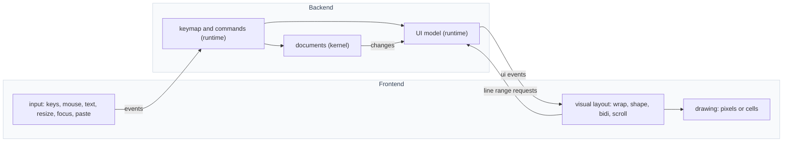
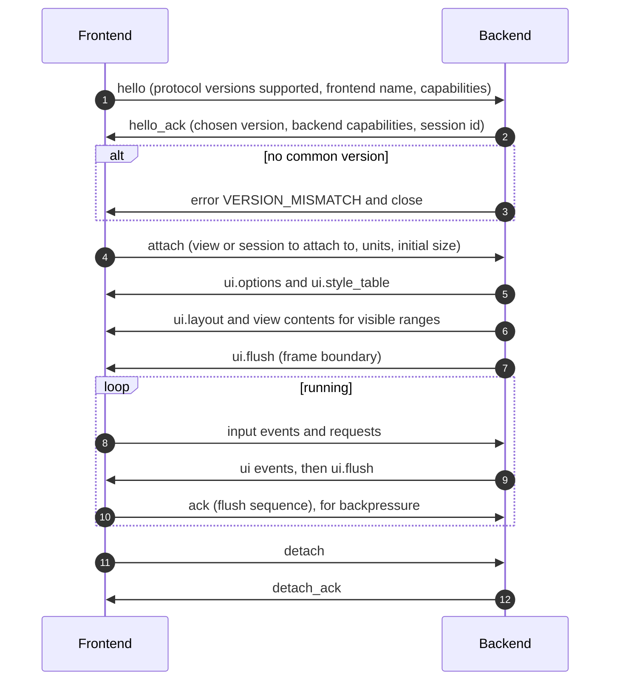

# Frontend Protocol

The accepted contract between the Backend and any number of frontends (GUI, TUI, CLI, headless, a different GUI toolkit, web). Status: **`ACCEPTED`** by [ADR-0005](../adr/ADR-0005-frontend-protocol.md) and [ADR-0018](../adr/ADR-0018-frontend-protocol-wire.md). The exact wire envelope and every payload schema are normative in [protocol-wire.md](protocol-wire.md); `cdin.ui-model.v1` is normative in [ui-model-v1.md](ui-model-v1.md).

## 1. Model

The backend keeps all editor state and produces a **semantic UI model**: which windows and views exist, which lines of which document are visible, which style role each span has, where selections are, what the status line and prompt say. A frontend renders that model in its environment and sends back **input events** and **requests**. The model contains no pixels and no cells.

The Runtime snapshot accepted at this boundary is `cdin.ui-model.v1`; see [ui-model-v1.md](ui-model-v1.md) for field-by-field constraints and the required projection into messages.

## 2. Roles and ownership

- **PROTO-001** `ACCEPTED` The backend MUST own all editor state: documents, views, selections, commands, keymaps, configuration. A frontend MUST be able to be discarded and re-attached without data loss. — *Verify:* INTEG
- **PROPOSED-note:** (not a requirement) a frontend MAY cache anything it likes for display; caches are disposable.
- **PROTO-002** `ACCEPTED` Frontends own visual layout (wrapping, shaping, bidi reordering, tab expansion, scroll position in pixels or cells). The protocol MUST NOT carry pixel or cell coordinates for text content; it carries logical positions. — *Verify:* INSPECT, INTEG
- **PROTO-003** `ACCEPTED` Visual motion (move up/down by visual line, home/end of visual line) is computed by the frontend and sent as a request that sets a logical position; the backend never needs font metrics. — *Verify:* INTEG
- **PROTO-004** `ACCEPTED` Raw keys are sent to the backend; the keymap is policy in the runtime. A frontend MUST NOT interpret keybindings. — *Verify:* INSPECT

## 3. Attach, handshake and capabilities

*Caption: `ACCEPTED` handshake and steady state.*

- **PROTO-010** `ACCEPTED` Every connection begins with `hello` and `hello_ack`. No other message is valid before them. — *Verify:* CONF
- **PROPOSED capability set** (illustrative, to be fixed by ADR): `units` = `cells` or `pixels`; `images`; `truecolor`; `mouse`; `hit_regions`; `rich_text`; `canvas`; `clipboard`; `dialogs`; `ime`. The backend sends only what the frontend declared.
- **PROTO-011** `ACCEPTED` Capabilities are declared by the frontend and accepted or reduced by the backend in `hello_ack`. Unknown capability names MUST be ignored. — *Verify:* CONF
- **PROTO-012** `ACCEPTED` Several frontends MAY attach to one session simultaneously. Each has an independent handshake, capability set and flush sequence. — *Verify:* INTEG
- **PROTO-013** `ACCEPTED` Exactly one attached frontend holds the driver lease. Other frontends are observers. The oldest attached observer is promoted only when the driver detaches/closes; permission details are normative in [protocol-wire.md](protocol-wire.md#2-protocol-flow-and-permissions). — *Verify:* CONF, INTEG

## 4. Message catalogue

### Frontend to backend

| Message | Payload (conceptual) | Notes |
|---|---|---|
| `hello` | versions, name, capabilities | first message |
| `attach` / `detach` | session, units, size | |
| `input.key` | normalized key, modifiers, press/release/repeat | raw; no keymap logic in the frontend |
| `input.text` | committed text (IME result) | |
| `input.mouse` | logical target, button, modifiers, action | target is a region id plus logical position when known |
| `input.paste` | bytes | bracketed paste or clipboard paste |
| `window.resize` | width, height in declared units | |
| `focus` | gained or lost | |
| `view.request_lines` | view id, line range, version | the frontend pulls what it can display |
| `view.set_position` | view id, logical position or range | result of visual motion (PROTO-003) |
| `request.command` | command name, arguments | for toolbars or CLI use |
| `response.*` | answer to a backend request | clipboard text, dialog result |
| `ack` | flush sequence number | backpressure |

### Backend to frontend

| Message | Payload (conceptual) | Notes |
|---|---|---|
| `hello_ack` | chosen version, capabilities, session | |
| `ui.options` | title, cursor shape, tab width, wrap preference | |
| `ui.style_table` | role id to attributes (colour, weight, slant) | roles come from the theme; the frontend maps to its palette |
| `ui.layout` | tree of panes and views with proportional sizes | in abstract proportions, not pixels |
| `view.lines` | view id, version, line range, per-line bytes and spans (byte ranges with style role id) | logical content; spans come from the runtime highlighter |
| `view.invalidate` | view id, version, ranges | tells the frontend cached lines are stale |
| `view.cursor` / `view.selection` | logical positions | selections owned by the view |
| `ui.statusline` / `ui.prompt` / `ui.panel` | structured content | declarative widgets, see [ADR-0011](../adr/ADR-0011-extension-ui.md) |
| `ui.notify` | level, text | |
| `request.clipboard_get/set` | | answered by `response.*` |
| `request.dialog` | confirm, open, save | `dialogs` capability only |
| `canvas.*` | drawing commands | `canvas` capability only; for custom plugin views |
| `ui.flush` | sequence number | frame boundary: apply all preceding messages atomically |
| `error` | status, detail | |

- **PROTO-020** `ACCEPTED` Messages between two `ui.flush` boundaries form one atomic update; a frontend MUST NOT present a partial update. — *Verify:* CONF, INTEG
- **PROTO-021** `ACCEPTED` The backend MUST NOT send more than a bounded number of unacknowledged flushes; the bound is negotiated or fixed by the protocol. When reached, the backend coalesces rather than queues without bound. — *Verify:* PERF, INTEG (supports ARCH-021)
- **PROTO-022** `ACCEPTED` `view.lines` is pull-based: the backend sends line content only for ranges the frontend requested or that are marked as pushed by a capability. — *Verify:* INTEG
- **PROTO-023** `ACCEPTED` Every `view.lines` and `view.invalidate` carries the document version it describes. A frontend that receives lines for a version older than one it already holds MUST discard them. — *Verify:* CONF
- **PROTO-024** `ACCEPTED` Spans are byte ranges over line content with a style role id; they carry no colour. Colours come from `ui.style_table`. — *Verify:* CONF

## 5. Transports

- **PROTO-030** `ACCEPTED` Protocol semantics are independent of transport. In-process calls and serialized byte streams carry the same typed messages. — *Verify:* INSPECT
- **PROTO-031** `ACCEPTED` Serialized frames use a four-byte unsigned big-endian body length and deterministic CBOR. The complete framing and envelope rules are normative in [protocol-wire.md](protocol-wire.md#1-frame-and-envelope). — *Verify:* CONF, FUZZ
- **PROTO-032** `ACCEPTED` Implementations in different languages MUST interoperate using the same envelope, payload schemas and conformance vectors. — *Verify:* CONF, INTEG
- **PROTO-033** `ACCEPTED` The in-process transport MUST observe the ABI rules ([abi-and-compatibility.md](abi-and-compatibility.md)). — *Verify:* STATIC

## 6. Versioning and evolution

- **PROTO-040** `ACCEPTED` The protocol has a `MAJOR.MINOR` version negotiated in `hello`. Within a MAJOR version, evolution is additive: new optional messages, new optional fields, new capabilities. — *Verify:* CONF
- **PROTO-041** `ACCEPTED` A receiver MUST ignore unknown optional fields and unknown messages in optional namespaces, and MUST respond with `error` (`UNSUPPORTED`) to unknown messages in mandatory namespaces. — *Verify:* CONF, FUZZ
- **PROTO-042** `ACCEPTED` Namespace `core` is mandatory. Optional namespaces require explicit negotiated capabilities; an unknown optional namespace may be ignored, while an unknown message in `core` returns `UNSUPPORTED`. — *Verify:* CONF

The payload fields for every message in §4 are fully specified in [protocol-wire.md](protocol-wire.md#3-message-schemas). That document is normative when a conceptual payload above is ambiguous.

## 7. Frontend kinds

| Frontend | Environment | Status |
|---|---|---|
| gui-sdl | SDL window, pixels | `ACCEPTED`; today fused with the backend |
| headless | no display; used for scripts and for protocol verification | `ACCEPTED` (reference behaviour defined in [conformance.md](../testing/conformance.md)) |
| cli | non-interactive commands against a session | `DEFERRED` |
| tui | terminal cells | `DEFERRED` |
| web, remote | network transport | not planned; the serialized transport does not preclude it |

- **PROTO-050** `ACCEPTED` Frontends are peers (same rule as FE-001, stated here from the protocol's side). The GUI MUST NOT use any private backend call that the protocol cannot express. Existing SDL-specific functionality (window control, title-bar hit regions, native dialogs) becomes capabilities or requests. — *Verify:* INSPECT, STATIC

## 8. Existing code relation

- **EXISTING** The Lua-visible API already exposes a renderer as a cached command list (`begin_frame`, `end_frame`, `set_clip_rect`, `draw_rect`, `draw_text`) and a `system` table with window and event functions (`poll_event`, `wait_event`, `set_window_title`, `set_hit_regions`, `show_confirm_dialog`, …). These are the pieces the protocol replaces with semantic messages and capabilities. — *Anchor:* `src/api/renderer_compat.c`, `src/api/system.c`
- **EXISTING** Views are Lua classes that draw directly (`View:extend()`, `data/core/views/docview.lua`). Moving them to a declarative UI model is the largest migration step. — *Anchor:* `docs/architecture/internals.md` ("Views"), `data/core/views/`

## 9. Open points

Resolved protocol decisions: wire encoding, client library and mutation authority ([ADR-0018](../adr/ADR-0018-frontend-protocol-wire.md)). Remaining related decisions include canvas/plugin UI ([OD-25](../adr/open-decisions.md)) and visual-layout ownership ([OD-26](../adr/open-decisions.md)).
