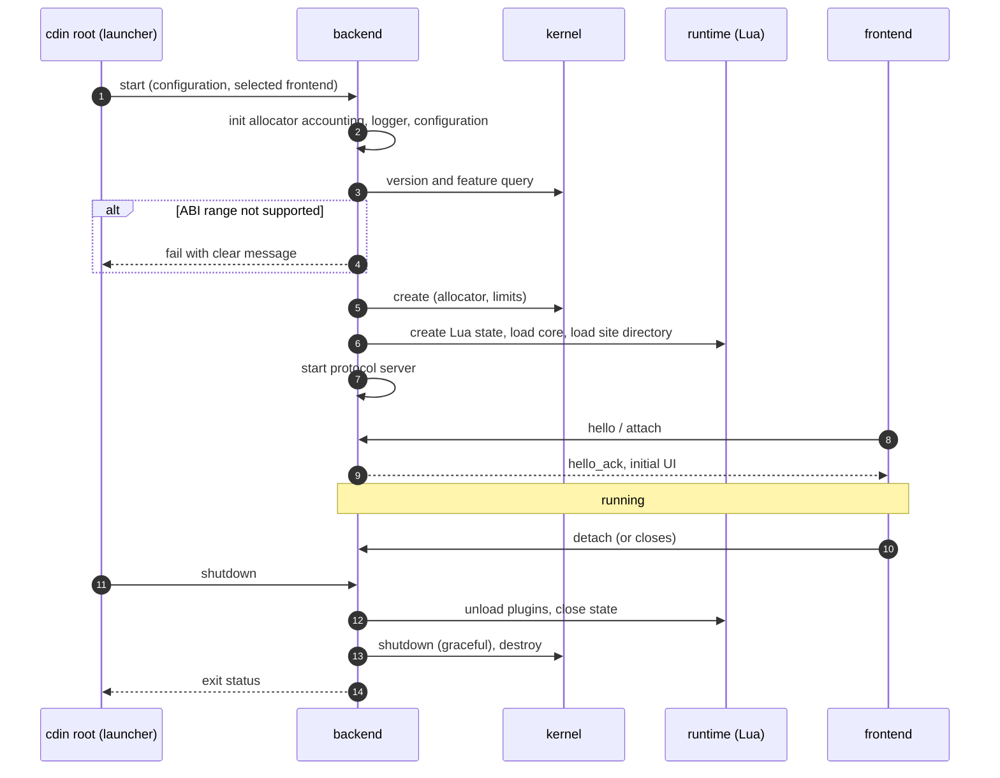
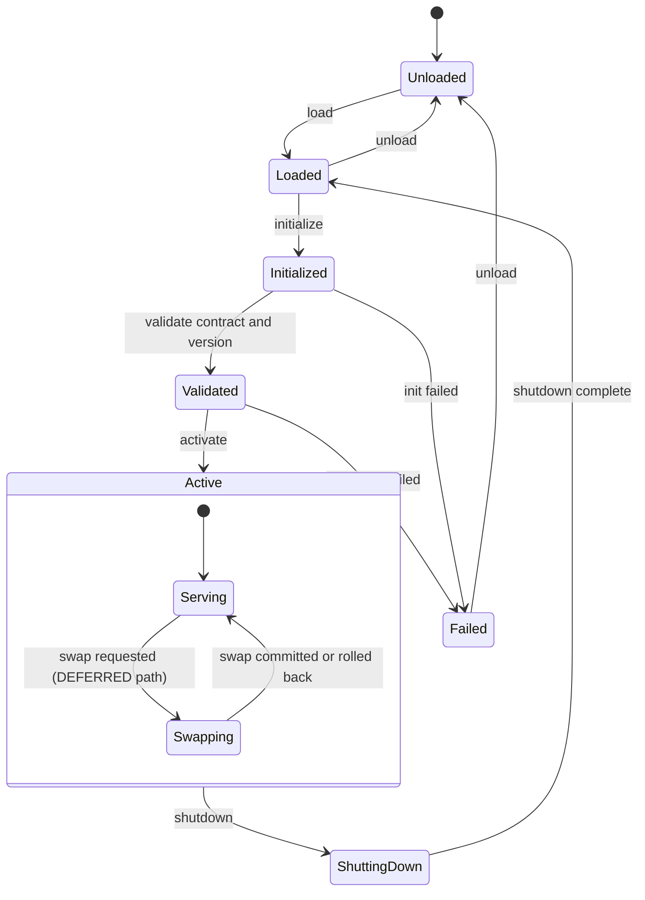
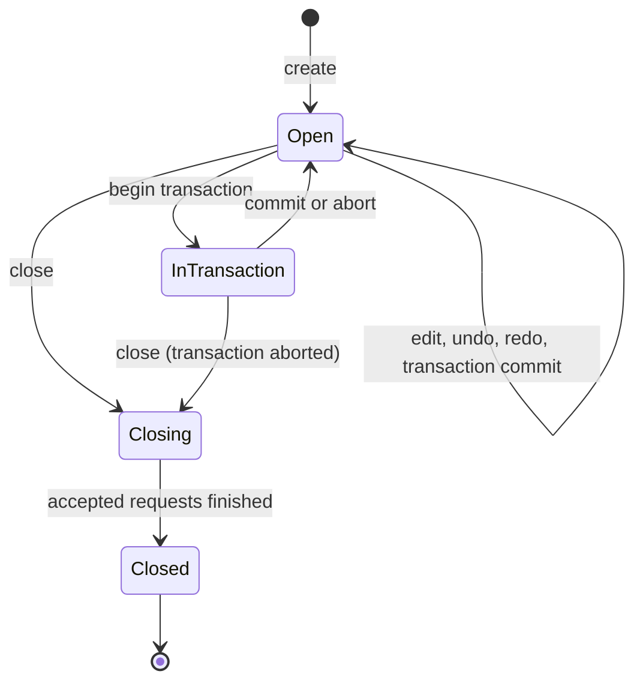

# Lifecycles

Process, module and document lifecycles. Document-level behaviour in detail is in [kernel/document-model.md](../kernel/document-model.md).

## 1. Process lifecycle

*Caption: `PROPOSED`. Order of initialization is dictated by dependency: kernel before runtime, runtime before accepting frontends.*

- **LIFE-001** `PROPOSED` Initialization order is allocator and logging, ABI compatibility check, kernel, runtime, protocol server, frontends. Shutdown is the reverse. — *Verify:* INTEG
- **LIFE-002** `PROPOSED` Failure to initialize any step MUST abort startup with a message naming the step and the cause, and MUST release everything already initialized. — *Verify:* INTEG, SAN
- **LIFE-003** `EXISTING` A cdin tree with an empty site directory starts and runs; startup does not require any extension. — *Verify:* INTEG — *Anchor:* `mk/bundle.mk` (`bare` target), `AGENTS.md §1`
- **LIFE-004** `PROPOSED` The backend MUST be able to start with no frontend attached (headless) and accept one later. — *Verify:* INTEG

## 2. Module lifecycle

Applies to any component that is loaded, initialized and later shut down as a module. Hot-swap is `DEFERRED`; the swap path below is conditional and shown only to fix its future place.

*Caption: `PROPOSED` states; the `Swapping` sub-state is `DEFERRED` and appears only as a placeholder.*

- **LIFE-010** `PROPOSED` A module MUST NOT become `Active` until its ABI version and features have been validated against the caller's requirements (ABI-014). — *Verify:* CONF, INTEG
- **LIFE-011** `PROPOSED` Shutdown of a module releases every resource it owns and invalidates every handle it issued. — *Verify:* SAN
- **LIFE-012** `DEFERRED` Hot-swap policy: which modules support it, how state moves (versioned, implementation-independent), validation, activation, rollback, restart fallback. Proposals recorded in [ADR-0013](../adr/ADR-0013-hot-swap.md). — *Verify:* INSPECT
- **LIFE-013** `PROPOSED` Replacing the kernel in the first phase requires a restart. — *Verify:* INSPECT

## 3. Plugin lifecycle (existing)

The Lua plugin lifecycle is defined by the extension contract and is not changed by this specification.

- **EXISTING** An entry point returns a table with `init(core, config)` and optionally `unload()`. `init` takes two arguments positionally and must tolerate being called twice. `unload` is called by `core:unload-plugin` and by nothing else. — *Anchor:* `docs/architecture/extension-contract.md`, "The plugin protocol"
- **LIFE-020** `EXISTING` Plugin lifecycle behaviour is governed by the extension contract; this specification MUST NOT redefine it. — *Verify:* INSPECT — *Anchor:* `docs/architecture/extension-contract.md`

## 4. Document lifecycle (summary)

*Caption: `PROPOSED` document states; full rules in the kernel documents.*

- **LIFE-030** `PROPOSED` A closed document's handle is permanently invalid; its generation is never reused within the process. — *Verify:* CONF (see DOC-005)
