# Migration from the current code

How the supplied `cdin` snapshot is integrated with the already-existing standalone `cdin-kernel` repository, then evolved toward the target architecture without breaking the editor. Strategy: **incremental** (`ACCEPTED`). Every integration phase must preserve a build/start gate (ARCH-026).

## 1. What exists today (inspected)

The inspected tree is a working-tree snapshot of the `cdin` repository (not git history). Measured on it:

| Part | Size | Content |
|---|---|---|
| `src/` | about 7.2 thousand lines of C | `base` (alloc, arena, error), `core` (config, logger, window), `fs`, `loop` (libuv jobs), `lua` (binding), `api` (Lua-visible tables), `platform`, `search`, `ui` (renderer, cache) |
| `data/core/` | about 7.3 thousand lines of Lua | documents, views, commands, keymaps, syntax, text pipeline, themes, plugin loader |
| `scripts/` | about 6.6 thousand lines | build, install, bench, measure, Lua tests |
| `mk/` | 8 make includes | `bundle.mk` is the only place that knows `cdin-x` exists |
| `tests/` | 484 files, mostly fuzz corpus | C tests, Lua unit and integration tests, benchmarks |

## 2. Where each piece goes (`PROPOSED`)

This mapping is a **plan to be verified during migration review**, not a statement of fact about the code. Files not analysed in detail are marked.

| Current location | Target | Notes |
|---|---|---|
| `src/base/*` | backend (internal); kernel uses injected allocator/lock/log services | `cdin-kernel` is already a separate repository and MUST NOT depend on `cdin/src/base` (ARCH-040). Candidate sharing requires a new ADR. |
| `src/loop/*` | backend OS services (jobs) | libuv-based; stays |
| `src/fs/*`, `src/platform/*` | backend OS services | SDL appears in `platform.*`; see the next section |
| `src/search/find.c` | migrate callers to supported kernel search modes | about 155 lines; regex is not supported by Kernel ABI 1.0.0 and must remain explicitly deferred rather than silently emulated |
| `src/lua/*`, `src/api/*` | runtime host API (backend side) | `api/system.c` is split by owner |
| `src/api/system.c` | split: OS services, frontend requests, debug hooks | grab-bag today |
| `src/api/renderer_*.c`, `src/ui/*` | gui-sdl frontend | renderer already behaves as a cached command list |
| `src/core/window.*`, SDL in `src/main.c` | gui-sdl frontend | |
| `src/core/config.*`, `logger.*` | backend | |
| `data/core/doc/*` | runtime; document layer becomes a client of the kernel | `highlighter` moves to the runtime/frontend side; `translate.lua` and `search.lua` not analysed |
| `data/core/text/{bidi,shaper,utf8}.lua` | frontend side (shaping, bidi), `utf8` stays for runtime use | confirms "shaping and bidi are outside the kernel" |
| `data/core/views/*`, `rootview/*` | runtime UI model; drawing code moves to frontend or becomes declarative | largest step (see below) |
| `data/core/commands/*`, `input/*`, `keymaps/*`, `config.lua`, `themes.lua`, `style.lua` | runtime | |
| `data/core/plugins.lua`, `project.lua` | runtime | |
| `mk/*`, `scripts/*`, `Makefile`, `Dockerfile`, `.github/` | composition root (`cdin`) | |
| `docs/architecture/extension-contract.md` | stays with `cdin` until `cdin-runtime` exists, then moves there | contract text is shared with `cdin-x` by reference |

## 3. Phases

```mermaid
flowchart LR
    M0["M0<br/>Spec 1.0.0 baseline"]
    M1["M1<br/>integrate standalone<br/>Kernel ABI 1.0.0 into cdin"]
    M2["M2<br/>Lua document layer<br/>becomes a kernel client"]
    M3["M3<br/>in-process Frontend Protocol<br/>around the GUI"]
    M4["M4<br/>headless frontend<br/>and serialized transport"]
    M5["M5<br/>extract cdin-runtime<br/>after host API stabilizes"]
    M0 -- "ABI and ownership gates clear" --> M1
    M1 -- "integrated create/edit/notify vectors pass" --> M2
    M2 -- "one canonical document/history store" --> M3
    M3 -- "no private backend calls" --> M4
    M4 -- "second frontend attaches" --> M5
```

*Caption: `PROPOSED` order. The kernel already exists as a standalone repository; phases now describe integration and higher-layer extraction, not a second kernel extraction.*

| Phase | Outcome | Entry gate | Exit gate |
|---|---|---|---|
| M0 | Stable Spec baseline and frozen Kernel C ABI 1.0.0 contract | Spec checker passes; ABI header reviewed | ownership and version boundaries documented |
| M1 | `cdin` builds against sibling `cdin-kernel` through its public header; ABI major is checked | M0 | editor starts; create/edit/read/notification path passes integrated tests; no private kernel header is included |
| M2 | `data/core/doc` calls the kernel instead of holding its own buffer and history | M1 | no document content or undo history duplicated outside the kernel (KERNEL-005) |
| M3 | GUI talks to the core through the semantic Frontend Protocol, in-process | M2; protocol contract accepted | GUI uses no private backend call (FE-001) |
| M4 | Headless frontend exists, followed by a versioned serialized transport | M3 | a second frontend implementation attaches through the same protocol |
| M5 | `cdin-runtime` extracted after its host API is versioned and tested | ARCH-030, ARCH-031; M4 integration evidence | editor builds/starts before and after extraction; tests and source-history mapping preserved (ARCH-032) |

- **ARCH-060** `PROPOSED` Migration proceeds in the order above. A later phase MUST NOT begin until the previous phase's exit gate holds. — *Verify:* INSPECT
- **ARCH-061** `ACCEPTED` The kernel is a standalone `cdin-kernel` repository, not a directory duplicated under `cdin`. Consumers include only `include/cdin/kernel.h`; ABI-specific internals stay private. — *Verify:* STATIC
- **ARCH-062** `PROPOSED` Each phase begins with a prototype spike that exercises the design (see "Implementation feedback gates" in [spec.md](../components/spec.md)). A spike that contradicts the specification changes the specification first. — *Verify:* INSPECT

## 4. The hardest steps

**The document layer (M2).** The current document model lives in Lua (`data/core/doc/`). Moving it to the kernel reverses a documented principle: today's overview states that the C layer "knows nothing about documents". That statement is recorded as a contradiction in [status.md](../reference/status.md) and resolved by [ADR-0002](../adr/ADR-0002-kernel-owns-documents.md).

**The views (M3).** Views draw directly through the renderer API today. Making them produce a semantic UI model is the largest change, and the extension contract lets plugins subclass views. The transitional plan: keep the existing drawing path working through an in-process `canvas`-style capability while the declarative path is built, then retire it with shims (ARCH-027).

## 5. Rollback

- **ARCH-070** `PROPOSED` Each phase MUST be reversible by reverting its commits; no phase may merge a state in which the previous phase's tests fail. — *Verify:* INTEG
