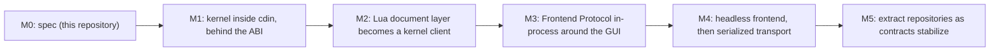

# Migration from the current code

How today's `cdin` becomes the target architecture without ever breaking the editor. Strategy: **incremental** (`ACCEPTED`). After every step the editor builds and starts (ARCH-026).

## 1. What exists today (inspected)

The inspected tree is a working-tree snapshot of the `cdin` repository (not git history). Measured on it:

| Part | Size | Content |
|---|---|---|
| `src/` | about 7.2 thousand lines of C | `base` (alloc, arena, error), `core` (config, logger, window), `fs`, `loop` (libuv jobs), `lua` (binding), `api` (Lua-visible tables), `platform`, `search`, `ui` (renderer, cache) |
| `data/core/` | about 7.3 thousand lines of Lua | documents, views, commands, keymaps, syntax, text pipeline, themes, plugin loader |
| `scripts/` | about 6.6 thousand lines | build, install, bench, measure, Lua tests |
| `mk/` | 8 make includes | `bundle.mk` is the only place that knows `cdin-x` exists |
| `tests/` | 484 files, mostly fuzz corpus | C tests, Lua unit and integration tests, benchmarks |

## 2. Where each piece goes (`PROPOSED`)

This mapping is a **plan to be verified during migration review**, not a statement of fact about the code. Files not analysed in detail are marked.

| Current location | Target | Notes |
|---|---|---|
| `src/base/*` | backend (internal), kernel gets its own via injected allocator | The kernel MUST NOT depend on `base/` (ARCH-040). Candidate to share later only with an ADR. |
| `src/loop/*` | backend OS services (jobs) | libuv-based; stays |
| `src/fs/*`, `src/platform/*` | backend OS services | SDL appears in `platform.*`; see the next section |
| `src/search/find.c` | superseded by kernel search | about 155 lines; the kernel search engine replaces it |
| `src/lua/*`, `src/api/*` | runtime host API (backend side) | `api/system.c` is split by owner |
| `src/api/system.c` | split: OS services, frontend requests, debug hooks | grab-bag today |
| `src/api/renderer_*.c`, `src/ui/*` | gui-sdl frontend | renderer already behaves as a cached command list |
| `src/core/window.*`, SDL in `src/main.c` | gui-sdl frontend | |
| `src/core/config.*`, `logger.*` | backend | |
| `data/core/doc/*` | runtime; document layer becomes a client of the kernel | `highlighter` moves to the runtime/frontend side; `translate.lua` and `search.lua` not analysed |
| `data/core/text/{bidi,shaper,utf8}.lua` | frontend side (shaping, bidi), `utf8` stays for runtime use | confirms "shaping and bidi are outside the kernel" |
| `data/core/views/*`, `rootview/*` | runtime UI model; drawing code moves to frontend or becomes declarative | largest step (see below) |
| `data/core/commands/*`, `input/*`, `keymaps/*`, `config.lua`, `themes.lua`, `style.lua` | runtime | |
| `data/core/plugins.lua`, `project.lua` | runtime | |
| `mk/*`, `scripts/*`, `Makefile`, `Dockerfile`, `.github/` | composition root (`cdin`) | |
| `docs/architecture/extension-contract.md` | stays with `cdin` until `cdin-runtime` exists, then moves there | contract text is shared with `cdin-x` by reference |

## 3. Phases

*Caption: `PROPOSED` order. Each box ends with the editor building and starting.*

| Phase | Outcome | Entry gate | Exit gate |
|---|---|---|---|
| M0 | Specification complete enough to implement the kernel | owner accepts ADR-0001 to 0003 | kernel sections have no blocking `OPEN` items |
| M1 | `src/kernel/` with a C ABI header and its own tests; not yet used by the editor | M0 | kernel passes its conformance vectors; editor still runs unchanged |
| M2 | `data/core/doc` calls the kernel instead of holding its own buffer and history | M1 | no document content or history held outside the kernel (KERNEL-005) |
| M3 | GUI talks to the core through the protocol, in-process | M2, protocol ADR accepted | the GUI uses no private backend call (FE-001) |
| M4 | A headless frontend exists; then the serialized transport | M3 | a second implementation attaches successfully |
| M5 | `cdin-kernel`, `cdin-runtime` extracted when ABI versions are stable | ARCH-030, ARCH-031 | editor builds and starts before and after (ARCH-032) |

- **ARCH-060** `PROPOSED` Migration proceeds in the order above. A later phase MUST NOT begin until the previous phase's exit gate holds. — *Verify:* INSPECT
- **ARCH-061** `PROPOSED` During M1 and M2 the kernel is a directory in `cdin`, with its public header being the only thing the rest of the tree may include (ARCH-043 applies from M1). — *Verify:* STATIC
- **ARCH-062** `PROPOSED` Each phase begins with a prototype spike that exercises the design (see "Implementation feedback gates" in [spec.md](../components/spec.md)). A spike that contradicts the specification changes the specification first. — *Verify:* INSPECT

## 4. The hardest steps

**The document layer (M2).** The current document model lives in Lua (`data/core/doc/`). Moving it to the kernel reverses a documented principle: today's overview states that the C layer "knows nothing about documents". That statement is recorded as a contradiction in [STATUS.md](../../STATUS.md) and resolved by [ADR-0002](../decisions/ADR-0002-kernel-owns-documents.md).

**The views (M3).** Views draw directly through the renderer API today. Making them produce a semantic UI model is the largest change, and the extension contract lets plugins subclass views. The transitional plan: keep the existing drawing path working through an in-process `canvas`-style capability while the declarative path is built, then retire it with shims (ARCH-027).

## 5. Rollback

- **ARCH-070** `PROPOSED` Each phase MUST be reversible by reverting its commits; no phase may merge a state in which the previous phase's tests fail. — *Verify:* INTEG
