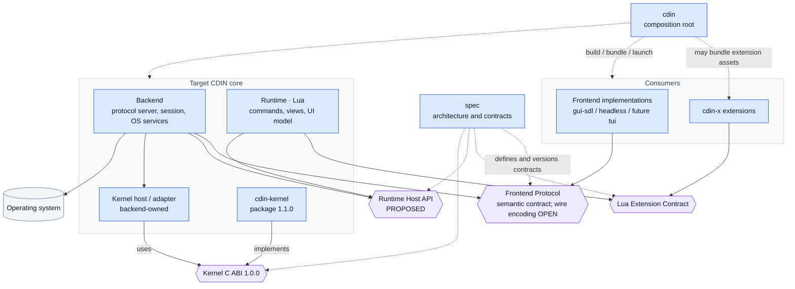

# Module boundaries

Who may depend on whom, who owns what, and how components talk. This is the contract between the components' *authors*.

## 1. Dependency directions

The diagram is a **dependency map**, not a call timeline. Arrows mean “uses the contract or service provided by”; dotted arrows are composition or contract-governance relationships. A runtime call sequence is shown in [system-maps.md](system-maps.md#3-detailed-request-path--one-edit-from-input-to-pixels).

*Caption: target architecture. The Runtime Host API is proposed, while the kernel ABI `1.0.0` is the published native boundary. `cdin-runtime` and frontends do not link directly to the kernel. The package release version `1.1.0` does not change ABI version `1.0.0`.*

Read as rules:

- **ARCH-040** `ACCEPTED` The kernel MUST depend only on the C11/platform C runtime and explicitly injected services; it MUST NOT depend on the GUI, runtime, backend, OS file APIs or third-party regex engine in ABI 1.0.0. — *Verify:* STATIC
- **ARCH-041** `PROPOSED` The runtime MUST reach documents only through the runtime host API that the backend provides; it MUST NOT link to or load the kernel directly. — *Verify:* STATIC, INSPECT
- **ARCH-042** `PROPOSED` The backend MUST NOT include any display-toolkit header (SDL, terminal libraries). — *Verify:* STATIC
- **ARCH-043** `PROPOSED` A frontend MUST depend only on the Frontend Protocol (and its own toolkit). It MUST NOT include kernel, runtime or backend internal headers. — *Verify:* STATIC
- **ARCH-044** `PROPOSED` `cdin-x` MUST depend only on the extension contract. — *Verify:* INSPECT, STATIC
- **ARCH-045** `PROPOSED` The composition root MAY depend on everything at build time and MUST NOT be depended on by any component. — *Verify:* STATIC
- **ARCH-046** `PROPOSED` Include-direction rules (ARCH-040 to ARCH-045) are enforced by an automated check in the implementation repositories (the current `scripts/check.py` is the natural home). — *Verify:* STATIC

## 2. State ownership

| State | Owner | Others hold |
|---|---|---|
| Document content and canonical text | kernel | read-only snapshots, versioned |
| Undo/redo history | kernel | nothing (opaque caller metadata blobs are stored by the kernel but owned by their producer) |
| Document version | kernel | the version number as a plain integer |
| Selections, logical scroll anchor, focus | view (runtime UI model) | frontend mirrors for display |
| Commands, keymaps, configuration, themes (as data) | runtime | backend relays; frontend consumes style roles |
| Plugin state | the plugin (inside the runtime sandbox) | nothing |
| Visual layout (wrapping, shaping, bidi, pixel/cell scroll) | the frontend | nothing |
| Window/terminal handle, input device state | the frontend | nothing |
| Files, processes, jobs, clock | OS services (backend) | handles |
| Session (open documents, attached frontends) | backend | handles |

- **ARCH-050** `PROPOSED` The runtime MUST NOT hold an independent copy of document content or undo history (restates KERNEL-005 from the runtime's side). — *Verify:* INSPECT
- **ARCH-051** `ACCEPTED` Selections MUST be owned by the view and not by the kernel. The kernel MAY store an opaque caller-supplied blob per undo unit so selections can be restored. — *Verify:* INSPECT, CONF
- **ARCH-052** `ACCEPTED` Visual layout MUST be owned by frontends. — *Verify:* INSPECT

## 3. Communication matrix

| From | To | Mechanism | Contract |
|---|---|---|---|
| frontend | backend | Frontend Protocol, in-process C ABI transport or serialized transport | [frontend-protocol.md](frontend-protocol.md) |
| backend | kernel | Kernel C ABI, direct calls | [kernel/](../kernel/overview.md), [abi-and-compatibility.md](abi-and-compatibility.md) |
| runtime | backend | Lua-visible host API (`doc`, `fs`, `path`, `search`, `system`-style services) | [runtime.md](../components/runtime.md) |
| backend | runtime | Lua state calls: key events, protocol requests, lifecycle | [runtime.md](../components/runtime.md) |
| cdin-x | runtime | extension contract (Lua) | `extension-contract.md` in `cdin`, [extension-model.md](extension-model.md) |
| backend | OS | OS services, internal | [backend.md](../components/backend.md) |
| root | all | build-time composition, launch | [cdin.md](../components/cdin.md) |

## 4. Allowed and forbidden, in short

| | kernel | runtime | backend | frontend | cdin-x |
|---|---|---|---|---|---|
| Knows about documents | owns | via host API | hosts | via protocol | via contract |
| Knows about SDL / terminals | no | no | no | its own only | no |
| Calls the kernel directly | n/a | no | yes | no | no |
| Reads the clock | no | yes | yes | yes | yes |
| Performs file I/O | no | via OS services | yes (OS services) | toolkit only | via contract |
| Knows who its clients are | no | no | yes (sessions) | no | no |

## 5. Existing code mapped to these boundaries

The current tree (`cdin`, inspected) does not yet separate these; see [migration.md](migration.md) for the full mapping. Two measured facts motivate the boundary rules:

- **EXISTING** SDL appears in nine source files; almost all of it in `src/api/system.c` and `src/core/window.c`. `src/ui/renderer.c` has only a handful of SDL references because the renderer already works as a cached command list. — *Anchor:* `src/api/system.c`, `src/core/window.c`, `src/ui/renderer.c`, `src/ui/renderer.h`
- **EXISTING** The Lua-visible `system` table mixes window control, clipboard, filesystem, process execution, time and debugging hooks in one namespace. Splitting these by owner is the first boundary to draw. — *Anchor:* `src/api/system.c` (function table near the end of the file)
