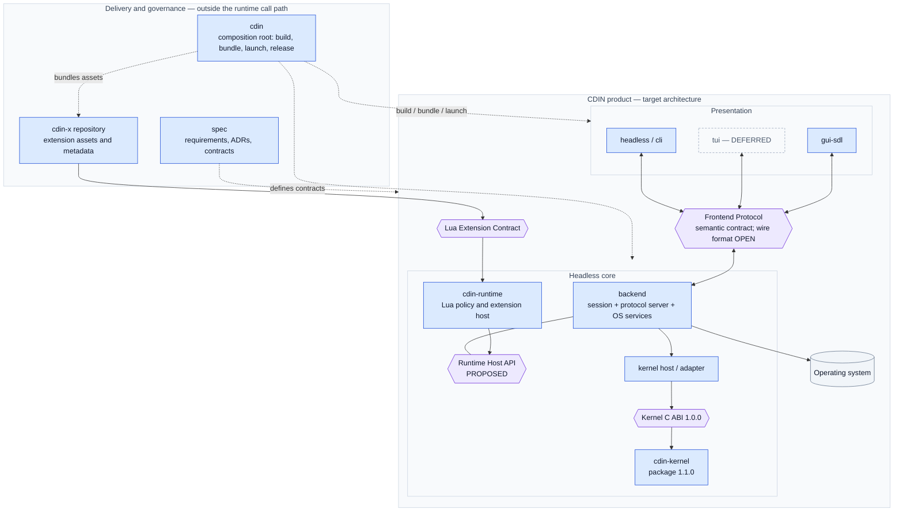

# Architecture overview

## 1. Goals

1. Components with a single responsibility, explicit state ownership and a stable contract.
2. Any component replaceable by another implementation, in any language, behind the same contract.
3. New frontends (TUI, CLI, a different GUI toolkit, web) added without changing the kernel, runtime or backend.
4. Data safety first: the editor never alters bytes it was not asked to alter.
5. A design that can be checked against real code and tested, not only read.

Non-goals for this phase: implementation, general hot-swap of modules, a network protocol for remote editing (the protocol is designed so one is possible later).

## 2. Principles

1. **Capability, not layering.** A component is defined by what it is able to know. The kernel cannot misbehave about GUIs because it cannot know about GUIs.
2. **Contracts, not internals.** Public contracts never mention internal data structures.
3. **One owner per piece of state.** Every piece of state has one owning component; others hold references or derived copies that are explicitly disposable.
4. **Peers, not privileged paths.** Every frontend uses the same protocol. The first frontend (SDL GUI) gets no private channel.
5. **Determinism where possible.** The kernel reads no clock and performs no I/O, so its behaviour is reproducible from its inputs.
6. **Bounded everything.** Every cache, queue, buffer and history has a cap and a defined behaviour at the cap.
7. **Specify first, then prove with a prototype.** A decision is not settled until code has exercised it.

## 3. System context: planes and boundaries

The architecture is easier to read as three related planes: **delivery** assembles the product, **runtime interaction** carries requests, and **contracts** keep implementations replaceable. This is a target view; implementation status is recorded separately.

*Caption: target architecture. Solid arrows in this context view show message or call paths; dotted arrows are build-time, bundling or contract-governance relationships. A box marked `PROPOSED`, `OPEN` or `DEFERRED` is not evidence of an implementation.*

### The four main contracts

| Boundary | Caller / consumer | Provider / authority | What it deliberately does not define |
|---|---|---|---|
| Frontend Protocol | GUI, TUI, headless and future frontends | Backend protocol server | Kernel C types; pixel/cell layout; serialized wire encoding until OD-22 is resolved |
| Runtime Host API | Lua runtime and extensions through the runtime | Backend runtime host | Kernel internals; it is still a proposed, versioned API |
| Kernel C ABI | Backend kernel host / adapters | `cdin-kernel` | Filesystem policy, rendering, Lua, plugins and persistence |
| Lua Extension Contract | `cdin-x` extensions | Runtime/extension host | Direct kernel calls, backend internals or private frontend channels |

For the larger dependency graph and the detailed edit flow, see [system-maps.md](system-maps.md). The [migration plan](migration.md) distinguishes the existing integrated source tree from this target topology.

## 4. Components

| Component | One-line responsibility | Detail |
|---|---|---|
| kernel | Owns documents; edits, positions, undo, transactions, versions, notifications, search. | [kernel/](../kernel/overview.md) |
| runtime | Lua policy: commands, keymaps, config, plugin host, UI model. | [runtime.md](../components/runtime.md) |
| backend | Hosts kernel and runtime; OS services; Frontend Protocol server; session. | [backend.md](../components/backend.md) |
| frontend | Presentation and input for one environment; speaks the protocol only. | [frontend.md](../components/frontend.md) |
| data | Persistence and serialization responsibilities. `DEFERRED`. | [data.md](../components/data.md) |
| cdin | Composition root: build, bundle, release, launcher. | [cdin.md](../components/cdin.md) |
| cdin-x | Optional extension ecosystem. | [cdin-x.md](../components/cdin-x.md) |
| spec | This specification and its process. | [spec.md](../components/spec.md) |

## 5. Requirements

- **ARCH-001** `ACCEPTED` `cdin` is the composition root: the point where components are assembled, built, bundled and launched. It MUST NOT reimplement kernel, runtime, frontend or backend logic. — *Verify:* INSPECT
- **ARCH-002** `ACCEPTED` The kernel MUST be independent of GUI, TUI, runtime and operating-system details. — *Verify:* STATIC, INSPECT
- **ARCH-003** `ACCEPTED` Binary boundaries between components MUST use the C ABI. — *Verify:* STATIC, INSPECT
- **ARCH-004** `ACCEPTED` Public contracts MUST NOT depend on internal implementation details of any component. — *Verify:* INSPECT, CONF
- **ARCH-005** `ACCEPTED` No auxiliary repository such as `cdin-common` or `cdin-shared` MAY be created without a stated architectural reason and explicit owner approval. — *Verify:* INSPECT
- **ARCH-006** `ACCEPTED` Extensions MUST NOT have direct access to the kernel; they use only the extension contract. — *Verify:* INSPECT, STATIC
- **ARCH-007** `PROPOSED` Components MUST obey the dependency directions in [module-boundaries.md](module-boundaries.md). — *Verify:* STATIC
- **ARCH-008** `PROPOSED` A component is not necessarily a repository. Repositories are created in stages according to [repositories.md](repositories.md). — *Verify:* INSPECT
- **ARCH-009** `ACCEPTED` Frontends MUST be peers: no frontend MAY use a channel to the backend that other frontends cannot use. — *Verify:* INSPECT, INTEG
- **ARCH-010** `EXISTING` `cdin` builds and runs without `cdin-x` (`make bin` needs no `cdin-x`; a bare tree runs with an empty site directory). — *Verify:* INTEG — *Anchor:* `AGENTS.md §1`, `mk/bundle.mk` (targets `bin`, `bare`)
- **ARCH-011** `EXISTING` No code under `src/` or `data/core/` depends on `cdin-x`. References are comments only. The single build coupling is the variable `CDINX_DIR`. — *Verify:* STATIC — *Anchor:* `mk/bundle.mk` header; comment-only matches in `src/lua/error.h`, `src/api/system.c`, `src/main.c`, `data/core/config.lua`, `data/core/keymaps/default.lua`
- **ARCH-012** `DEFERRED` General hot-swap of modules is not part of this phase. Only modules explicitly designed for it MAY be swapped live, later. — *Verify:* INSPECT
- **ARCH-013** `ACCEPTED` Every component document MUST state which state it owns, and no component MAY expose mutable state shared with another. — *Verify:* INSPECT
- **ARCH-014** `ACCEPTED` Every component MUST declare the specification version it claims to conform to; the kernel header declares Spec 1.0.0. — *Verify:* INSPECT

### Invariants inherited from the current project rules

The current `cdin` repository already enforces these rules. They are adopted here as architecture-level requirements so that they survive the move to multiple components.

- **ARCH-020** `EXISTING` The text buffer stores bytes. Content (NUL, invalid UTF-8, BOM, line endings) MUST NOT be sanitized or rewritten on load; a decoder may substitute only for display. — *Verify:* CONF, FUZZ — *Anchor:* `AGENTS.md §2.6`
- **ARCH-021** `EXISTING` Every cache, queue, buffer and history MUST have a byte cap and an eviction or refusal policy; nothing may silently drop data at a fixed ceiling. — *Verify:* INSPECT, PERF — *Anchor:* `AGENTS.md §2.4`
- **ARCH-022** `EXISTING` Every handle has one owner and a defined lifetime; an object reachable from Lua cannot be freed while Lua can still use it. — *Verify:* SAN, INSPECT — *Anchor:* `AGENTS.md §2.5`
- **ARCH-023** `EXISTING` Nothing unbounded MAY block the frame/event thread (no unbounded `fread`, `popen`, `waitpid` or sleep loops). — *Verify:* INSPECT, PERF — *Anchor:* `AGENTS.md §2.7`
- **ARCH-024** `EXISTING` Processes are spawned with argument arrays only, never through a shell. — *Verify:* STATIC — *Anchor:* `AGENTS.md §2.8`
- **ARCH-025** `EXISTING` The Lua state is single-threaded. Worker threads never touch Lua; they work on immutable, reference-counted snapshots. — *Verify:* SAN, INSPECT — *Anchor:* `AGENTS.md §2.3`
- **ARCH-026** `EXISTING` The editor builds and starts after every development step. — *Verify:* INTEG — *Anchor:* `AGENTS.md §2.10`
- **ARCH-027** `EXISTING` The extension contract MUST NOT be broken without an owner-approved decision; a removed or changed API stays as a shim that logs one deprecation per process. — *Verify:* INSPECT — *Anchor:* `AGENTS.md §2.2`
- **ARCH-028** `EXISTING` Priority order when rules conflict: correctness and data safety, then memory safety, then bounded memory, then latency, then simplicity, then modularity, then brevity. — *Verify:* INSPECT — *Anchor:* `AGENTS.md §3`
