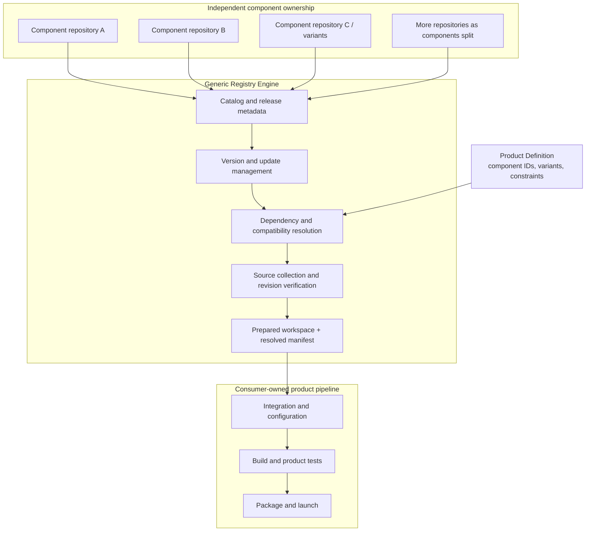

# Registry architecture

- **Status:** PROPOSED — see [ADR-0022](../adr/ADR-0022-minimal-static-release-catalog.md).
- **Architecture name:** Data-Driven Component Orchestration.
- **Scope:** generic component discovery, release/version management, dependency resolution, update handling, source collection and workspace preparation for independent products.

## 1. Purpose

The Registry is a **consumer-independent Component Orchestration system**. It manages independently developed components, resolves requested component requirements, collects exact source revisions and prepares a reproducible workspace for the requesting product.

The Registry does not contain product-specific rules. It does not need to know whether a consumer is CDIN Editor, another editor or an unrelated application.

> **Registry must understand requirements, not consumer identity.**

The same Registry serves multiple products by processing different data-only Product Definitions. Supporting a new consumer must not require product-specific branches, identifiers or workflows in the Registry engine.

## 2. Responsibilities and boundaries

| Area | Registry | Product Definition | CDIN |
|---|---|---|---|
| Component identity and release metadata | Owns catalog | References logical IDs | Does not maintain |
| Version and update tracking | Owns | Declares constraints/policy | Does not manage |
| Dependency and compatibility metadata | Stores and evaluates declarations | Supplies constraints/profile | Does not resolve |
| Version selection and resolution | Owns | Supplies inputs | Does not resolve |
| Source retrieval and collection | Owns | Does not fetch | Does not fetch |
| Prepared workspace and resolved manifest | Produces | Names desired set | Consumes |
| Product-specific integration | Does not own | Describes requirements | Owns |
| Build, tests, packaging and launch | Does not own | Does not execute | Owns |

Component repositories remain authoritative for their source, package versions, tags, releases, component tests and release assets. Registry maintains cross-component catalog and orchestration metadata; it is not a shared-code repository.

Registry can validate declared compatibility constraints and dependency metadata. It cannot prove that the assembled product works. Consumer-side integration tests remain the final evidence.

## 3. Product Definitions are data, not Registry code

A **Product Definition** is an independent declarative input describing the components and variants a product needs. It is not a plugin, script or CDIN-specific branch in Registry code.

It may live in the consuming product's repository or another independently governed location. Registry consumes it through a generic input contract. Exact storage and schema remain open; no new repository is required.

Illustrative definition:

```yaml
product:
  id: cdin-editor
  version: 1.0.0
components:
  - id: backend
    version: "^2.0"
  - id: frontend
    variant: cli
    version: "^1.0"
  - id: frontend
    variant: gui-sdl
    version: "^1.0"
  - id: runtime
    variant: native
    version: "^3.0"
  - id: kernel
    variant: library
    version: "^2.0"
```

This is illustrative, not a finalized schema. Registry interprets generic fields such as component identity, variant, version constraint, dependencies and compatibility metadata. It must not contain logic such as an if-condition for product identity.

The definition selects only the Frontend variants required by a build. If Frontend gains more GUI implementations or Backend splits into multiple repositories, Product Definition and component metadata express the required set without teaching CDIN or Registry about every repository.

## 4. End-to-end orchestration



1. Component maintainers publish independently versioned releases and metadata.
2. A product supplies a Product Definition describing components, variants and constraints.
3. Registry resolves compatible releases using generic metadata and dependency rules.
4. Registry collects exact source revisions, verifies immutable references and prepares the workspace.
5. Registry returns the workspace and a resolved manifest identifying each selected component, version, repository and revision.
6. CDIN consumes the prepared input and performs product-specific configuration, integration, build, tests, packaging and launch.

Registry does not run CDIN code to discover what CDIN needs. Product Definition is the explicit data boundary.

## 5. What CDIN receives and how it uses it

A list of repository URLs and commit SHAs is only a retrieval plan, not a usable assembled product. Registry performs retrieval and collection before handing off to CDIN.

The handoff consists of:
- **Prepared workspace:** exact component source trees staged in a documented, deterministic layout.
- **Resolved manifest:** machine-readable record of component IDs, variants, package versions, source repositories, full commit revisions, declared contract versions and content digests where available.
- **Resolution report:** selected candidates, applied constraints and warnings/rejected candidates.

Illustrative workspace:

```text
prepared/
├── components/
│   ├── backend/
│   ├── frontend/
│   │   ├── cli/
│   │   └── gui-sdl/
│   ├── runtime/
│   └── kernel/
└── registry-manifest.json
```

The final workspace contract must be generic and must not assume one logical component always maps to one repository. A component may use multiple source units; multiple variants may originate from one repository.

CDIN does not query component repositories, select versions, update dependencies, resolve transitive dependencies or collect source. It treats workspace and manifest as build inputs. It may validate manifest integrity and required contract declarations, then owns product-specific integration, build, test, package and launch.

## 6. Versioning, updates and reproducibility

Registry owns release discovery, version metadata, update tracking and selection. Product Definitions express version constraints or update policy as data; they do not implement a version solver.

A new release creates a new resolution result and immutable manifest; it never mutates an existing workspace or manifest. Previous manifests retain exact revisions for reproducibility, subject to source availability and explicit security withdrawal policy.

If Frontend SDL 1.5.0 is selected today and 1.6.0 is published tomorrow:
- Registry discovers and records 1.6.0.
- Registry evaluates whether it satisfies the Product Definition and declared compatibility constraints.
- Registry can prepare a new candidate workspace.
- CDIN runs integration and product tests against that candidate.
- The previous workspace/manifest remains unchanged.

CDIN does not need an updater or package manager; it receives a newly prepared input when a product build or update is requested. The resolved manifest is the reproducibility record, not a mutable lockfile CDIN must maintain.

## 7. Component metadata and compatibility

| Metadata | Purpose |
|---|---|
| Stable component ID | Logical identity independent of repository name |
| Variant / capability | Selectable implementations such as cli or gui-sdl |
| Package version | Component-owned release version |
| Source units | One or more authoritative repositories and immutable revisions |
| Dependencies | Other component IDs, variants and version constraints |
| Contract declarations | Independently versioned contracts implemented or required |
| Release status | Available, withdrawn or otherwise ineligible |
| Optional asset metadata | Only for real prebuilt assets consumed by a product |

A logical component need not map one-to-one to a Git repository. A component may be split across repositories, and a repository may publish multiple variants. The metadata model expresses these relationships without embedding repository names or product identities in Registry code.

Registry checks declared constraints and metadata consistency. It cannot replace integration tests or claim runtime compatibility solely from version numbers.

## 8. Security, integrity and withdrawal

- Source references resolve to immutable full commit revisions, not floating branches.
- Registry verifies fetched source against the selected revision and checks published digests where available.
- HTTPS and repository access controls are a practical baseline, not signed publisher provenance.
- Withdrawn releases are excluded from new resolutions with a recorded reason; existing manifests remain auditable unless security policy explicitly blocks them.
- Custom signing infrastructure and trust roots are future options only when a concrete threat model requires them.

## 9. Architectural placement

Registry belongs to the **component delivery and orchestration plane**, outside every consumer's runtime and build implementation.

- Component repositories own component development and releases.
- Product Definitions express consumer requirements as data.
- Registry manages versions, updates, resolution and source collection.
- CDIN owns product integration and execution.
- Spec defines contracts and architecture; it does not execute Registry operations.

No component depends on Registry at runtime. Registry is not linked into the editor.

## 10. Non-goals and complexity limits

The proposal does not require microservices, a database, a permanently running API, a custom binary artifact host, a new package format, consumer-specific Registry plugins or a separate repository for every Registry responsibility.

The first implementation can be one generic CLI/engine, version-controlled metadata, declarative Product Definitions and deterministic workspace/manifest output. Internal modules may separate catalog, resolver, updater and collector responsibilities without becoming separately deployed services.

Add complexity only when demonstrated needs require it.

## References

- [ADR-0022 — Data-driven Component Orchestration](../adr/ADR-0022-minimal-static-release-catalog.md)
- [System maps](system-maps.md)
- [Architecture overview](overview.md)
- [CDIN composition root](../components/cdin.md)
- [Repository topology](repositories.md)
