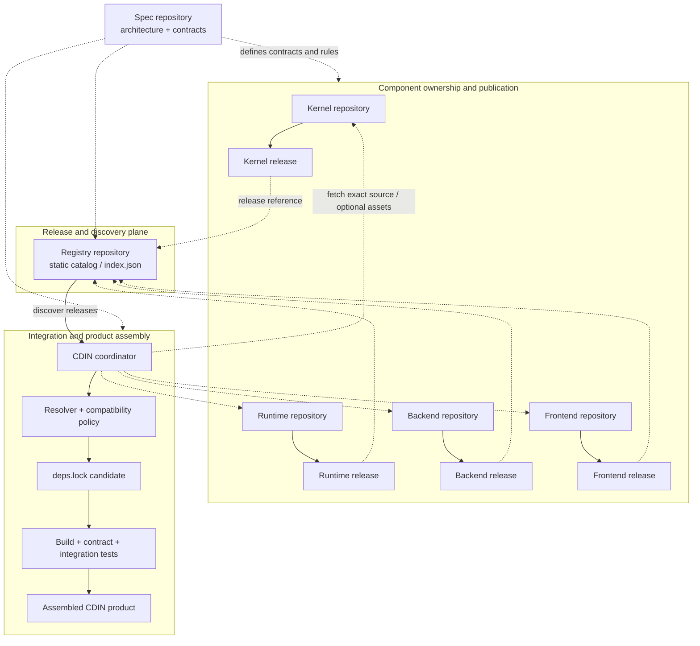

# Registry architecture

- **Status:** `PROPOSED` — see [ADR-0022](../adr/ADR-0022-minimal-static-release-catalog.md).
- **Scope:** first-party CDIN component release discovery and coordination.
- **Non-goal:** a general-purpose package manager, binary mirror or runtime service.

## 1. What the Registry is

The CDIN Registry is a **static catalog of published component releases**. It tells CDIN which releases exist, which immutable source revision belongs to each release, which independently versioned contracts that release implements, and where the authoritative source or an optional release asset can be retrieved.

It stores **release metadata and references**, not component source code or a second copy of every artifact. Think of it as a release directory for CDIN components—not npm, Cargo, apt or Docker Hub.

## 2. Why it exists

CDIN is assembled from independently versioned repositories. Without a catalog, the composition root must know where every component lives and query each repository separately. The Registry gives CDIN one stable discovery point, while component repositories retain ownership of their releases.

If the catalog does not materially simplify coordination for the small set of first-party repositories, querying those repositories directly remains a valid simpler alternative.

## 3. Where it sits

The Registry belongs to the **release and discovery plane**, alongside repositories and release workflows. It is not a runtime layer and is not part of the editor process.



*Proposed responsibility map; it does not claim that automated publication or synchronization workflows already exist.*

### Responsibility boundaries

| Part | Owns | Does not own |
|---|---|---|
| Component repository | Source, package version, tags, release notes, build and publication workflow, contract implementation | Global discovery catalog or CDIN's selected dependency set |
| GitHub Release | Downloadable source archives and optional component-produced assets | Dependency resolution or cross-component compatibility |
| Registry | Static release index, immutable revision references, contract-version declarations and withdrawal notices | Source code, builds, artifact mirroring, dependency solving, lockfiles or runtime services |
| CDIN composition root | Catalog consumption, resolver, dependency graph, compatibility policy, lockfile generation, integration CI and product assembly | Component source/version ownership or Registry metadata authority |
| Spec | Normative architecture, contract definitions, versioning rules and ADRs | Runtime release discovery or executable package management |

The Spec defines the rules; the Registry lists releases that claim to follow them. The Registry is not a contract authority and cannot make an incompatible release compatible.

## 4. Example: publishing Kernel 2.0.0

Assume the Kernel maintainer publishes package version `2.0.0`.

1. **Kernel publishes its release.** Its own CI tests the component, creates tag `v2.0.0`, resolves the full commit SHA and publishes a GitHub Release. Optional prebuilt assets are attached to that Kernel release.
2. **Registry records the release.** A small publication step adds metadata to the static catalog. For example:

```json
{
  "component": "cdin.kernel",
  "package_version": "2.0.0",
  "repository": "https://github.com/cdin-editor/kernel",
  "tag": "v2.0.0",
  "revision": "<full-git-commit-sha>",
  "contracts": {
    "kernel_abi": "1.1.0"
  },
  "release": "https://github.com/cdin-editor/kernel/releases/tag/v2.0.0",
  "status": "available"
}
```

This is illustrative, not a finalized schema. ABI `1.1.0` is also illustrative: the package version and ABI version are independent. A package release `2.0.0` does not imply ABI `2.0.0`.

3. **CDIN discovers the release.** CDIN reads the catalog and notices Kernel package `2.0.0`. It does not blindly upgrade. Its resolver compares contract versions against the active integration profile and evaluates the full dependency graph.
4. **CDIN tests a candidate set.** CDIN retrieves the exact recorded revision (and optional assets if needed), verifies available digests, then runs build, contract and integration tests. A version number or publisher declaration alone is not proof of compatibility.
5. **CDIN proposes the lockfile change.** If all gates pass, CDIN opens or updates a pull request containing the candidate `deps.lock` change and test evidence. Merge remains governed by CDIN's separate repository policy.

The Registry never edits `deps.lock`; a new release never silently changes an existing integration.

## 5. Minimal data model

| Field | Purpose |
|---|---|
| `component` | Stable component identity, independent of repository name |
| `package_version` | Component's own release version |
| `repository` | Authoritative source repository |
| `tag` | Human-readable release tag |
| `revision` | Full immutable Git commit SHA |
| `contracts` | Contract identifiers and implemented versions |
| `release` | Optional link to the component's GitHub Release |
| `status` | Whether the release is available or withdrawn |

Add asset URLs, platform/architecture selectors, checksums and provenance only when a real component publishes a downloadable asset consumed by CDIN. Do not invent an artifact matrix for source-built components.

## 6. Publication and synchronization

Proposed happy path:

1. Component owner tags and publishes a release in the component repository.
2. Existing component CI remains responsible for component build and tests.
3. A small publication step adds the release entry to the Registry catalog.
4. Registry validation checks required fields, unique component/version identity and immutable revision references.
5. CDIN sync reads the catalog and creates a candidate update.
6. CDIN runs resolver and integration gates and opens a lockfile PR when successful.

A Registry update must not trigger a release of every component. A component release must not rewrite other components' metadata.

## 7. Static delivery and integrity

- Store the catalog as version-controlled JSON in `cdin-editor/registry`.
- Use the Registry repository's Git history as catalog history; no separate snapshot service or database is needed.
- Read the catalog from a stable GitHub-hosted raw/content URL. No API server is required.
- Keep source and optional downloadable assets in the component's own repository and GitHub Release.
- Pin source by full commit SHA, not a floating branch or mutable tag alone.
- For optional binary assets, publish and verify SHA-256 digests.
- Use HTTPS and GitHub repository access controls for the first-party v1 workflow. Do not build a custom signing or trust-root system until external publishers or a concrete threat model require it.

A commit SHA identifies source content; it is not by itself a cryptographic publisher signature. HTTPS and SHA-256 do not provide signed provenance. The v1 proposal makes no stronger security claim.

## 8. Withdrawal and reproducibility

A release may be marked `withdrawn` with a reason and timestamp. New resolution must reject it. The Registry does not silently delete or rewrite the component's release assets.

Existing lockfiles continue to identify their exact revisions. A security policy may explicitly block a withdrawn revision, but that is a CDIN policy decision—not an automatic side effect of editing the catalog.

## 9. Explicit non-responsibilities

Registry v1 does **not** compile, test or package component source; host or mirror artifacts; own component versions, tags or release notes; solve dependency graphs; generate or modify `deps.lock`; merge CDIN pull requests; run a daemon, database or custom API; manage runtime plugin installation; or replace GitHub Releases or the Spec repository.

## 10. When to add complexity

| Demonstrated need | Possible later addition |
|---|---|
| External component publishers | Publisher identity and signed provenance |
| Large or independently hosted binaries | Object storage or dedicated artifact service |
| Many platform-specific binaries | Explicit target/format/architecture asset metadata |
| Catalog becomes too large | Split catalog files or generated indexes |
| Multiple registry sources | Source priority and trust policy |
| Real need for more automation | Advanced scheduling and PR policies |

These are future options, not v1 requirements.

## References

- [ADR-0022 — Minimal static release catalog](../adr/ADR-0022-minimal-static-release-catalog.md)
- [Repository topology](repositories.md)
- [System maps](system-maps.md)
- [CDIN composition root](../components/cdin.md)
- [Open Decisions Register](../adr/open-decisions.md)
