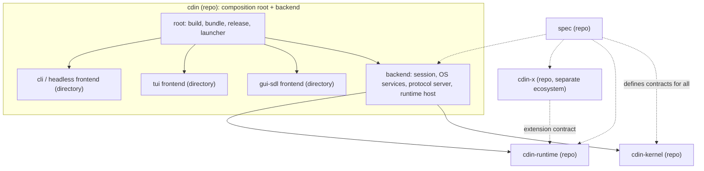

# Components and repositories

A **component** has one responsibility and a contract. A **repository** is a unit of version control and release. They are different things. This document says which component lives in which repository now, and the conditions under which that changes.

## 1. Target topology (`PROPOSED`)

*Caption: `PROPOSED` end state. Arrows are build or link dependencies; dotted arrows are contract relationships.*

## 2. Component to repository map

| Component | Repository now | Repository target | Status |
|---|---|---|---|
| spec | `cdin-editor/spec` | same | `ACCEPTED` that it exists; contents `PROPOSED` |
| kernel | does not exist | `cdin-kernel`, created after its ABI is stable (phase 2 of [migration.md](migration.md)); until then a directory inside `cdin` | `PROPOSED` |
| runtime | inside `cdin` (`data/core/`, `src/lua/`, `src/api/`) | `cdin-runtime`, created after the runtime host API is stable | `PROPOSED` |
| backend | inside `cdin` (`src/`) | stays in `cdin` | `PROPOSED` |
| frontend: gui-sdl | inside `cdin` (`src/ui/`, `src/core/window.*`, SDL parts of `src/api/system.c`) | directory in `cdin`, extractable | `PROPOSED` |
| frontend: tui, cli, headless | does not exist | directories in `cdin` first | `DEFERRED` (tui, cli), `PROPOSED` (headless reference) |
| data | not a component in code | no repository | `DEFERRED` |
| cdin (root) | `cdin` repository | same | `ACCEPTED` as composition root |
| cdin-x | its own repository | same, fully separate | `ACCEPTED` |

There is deliberately **no** `cdin-backend`, `cdin-frontend`, `cdin-data`, `cdin-scripts`, `cdin-common` or `cdin-shared` repository in the target topology. Reasons are in [ADR-0001](../decisions/ADR-0001-repository-topology.md).

## 3. Rules for creating or splitting a repository

- **ARCH-030** `PROPOSED` A new repository MUST be justified by at least one of: a second consumer of the component that is not the current repository; an independent release cadence; a different implementation language or toolchain; a separation of ownership. — *Verify:* INSPECT
- **ARCH-031** `PROPOSED` A component MUST NOT be extracted into its own repository until its contract has a version number and a written compatibility policy. — *Verify:* INSPECT
- **ARCH-032** `PROPOSED` Extraction MUST preserve history (`git mv` then split with history retained), and the editor MUST build and start before and after extraction. — *Verify:* INTEG
- **ARCH-033** `PROPOSED` Frontends MAY live outside the `cdin` repository at any time, because they depend only on the Frontend Protocol. No change to other components is required for that. — *Verify:* INSPECT
- **ARCH-034** `ACCEPTED` No `cdin-common` or `cdin-shared` repository is created without explicit approval and a stated reason (same as ARCH-005; restated here as the rule for this document). — *Verify:* INSPECT
- **ARCH-035** `PROPOSED` A protocol client library (a binding of the Frontend Protocol for frontend authors) is the one shared artifact with an architectural justification. Whether it is a separate repository is `OPEN`: see [OD-23](../decisions/open-decisions.md). — *Verify:* INSPECT

## 4. What each repository is, and is not

### spec
- **Is:** architecture, contracts, decisions, verification design.
- **Is not:** an implementation, a test runner, or a place for code.

### kernel (`cdin-kernel`)
- **Is:** the document engine behind a C ABI.
- **Is not:** a UI toolkit, a file manager, a scripting host, a syntax highlighter, a text shaper.

### runtime (`cdin-runtime`)
- **Is:** the Lua policy layer and the definition of the Lua environment extensions run in.
- **Is not:** a document store; it keeps no independent copy of document content or history.

### backend (inside `cdin`)
- **Is:** the headless core that can run with no frontend attached.
- **Is not:** tied to SDL, a terminal, or any display.

### frontends (directories in `cdin`, later possibly their own repositories)
- **Are:** presentation and input for one environment.
- **Are not:** owners of documents, commands or keymaps.

### cdin (composition root)
- **Is:** build system, bundling, release workflows, installers, launcher, development tooling.
- **Is not:** a place where kernel or runtime logic is re-implemented.

### cdin-x
- **Is:** the mandatory bundled set (vim mode, extension manager, default theme, fonts) plus every optional extension.
- **Is not:** aware of the kernel, the protocol or the backend.

## 5. Why the current layout is not simply split

The current `cdin` source is small (roughly 7.2 thousand lines of C and 7.3 thousand of Lua core, measured on the inspected tree) and the C API and the Lua core change together. A split without a stable contract would force every change into several coordinated pull requests. The target topology therefore creates contracts first (this repository), repositories second. See [migration.md](migration.md).
