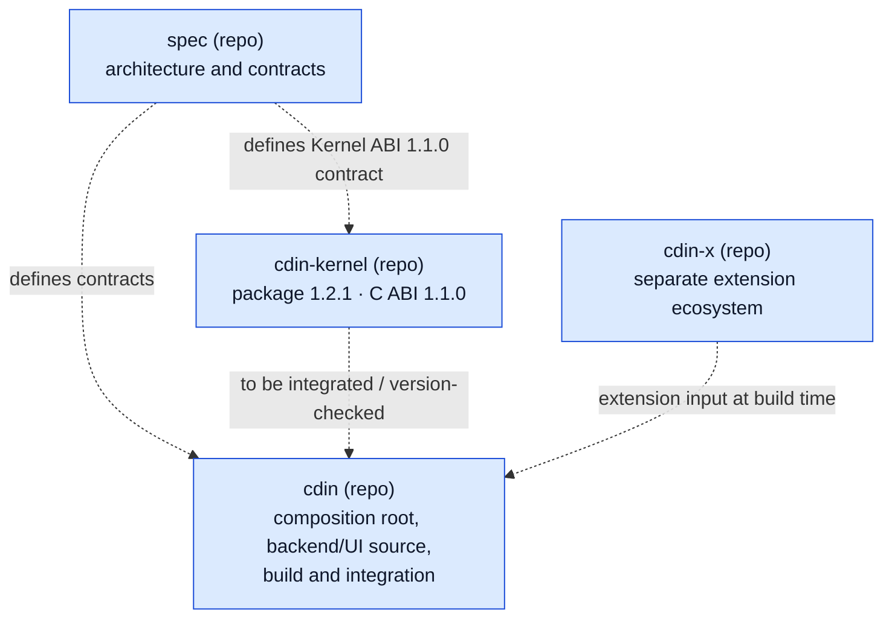
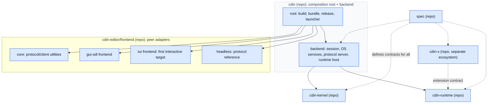

# Components and repositories

A **component** has one responsibility and a contract. A **repository** is a unit of version control and release. They are different things. This document says which component lives in which repository now, and the conditions under which that changes.

## 1. Today and target

### Current archive baseline

*Caption: this diagram records the historical archive baseline only. The current audited component versions are listed in §2; archive snapshots do not contain Git history and cannot establish commit ancestry. Current Kernel package `1.2.1` publishes C ABI `1.1.0`, with Kernel-declared Spec target `1.1.0`.*

### Stable architecture baseline and target

*Caption: accepted repository boundaries and target composition. The standalone Frontend repository and its adapters are accepted targets, not a claim that extraction or TUI implementation has shipped. The `cdin-runtime` repository is already extracted and has provisional package releases; stable Host API and live integration remain separate gates. Arrows are build or link dependencies; dotted arrows are contract relationships.*

## 2. Component to repository map

| Component | Repository now | Repository target | Status |
|---|---|---|---|
| spec | `cdin-editor/spec` | same | `ACCEPTED`; Spec release `1.3.0`, Kernel-declared compatibility target remains `1.1.0` |
| kernel | standalone `cdin-kernel`, package `1.2.1` | same; public C ABI `1.1.0` | `ACCEPTED` |
| runtime | standalone `cdin-runtime`, latest candidate package `1.0.0-rc.1` | same; stable Host API `1.0.0`; live Backend integration and extension/migration conformance remain gates | `ACCEPTED` repository boundary; package candidate and product integration remain in progress |
| backend | standalone Backend source repository, audited release `1.0.0` | same; composition root remains `cdin` | `ACCEPTED` repository boundary; product integration remains in progress |
| frontend | standalone `cdin-editor/frontend` package `1.0.0`; adapters `core`, `gui-sdl`, `tui`, `headless` | same | `ACCEPTED` repository/Protocol contract; full TUI/GUI/Headless product completion remains in progress |
| cli | does not exist | optional non-interactive adapter, separate from the interactive TUI | `DEFERRED` |
| data | not a component in code | no repository | `DEFERRED` |
| cdin (root) | `cdin` repository | same | `ACCEPTED` as composition root |
| cdin-x | its own repository | same, fully separate | `ACCEPTED` |

There is deliberately **no** `cdin-backend`, `cdin-data`, `cdin-scripts`, `cdin-common` or `cdin-shared` repository in the target topology. One standalone `cdin-editor/frontend` repository is explicitly accepted by [ADR-0020](../adr/ADR-0020-frontend-topology-and-interaction.md); the earlier no-frontend-repository baseline is superseded.

## 3. Rules for creating or splitting a repository

- **ARCH-030** `PROPOSED` A new repository MUST be justified by at least one of: a second consumer of the component that is not the current repository; an independent release cadence; a different implementation language or toolchain; a separation of ownership. — *Verify:* INSPECT
- **ARCH-031** `PROPOSED` A component MUST NOT be extracted into its own repository until its contract has a version number and a written compatibility policy. — *Verify:* INSPECT
- **ARCH-032** `PROPOSED` Extraction SHOULD preserve source history using a subtree/filter-repo method or an equivalent mapping; `git mv` alone does not preserve history across repositories. The editor MUST build and start before and after extraction. — *Verify:* INTEG
- **ARCH-033** `PROPOSED` Frontends MAY live outside the `cdin` repository at any time, because they depend only on the Frontend Protocol. No change to other components is required for that. — *Verify:* INSPECT
- **ARCH-034** `ACCEPTED` No `cdin-common` or `cdin-shared` repository is created without explicit approval and a stated reason (same as ARCH-005; restated here as the rule for this document). — *Verify:* INSPECT
- **ARCH-035** `PROPOSED` A protocol client library (a binding of the Frontend Protocol for frontend authors) is the one shared artifact with an architectural justification. Whether it is a separate repository is `OPEN`: see [OD-23](../adr/open-decisions.md). — *Verify:* INSPECT

## 4. What each repository is, and is not

### spec
- **Is:** architecture, contracts, decisions, verification design.
- **Is not:** an implementation, a test runner, or a place for code.

### kernel (`cdin-kernel`)
- **Is:** the document engine behind a C ABI.
- **Is not:** a UI toolkit, a file manager, a scripting host, a syntax highlighter, a text shaper.

### runtime (`cdin-runtime`)
- **Is:** the Lua policy layer and the definition of the Lua environment extensions run in.
- **Is not:** a document store; it keeps no independent copy of document content or history.

### backend (inside `cdin`)
- **Is:** the headless core that can run with no frontend attached.
- **Is not:** tied to SDL, a terminal, or any display.

### frontend (`cdin-editor/frontend`, accepted target)
- **Is:** one repository containing peer `core`, `gui-sdl`, `tui` and `headless` adapters.
- **Is not:** a shared GUI/TUI renderer or an owner of documents, commands or keymaps.
- **Migration note:** legacy GUI code remains in `cdin` until it is extracted; the TUI and standalone repository are not yet shipped.

### cdin (composition root)
- **Is:** build system, bundling, release workflows, installers, launcher, development tooling.
- **Is not:** a place where kernel or runtime logic is re-implemented.

### cdin-x
- **Is:** the mandatory bundled set (vim mode, extension manager, default theme, fonts) plus every optional extension.
- **Is not:** aware of the kernel, the protocol or the backend.

## 5. Why the current layout is not simply split

The current `cdin` archive still contains backend, runtime and GUI-related code together; its SDL3-dependent build/test path could not be verified in the available environment because SDL3 headers are absent and the archived test baseline is empty. The standalone `cdin-kernel` ABI is now stable, but its composition-root integration must be gated by an integration test. The next justified repository extraction is `cdin-runtime` only after its host API is stable. The supplied archives have no Git history, so migration history preservation cannot be assessed here. See [migration.md](migration.md).
