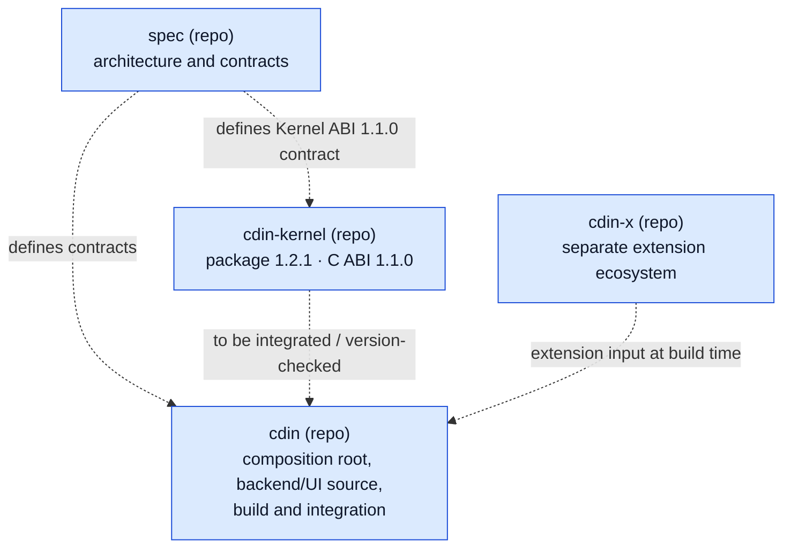

# Components and repositories

A **component** has one responsibility and a contract. A **repository** is a unit of version control and release. They are different things. This document records component ownership and separately identifies infrastructure repositories that support product delivery.

## 1. Today and target

### Current archive baseline



*Caption: this records the historical archive baseline only. Current audited versions are listed below; archive snapshots contain no Git history and cannot establish commit ancestry. Kernel package 1.2.1 publishes C ABI 1.1.0.*

### Stable architecture baseline and target

```mermaid
flowchart TB
    spec["spec (repo)"]
    registry["registry (infrastructure repo)<br/>generic component orchestration"]
    productdef["Product Definition<br/>consumer-owned declarative data"]
    subgraph cdinrepo["cdin (repo): composition root + backend"]
        root["root: build, bundle, release, launcher"]
        be["backend: session, OS services, protocol server, runtime host"]
    end
    subgraph ferepo["cdin-editor/frontend (repo): peer adapters"]
        fecore["core: protocol/client utilities"]
        fegui["gui-sdl frontend"]
        fetui["tui frontend: first interactive target"]
        feheadless["headless: protocol reference"]
    end
    kernel["cdin-kernel (repo)"]
    runtime["cdin-runtime (repo)"]
    x["cdin-x (repo, separate ecosystem)"]
    root --> be
    root --> fecore
    root --> fegui
    root --> fetui
    root --> feheadless
    be --> kernel
    be --> runtime
    x -. "extension contract" .-> runtime
    productdef --> registry
    kernel -. "release metadata and source" .-> registry
    runtime -.-> registry
    be -.-> registry
    fecore -.-> registry
    registry -->| "prepared workspace + manifest" | root
    spec -. "defines contracts for all" .-> kernel
    spec -.-> runtime
    spec -.-> be
    spec -.-> x
    spec -.-> registry
    classDef comp fill:#dbeafe,stroke:#1d4ed8,color:#0f172a
    classDef group fill:#f8fafc,stroke:#cbd5e1,color:#334155
    classDef infra fill:#ede9fe,stroke:#6d28d9,color:#0f172a
    class be,fecore,feheadless,fegui,fetui,kernel,root,runtime,spec,x comp
    class registry,productdef infra
    class cdinrepo,ferepo group
```

*Caption: accepted repository and infrastructure boundaries. Registry is a build-time/delivery-plane tool, not a product runtime dependency. Dotted arrows are metadata, source, build or contract relationships; the Registry-to-root arrow is the prepared workspace handoff. Frontend extraction and TUI delivery remain separate implementation gates.*

## 2. Component to repository map

| Component | Repository now | Repository target | Status |
|---|---|---|---|
| spec | `cdin-editor/spec` | same | `ACCEPTED`; architecture and contracts |
| kernel | standalone `cdin-editor/kernel`, package `1.2.1` | same; public C ABI `1.1.0` | `ACCEPTED` |
| runtime | standalone `cdin-editor/runtime`, latest candidate package `1.0.0-rc.1` | same; stable Host API `1.0.0`; live Backend integration and extension/migration conformance remain gates | `ACCEPTED` repository boundary; package and integration remain in progress |
| backend | standalone Backend source repository, audited release `1.0.0` | same; composition root remains `cdin` | `ACCEPTED` repository boundary; product integration remains in progress |
| frontend | standalone `cdin-editor/frontend` package `1.0.0`; adapters `core`, `gui-sdl`, `tui`, `headless` | same | `ACCEPTED` repository/Protocol contract; implementation remains in progress |
| cli | does not exist | optional non-interactive adapter, separate from TUI | `DEFERRED` |
| data | not a component in code | no repository | `DEFERRED` |
| cdin (root) | `cdin` repository | same | `ACCEPTED` as composition root |
| cdin-x | its own repository | same | `ACCEPTED` |

## 3. Independent infrastructure repositories

| System | Repository | Responsibility | Runtime relationship |
|---|---|---|---|
| Registry | `cdin-editor/registry` | Generic catalog, release metadata, resolution, source collection and workspace/manifest production | Build-time/delivery-plane only; no component links to it |
| Spec | `cdin-editor/spec` | Architecture, data contracts, normative requirements and ADRs | Documentation/governance; not linked into product |

Registry is not a component and is not a shared-utilities repository. It owns a cohesive delivery-plane system that can serve multiple consumers through the same generic contracts. Spec defines its contracts but does not contain its implementation.

There is deliberately no catch-all `cdin-backend`, `cdin-data`, `cdin-scripts`, `cdin-common` or `cdin-shared` repository. The standalone Frontend repository is accepted by [ADR-0020](../adr/ADR-0020-frontend-topology-and-interaction.md).

## 4. Rules for creating or splitting a repository

- **ARCH-030** `PROPOSED` A new repository MUST be justified by at least one of: a second consumer of the component that is not the current repository; an independent release cadence; a different implementation language or toolchain; a separation of ownership. — *Verify:* INSPECT
- **ARCH-031** `PROPOSED` A component MUST NOT be extracted into its own repository until its contract has a version number and a written compatibility policy. — *Verify:* INSPECT
- **ARCH-032** `PROPOSED` Extraction SHOULD preserve source history using a subtree/filter-repo method or an equivalent mapping; `git mv` alone does not preserve history across repositories. The editor MUST build and start before and after extraction. — *Verify:* INTEG
- **ARCH-033** `PROPOSED` Frontends MAY live outside the `cdin` repository at any time, because they depend only on the Frontend Protocol. No change to other components is required for that. — *Verify:* INSPECT
- **ARCH-034** `ACCEPTED` No `cdin-common` or `cdin-shared` repository is created without explicit approval and a stated reason (same as ARCH-005; restated here as the rule for this document). — *Verify:* INSPECT
- **ARCH-035** `PROPOSED` A protocol client library (a binding of the Frontend Protocol for frontend authors) is the one shared artifact with an architectural justification. Whether it is a separate repository is `OPEN`: see [OD-23](../adr/open-decisions.md). — *Verify:* INSPECT

ARCH-030 applies to all new repositories; Registry meets its justification through a distinct delivery-plane capability, public contracts, ownership and lifecycle. ARCH-031 governs extraction of product components.

## 5. What each repository is, and is not

### spec
- **Is:** architecture, contracts, decisions and verification design.
- **Is not:** an implementation or product source repository.

### Registry (`cdin-editor/registry`)
- **Is:** generic delivery-plane engine, catalog/release-metadata handling, dependency/contract resolution, source collection, workspace preparation and conformance tests.
- **Is not:** common library repository, component source authority, product build system or runtime dependency.

### kernel (`cdin-editor/kernel`)
- **Is:** document engine behind a C ABI.
- **Is not:** UI toolkit, file manager, scripting host, syntax highlighter or text shaper.

### runtime (`cdin-editor/runtime`)
- **Is:** Lua policy layer and extension environment.
- **Is not:** a document store or owner of canonical document content/history.

### backend (inside `cdin`)
- **Is:** headless core that can run without a frontend.
- **Is not:** tied to SDL, a terminal or any display.

### frontend (`cdin-editor/frontend`)
- **Is:** peer `core`, `gui-sdl`, `tui` and `headless` adapters.
- **Is not:** shared GUI/TUI renderer or owner of documents, commands or keymaps.
- **Migration note:** legacy GUI code remains in `cdin` until extracted; standalone TUI delivery remains in progress.

### cdin (composition root)
- **Is:** product configuration, integration, build, bundle, release workflows, installers, launcher and developer tooling.
- **Is not:** a place where kernel, runtime or Registry logic is re-implemented.

### cdin-x
- **Is:** mandatory bundled set plus optional extensions.
- **Is not:** aware of kernel, protocol or backend internals.

## 6. Current migration limits

The current `cdin` archive still contains backend, runtime and GUI-related code together; its SDL3-dependent build/test path could not be verified in the available environment because SDL3 headers are absent and the archived test baseline is empty. Kernel ABI is stable, but composition-root integration requires an integration test. Runtime and Frontend repository boundaries are accepted while remaining product integration gates are tracked separately. Supplied archives have no Git history, so migration history preservation cannot be assessed here. See [migration.md](migration.md).
