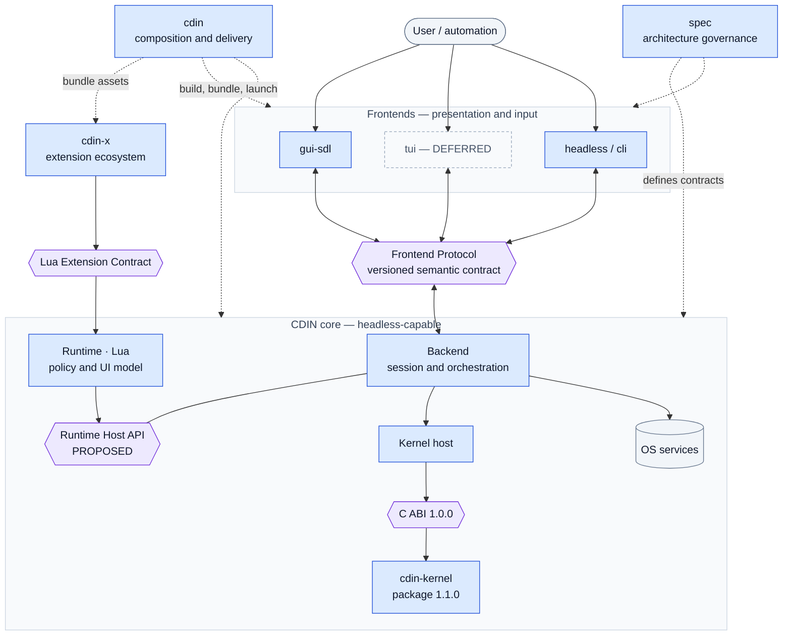
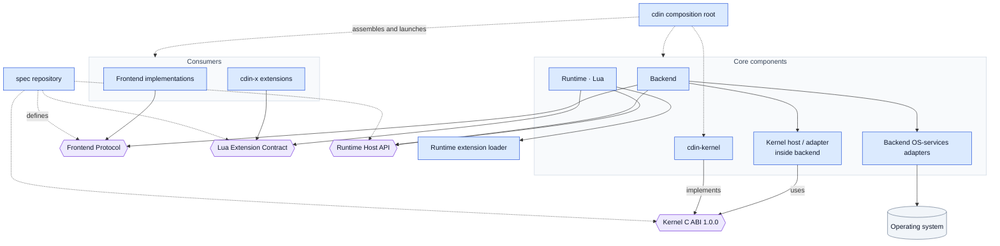
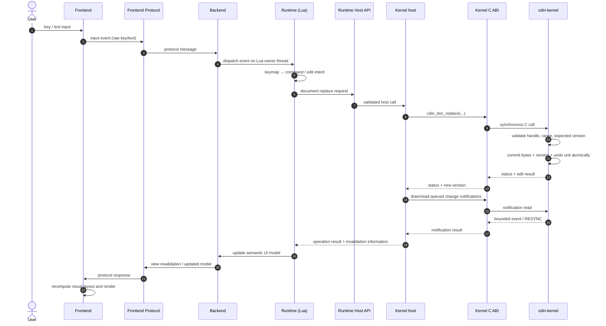
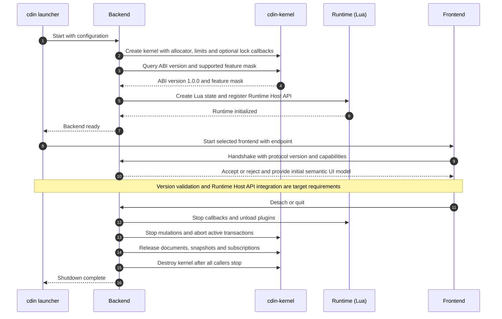

# System maps

This page collects architecture views at different levels of abstraction. Read them in order: landscape, dependency boundaries, request flow, then startup and release. These diagrams describe the target architecture unless marked `EXISTING`; they do not promote `PROPOSED` or `OPEN` work to implemented status.

## 1. Landscape view — who plays which role?

This is the quickest mental model: frontends present, the runtime decides editor policy, the backend coordinates, the kernel owns canonical document state, `cdin-x` supplies extensions, and `cdin` assembles the product. `spec` describes and governs contracts; it is not linked into the executable.

## 2. Dependency and ownership view

In this diagram, arrows mean **depends on or calls**. Dashed arrows mean **build-time composition or contract definition**. A dependency must not be inferred merely because two boxes appear next to each other.

### Boundary rules

- **The backend is the only direct kernel client in the target topology.** Lua uses the Runtime Host API; frontends use the Frontend Protocol; extensions use the Lua Extension Contract.
- **No second canonical document store exists.** The kernel owns document bytes, document versions and undo/redo history. Runtime views may own selections and logical scroll anchors; frontends may own disposable visual caches.
- **The kernel is presentation-neutral.** It does not know about SDL, terminals, Lua, `cdin-x`, the filesystem or release tooling.
- **The root is not a runtime service.** `cdin` can know about components to assemble them but no component depends on the composition root.
- **The language bridge remains an implementation choice.** Lua C API binding, LuaJIT FFI or an intermediary such as MetaCall must stay behind the Runtime Host API/kernel adapter and requires a separate decision; see [OD-32](../adr/open-decisions.md).

## 3. Detailed request path — one edit from input to pixels

*Status: `PROPOSED` for the integrated end-to-end path. The synchronous kernel-call, version-check, committed-version and bounded-notification semantics are `EXISTING` in Kernel ABI 1.0.0; Runtime Host API and Frontend Protocol integration are not claimed as implemented by the kernel package.*

### What the sequence intentionally excludes

- No frontend calls the kernel directly.
- No Lua runtime links to private kernel internals.
- No kernel call draws pixels, shapes text or writes a file.
- No notification is an unbounded callback-driven work queue; kernel notifications are bounded and may require `RESYNC` after overflow.
- No search complexity promise such as O(1) is implied. Package 1.1.0 adds internal literal-search fast paths, but observable matching/range semantics and the public ABI remain the contract.

## 4. Startup, compatibility and shutdown

*Status: `PROPOSED` for application startup and shutdown as a whole. The kernel's ABI query, synchronous calls and shutdown semantics are specified in [concurrency](concurrency.md), [lifecycle](lifecycle.md) and the published header. The complete backend/runtime/frontend path still needs an integration test.*

## 5. Version and release view

Version labels describe different contracts; they are not interchangeable.

| Label | Current value | Authority | What it controls |
|---|---:|---|---|
| Kernel package | `1.1.0` | `cdin-kernel/CHANGELOG.md` / release tag | Source release, package contents and distribution workflow |
| Kernel C ABI | `1.0.0` | `include/cdin/kernel.h` | Native caller-visible names, types, layouts, constants and semantics |
| CDIN Spec release | `1.1.0` | [reference/status.md](../reference/status.md) | Current compatible specification release and architecture documentation |
| Kernel-declared Spec target | `1.0.0` | `include/cdin/kernel.h` via `CDIN_KERNEL_SPEC_VERSION_*` | Specification baseline this kernel package declares conformance to |
| Frontend Protocol version | not frozen | Open decisions and protocol page | Frontend/backend messages; serialization is still open |
| Runtime Host API version | not published | Open decision / future implementation | Runtime-to-backend service surface |
| Extension-contract version | follows the extension contract | `cdin` extension contract | Compatibility between runtime and `cdin-x` extensions |

The package `1.1.0` change is package-compatible with ABI `1.0.0`: public declarations and result-range semantics remain stable. Spec release `1.1.0` is separately versioned from the Spec `1.0.0` conformance target declared by this kernel. If the accepted kernel contract changes, update the kernel ABI and its declared Spec target through an explicit review, and update the Spec release according to `SPEC-010`; do not infer a kernel ABI bump from package-only or documentation-only changes.
