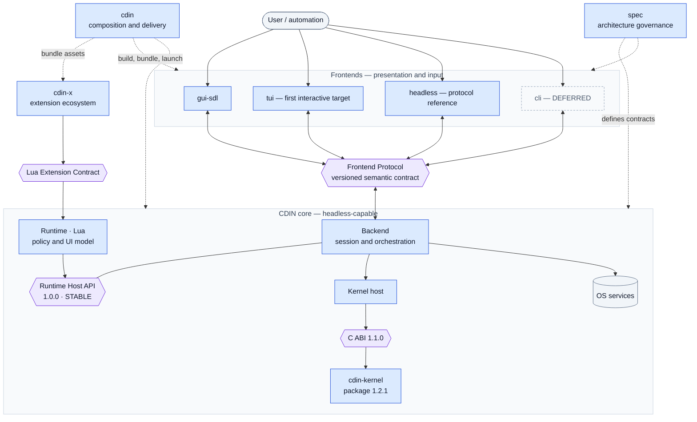
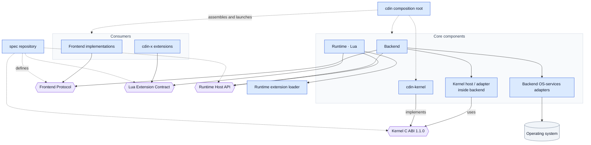
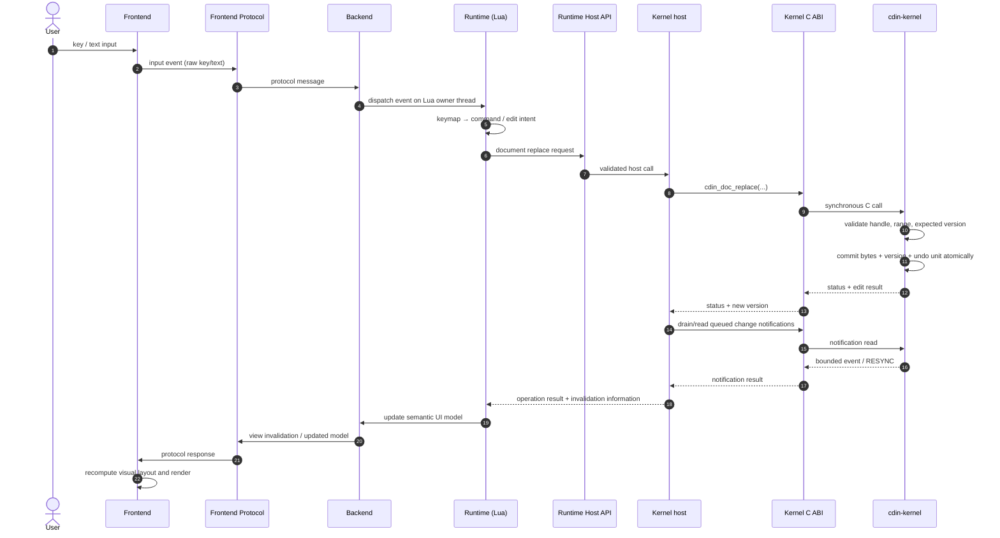
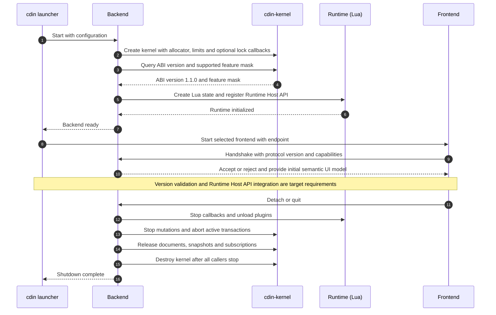

# System maps

This page collects architecture views at different levels of abstraction. Read them in order: landscape, dependency boundaries, request flow, then startup and release. These diagrams describe the target architecture unless marked `EXISTING`; they do not promote `PROPOSED` or `OPEN` work to implemented status.

## 1. Landscape view — who plays which role?

This is the quickest mental model: frontends present, the runtime decides editor policy, the backend coordinates, the kernel owns canonical document state, `cdin-x` supplies extensions, and `cdin` assembles the product. `spec` describes and governs contracts; it is not linked into the executable.

## 2. Dependency and ownership view

In this diagram, arrows mean **depends on or calls**. Dashed arrows mean **build-time composition or contract definition**. A dependency must not be inferred merely because two boxes appear next to each other.

### Boundary rules

- **The backend is the only direct kernel client in the target topology.** Lua uses the Runtime Host API; frontends use the Frontend Protocol; extensions use the Lua Extension Contract.
- **No second canonical document store exists.** The kernel owns document bytes, document versions and undo/redo history. Runtime views may own selections and logical scroll anchors; frontends may own disposable visual caches.
- **The kernel is presentation-neutral.** It does not know about SDL, terminals, Lua, `cdin-x`, the filesystem or release tooling.
- **The root is not a runtime service.** `cdin` can know about components to assemble them but no component depends on the composition root.
- **The language bridge is decided.** PUC Lua 5.4 C API is the only supported v1 bridge under [ADR-0019](../adr/ADR-0019-runtime-bridge.md); Backend owns the Lua state and callbacks. LuaJIT FFI and MetaCall are not v1 alternatives. The Runtime Host API is a separate stable `1.0.0` compatibility contract.

## 3. Detailed request path — one edit from input to pixels

*Status: `PROPOSED` for the integrated end-to-end path. The synchronous kernel-call, version-check, committed-version and bounded-notification semantics are `EXISTING` in Kernel ABI 1.0.0; Runtime Host API and Frontend Protocol integration are not claimed as implemented by the kernel package.*

### What the sequence intentionally excludes

- No frontend calls the kernel directly.
- No Lua runtime links to private kernel internals.
- No kernel call draws pixels, shapes text or writes a file.
- No notification is an unbounded callback-driven work queue; kernel notifications are bounded and may require `RESYNC` after overflow.
- No search complexity promise such as O(1) is implied. Package 1.2.1 has internal literal-search fast paths, but observable matching/range semantics and the public ABI remain the contract.

## 4. Startup, compatibility and shutdown

*Status: `PROPOSED` for application startup and shutdown as a whole. The kernel's ABI query, synchronous calls and shutdown semantics are specified in [concurrency](concurrency.md), [lifecycle](lifecycle.md) and the published header. The complete backend/runtime/frontend path still needs an integration test.*

## 5. Version and release view

Version labels describe different contracts; they are not interchangeable.

| Label | Current value | Authority | What it controls |
|---|---:|---|---|
| Kernel package | `1.2.1` | `cdin-kernel/CHANGELOG.md` / release tag | Source release, package contents and distribution workflow |
| Kernel C ABI | `1.1.0` | `include/cdin/kernel.h` | Native caller-visible names, types, layouts, constants and semantics |
| CDIN Spec release | `1.3.0` | [reference/status.md](../reference/status.md) | Current compatible specification release and architecture documentation |
| Kernel-declared Spec target | `1.1.0` | `include/cdin/kernel.h` via `CDIN_KERNEL_SPEC_VERSION_*` | Specification baseline this kernel package declares conformance to |
| Frontend Protocol version | `1.0.0` target | ADR-0018 and protocol contract | Accepted semantic/wire contract; Backend implementation conformance remains incomplete |
| Runtime Host API version | `1.0.0` stable | Backend Host API contract | Runtime-to-Backend service surface; live native integration remains a Runtime package release gate |
| Extension-contract version | follows the extension contract | `cdin` extension contract | Compatibility between runtime and `cdin-x` extensions |

## 6. Component delivery and product composition

The Registry is a generic, consumer-independent Component Orchestration system. Product Definitions provide requirements as data; Registry manages component versions, updates, resolution and source collection. CDIN consumes a prepared workspace and owns product integration, build, tests, packaging and launch.

\`\`\`mermaid
flowchart TB
    subgraph COMPONENTS["Component repositories and releases"]
        C1["Backend source units"]
        C2["Frontend variants CLI · GUI-SDL · TUI · ..."]
        C3["Runtime source units"]
        C4["Kernel library"]
        C5["Future split repositories"]
    end
    PD["Product Definition data-only requirements"]
    subgraph REGISTRY["Generic Registry — no consumer-specific logic"]
        CATALOG["Component and release catalog"]
        UPDATE["Version and update management"]
        RESOLVE["Dependency and compatibility resolution"]
        COLLECT["Source collection + immutable revision verification"]
        OUTPUT["Prepared workspace + resolved manifest"]
        CATALOG --> UPDATE --> RESOLVE --> COLLECT --> OUTPUT
    end
    C1 --> CATALOG
    C2 --> CATALOG
    C3 --> CATALOG
    C4 --> CATALOG
    C5 --> CATALOG
    PD --> RESOLVE
    subgraph CDIN["CDIN product pipeline"]
        INTEGRATE["Product-specific integration"]
        BUILD["Build"]
        TEST["Product and integration tests"]
        RUN["Package and launch"]
        INTEGRATE --> BUILD --> TEST --> RUN
    end
    OUTPUT --> INTEGRATE
    SPEC["Spec contracts and architecture"]
    SPEC -. "defines generic contracts" .-> CATALOG
    SPEC -.-> PD
    SPEC -.-> CDIN
\`\`\`

**Core invariant:** Registry must understand requirements, not consumer identity. The same Registry can serve CDIN Editor and a future unrelated product by processing different Product Definitions without product-specific code.

### Responsibility summary

| Owner | Responsibility |
|---|---|
| Component repositories | Source, component-owned versions, tags, tests and releases |
| Product Definition | Declarative component IDs, variants, constraints and product composition requirements |
| Registry | Catalog, version/update management, resolution, source collection, verification, prepared workspace and resolved manifest |
| CDIN | Product-specific integration, configuration, build, product tests, packaging and launch |
| Spec | Normative contracts, architecture and decision records |

### Handoff contract

Registry does not hand CDIN a list of URLs and expect CDIN to fetch or resolve them. It prepares the source workspace and returns a manifest with exact component identities, versions, variants, repositories, immutable revisions and available integrity metadata.

CDIN consumes that prepared input. It does not own component discovery, version selection, update tracking, dependency solving or source collection.

### Kernel 2.0.0 and Frontend variants

A Kernel release 2.0.0 is recorded by Registry with its package version, source revision and contract declarations. A Product Definition can request the Kernel library at a compatible version while selecting only Frontend cli and gui-sdl; other Frontend variants are not collected. If Backend later splits across multiple repositories, its component metadata can describe multiple source units without changing Registry's consumer-facing behavior.

Package version 2.0.0 does not imply ABI 2.0.0; package and contract version axes remain independent.

*Status: PROPOSED. These diagrams describe the intended architecture, not an implemented Registry or a shipped workspace contract.*

