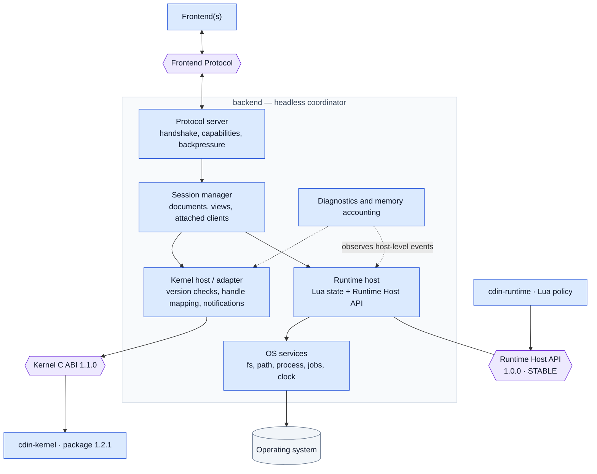
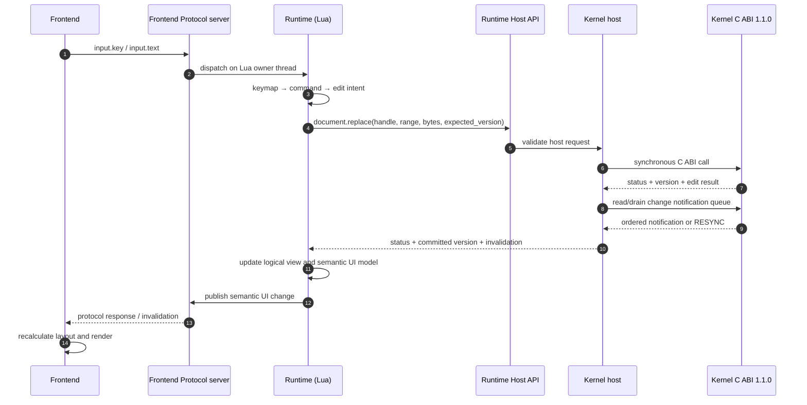

# Backend

The backend is the headless core of CDIN. It hosts the kernel and the runtime, provides OS services, relays the runtime's UI model, and serves the Frontend Protocol. It has no knowledge of any display toolkit and can run with no frontend attached.

"Backend" does **not** mean a network server and does not mean SDL. SDL is a *frontend* concern ([frontend.md](frontend.md)).

## 1. Responsibilities

1. **Session**: tracks open documents, views and attached frontends.
2. **Kernel host**: creates the kernel with an allocator and limits, owns its lifetime, forwards requests, converts kernel events into UI invalidations.
3. **Runtime host**: owns the Lua state, loads the runtime, exposes the runtime host API to Lua, runs Lua on the main thread.
4. **OS services**: files, paths, processes, jobs, clock, directory listing, file metadata.
5. **Protocol server**: handshake, capability negotiation, input routing to the runtime, UI-model relay, backpressure.
6. **Diagnostics**: logging, memory accounting.

The native bridge is deliberately hidden behind the Runtime Host API. Direct Lua-to-Kernel linking is not the target boundary. [ADR-0019](../adr/ADR-0019-runtime-bridge.md) accepts the PUC Lua 5.4 C API as the only supported v1 bridge and resolves OD-32. Backend owns `lua_State`, native callbacks and userdata, and enforces the Runtime owner thread. LuaJIT FFI and MetaCall are not v1 alternatives. The Runtime Host API is frozen at stable version `1.0.0`; live integration evidence remains a separate implementation gate.

## 2. Internal structure

*Caption: target internal structure. These boxes are logical responsibilities, not promises of separate binaries or repositories. The Backend is the direct client of the Kernel; Runtime depends on the Backend-provided Runtime Host API, not on `include/cdin/kernel.h`. The bridge choice is accepted by ADR-0019; Host API `1.0.0` is stable as a contract.*

## 3. Requirements

- **BE-001** `PROPOSED` The backend MUST run with no frontend attached and MUST accept frontends attaching and detaching at any time. — *Verify:* INTEG (LIFE-004)
- **BE-002** `PROPOSED` The backend MUST NOT include any display-toolkit header or link any display toolkit (ARCH-042). — *Verify:* STATIC
- **BE-003** `PROPOSED` The backend is the only direct client of the kernel ABI (ARCH-041, ARCH-043). — *Verify:* STATIC
- **BE-004** `PROPOSED` The backend creates the kernel with its allocator and limits, performs the ABI version check before use, and shuts it down gracefully (LIFE-001). — *Verify:* INTEG
- **BE-005** `PROPOSED` The OS services are independent of any display toolkit. A change of frontend or of toolkit MUST NOT require a change to them. — *Verify:* STATIC, INSPECT
- **BE-006** `EXISTING` The standalone Backend keeps display-toolkit-independent OS services in dedicated modules: filesystem, path and process operations in `src/os/`; bounded worker execution in `src/jobs/`; and clock, native-path and thread support in `src/platform/`. SDL remains a Frontend `gui-sdl` concern and is not included or linked by the Backend. — *Verify:* STATIC — *Anchor:* `src/os/fs.c`, `src/os/path.c`, `src/os/process.c`, `src/jobs/pool.c`, `src/platform/clock.c`, `src/platform/native_path.c`, `src/platform/thread.c`, `CMakeLists.txt`, `scripts/check-boundaries.sh`
- **BE-007** `EXISTING` Workers never enter the Lua bridge or access its `lua_State`; Backend records the creating/owner thread and enforces owner-thread access while worker completions are delivered through the Backend pump. — *Verify:* SAN — *Anchor:* `src/backend_internal.h`, `src/backend.c`, `src/runtime/lua_host.c`
- **BE-008** `PROPOSED` The backend never blocks the main thread on unbounded work; file reads, process execution and searching run as jobs (ARCH-023). — *Verify:* INSPECT, PERF
- **BE-009** `PROPOSED` The backend bounds every queue it owns: per-frontend outgoing flush queue, job queue, event queue (ARCH-021, PROTO-021). — *Verify:* PERF, INSPECT
- **BE-010** `PROPOSED` The Lua-visible `system` table is split by owner: OS services (files, process, time), frontend requests (window, clipboard, dialogs, cursor, as protocol requests), and debug hooks (allocation failure injection, memory statistics). — *Verify:* INSPECT — *Anchor (current state):* `src/runtime/lua_host_register.c`, `src/runtime/lua_host_services.c`, `src/runtime/lua_host_protocol.c`
- **BE-011** `PROPOSED` The backend spawns processes with argument arrays only, never through a shell (ARCH-024). — *Verify:* STATIC

## 4. OS services contract (summary)

OS services are an internal C API of the backend, not an ABI. Their behaviour is specified so that implementations per platform agree.

| Service | Operations (conceptual) | Notes |
|---|---|---|
| paths | normalize, absolute, join, relative | no dependence on a current working directory except where stated |
| fs | read in chunks, write in chunks, stat, list directory, atomic replace | streaming, bounded (ARCH-021) |
| process | spawn with argument array, pipes, wait asynchronously | never through a shell (BE-011) |
| jobs | run on a worker, cancel, post result to the main thread | the only way off-main-thread work reaches Lua |
| clock | monotonic and wall time | the kernel never calls it (KERNEL-007) |

## 5. Interaction summary — command to committed edit

*Caption: target cross-component path. Kernel call synchronicity, version-checked editing and bounded notifications are present in ABI 1.0.0; the Runtime Host API and Frontend Protocol 1.0.0 are implemented in their pinned components. A live CDIN Frontend transport and interactive editing workflow remain separate product integration gates.*

## 6. Proposed IME composition responsibilities

The following requirements depend on owner acceptance of
[ADR-0023](../adr/ADR-0023-ime-composition-contract.md). They are not claims
about the current Backend implementation.

- **BE-012** `PROPOSED` The Protocol server MUST accept the optional `ime` namespace only for a connection that negotiated `ime-composition/1`; it MUST enforce Driver role, one active composition per client, monotonic per-connection identifiers and the configured preedit/offset bounds. — *Verify:* CONF, FUZZ, INTEG
- **BE-013** `PROPOSED` The Backend MUST retain only bounded composition metadata, MUST NOT publish preedit to Runtime, the semantic UI model or Observer Frontends, and MUST send an ordered cancellation to the originating Frontend when the bound view/version/selection/focus/Driver/session becomes invalid. — *Verify:* CONF, INTEG
- **BE-014** `PROPOSED` The Backend MUST admit a matching composition commit to the Runtime owner-thread input queue at most once; it MUST preserve the active composition on `QUEUE_FULL`, consume its identifier only after successful admission, and forward the captured view/version/selection context for Runtime revalidation. — *Verify:* CONF, INTEG

## 7. State owned

Session (open documents, attached frontends); OS handles; the Lua state; logging and accounting. It does **not** own document content (kernel), selections (view in the runtime), or visual layout (frontend).
