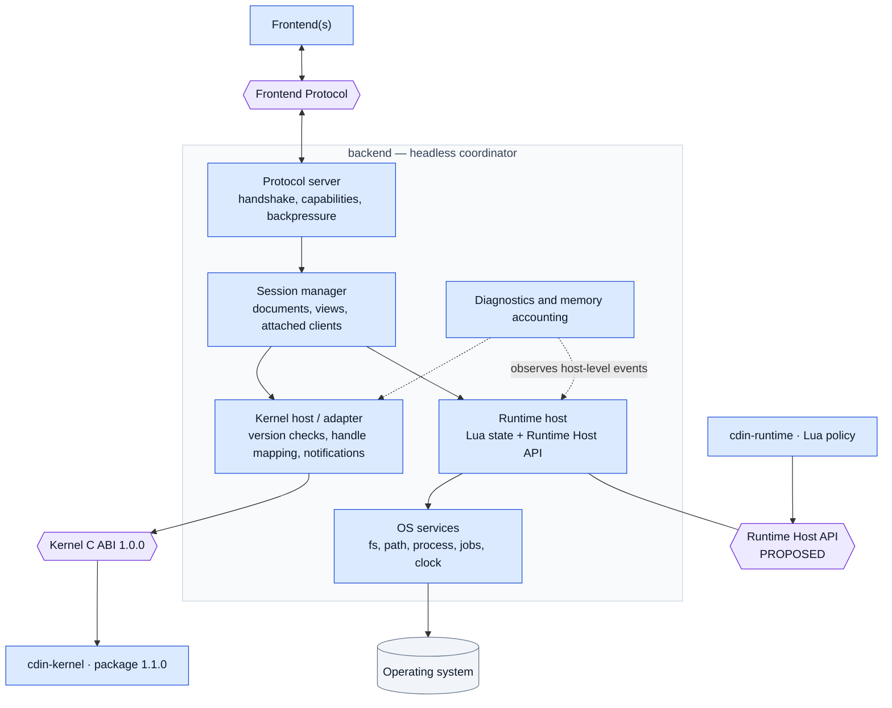
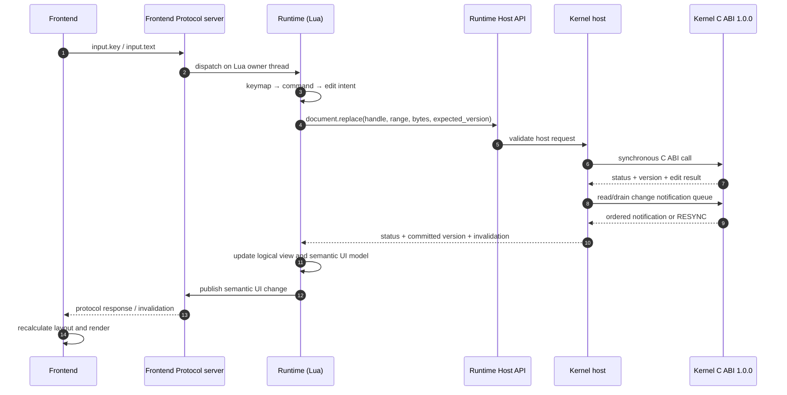

# Backend

The backend is the headless core of CDIN. It hosts the kernel and the runtime, provides OS services, relays the runtime's UI model, and serves the Frontend Protocol. It has no knowledge of any display toolkit and can run with no frontend attached.

"Backend" does **not** mean a network server and does not mean SDL. SDL is a *frontend* concern ([frontend.md](frontend.md)).

## 1. Responsibilities

1. **Session**: tracks open documents, views and attached frontends.
2. **Kernel host**: creates the kernel with an allocator and limits, owns its lifetime, forwards requests, converts kernel events into UI invalidations.
3. **Runtime host**: owns the Lua state, loads the runtime, exposes the runtime host API to Lua, runs Lua on the main thread.
4. **OS services**: files, paths, processes, jobs, clock, directory listing, file metadata.
5. **Protocol server**: handshake, capability negotiation, input routing to the runtime, UI-model relay, backpressure.
6. **Diagnostics**: logging, memory accounting.

The native bridge is deliberately hidden behind the Runtime Host API. Direct Lua-to-kernel linking is not the target boundary. Candidate bridge mechanisms (Lua C API, LuaJIT FFI, MetaCall) remain an open implementation choice in [OD-32](../adr/open-decisions.md); none is a kernel dependency.

## 2. Internal structure

*Caption: target internal structure. These boxes are logical responsibilities, not promises of separate binaries or repositories. The Backend is the direct client of the kernel; the Lua runtime depends on the Runtime Host API, not on `include/cdin/kernel.h`. The runtime host API remains proposed.*

## 3. Requirements

- **BE-001** `PROPOSED` The backend MUST run with no frontend attached and MUST accept frontends attaching and detaching at any time. — *Verify:* INTEG (LIFE-004)
- **BE-002** `PROPOSED` The backend MUST NOT include any display-toolkit header or link any display toolkit (ARCH-042). — *Verify:* STATIC
- **BE-003** `PROPOSED` The backend is the only direct client of the kernel ABI (ARCH-041, ARCH-043). — *Verify:* STATIC
- **BE-004** `PROPOSED` The backend creates the kernel with its allocator and limits, performs the ABI version check before use, and shuts it down gracefully (LIFE-001). — *Verify:* INTEG
- **BE-005** `PROPOSED` The OS services are independent of any display toolkit. A change of frontend or of toolkit MUST NOT require a change to them. — *Verify:* STATIC, INSPECT
- **BE-006** `EXISTING` The OS-services layer is already largely separate in the source: filesystem and path modules (`src/fs/`), a libuv-based job loop (`src/loop/`), platform helpers (`src/platform/`). SDL still appears in `src/loop/` and `src/platform/` and must be removed from them. — *Verify:* STATIC — *Anchor:* `src/fs/`, `src/loop/loop.c`, `src/platform/platform.c`
- **BE-007** `EXISTING` Workers never touch Lua; the main thread owns it (ARCH-025). — *Verify:* SAN — *Anchor:* `AGENTS.md §2.3`
- **BE-008** `PROPOSED` The backend never blocks the main thread on unbounded work; file reads, process execution and searching run as jobs (ARCH-023). — *Verify:* INSPECT, PERF
- **BE-009** `PROPOSED` The backend bounds every queue it owns: per-frontend outgoing flush queue, job queue, event queue (ARCH-021, PROTO-021). — *Verify:* PERF, INSPECT
- **BE-010** `PROPOSED` The Lua-visible `system` table is split by owner: OS services (files, process, time), frontend requests (window, clipboard, dialogs, cursor, as protocol requests), and debug hooks (allocation failure injection, memory statistics). — *Verify:* INSPECT — *Anchor (current state):* `src/api/system.c`
- **BE-011** `PROPOSED` The backend spawns processes with argument arrays only, never through a shell (ARCH-024). — *Verify:* STATIC

## 4. OS services contract (summary)

OS services are an internal C API of the backend, not an ABI. Their behaviour is specified so that implementations per platform agree.

| Service | Operations (conceptual) | Notes |
|---|---|---|
| paths | normalize, absolute, join, relative | no dependence on a current working directory except where stated |
| fs | read in chunks, write in chunks, stat, list directory, atomic replace | streaming, bounded (ARCH-021) |
| process | spawn with argument array, pipes, wait asynchronously | never through a shell (BE-011) |
| jobs | run on a worker, cancel, post result to the main thread | the only way off-main-thread work reaches Lua |
| clock | monotonic and wall time | the kernel never calls it (KERNEL-007) |

## 5. Interaction summary — command to committed edit

*Caption: `PROPOSED` for the cross-component path. Kernel call synchronicity, version-checked editing and bounded notifications are present in ABI 1.0.0. This diagram does not imply that the Runtime Host API or Frontend Protocol wire format is already implemented.*

## 6. State owned

Session (open documents, attached frontends); OS handles; the Lua state; logging and accounting. It does **not** own document content (kernel), selections (view in the runtime), or visual layout (frontend).
