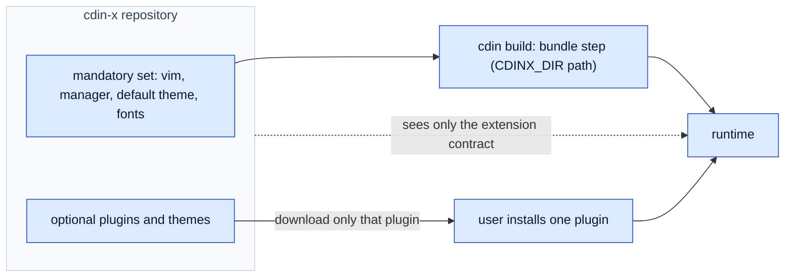

# cdin-x

`cdin-x` is the optional extension ecosystem. It lives in its own repository and is completely independent of how the core is organised. **It is not a layer of `cdin`**; it is a separate product that `cdin` can bundle from.

## 1. What it contains

- The **mandatory set** that a standalone `cdin` build bundles: the vim plugin, the extension manager, the default theme, the fonts (`EXISTING`).
- Every **optional** extension, theme and workflow users may install.

## 2. Relationship to the core

*Caption: the build takes a directory path; installs download single plugins. Nothing clones the whole repository.*

## 3. Requirements

- **EXT-050** `ACCEPTED` `cdin-x` is fully separate from `cdin` and `cdin` is fully separate from `cdin-x`; `cdin` builds alone. — *Verify:* INTEG (ARCH-010)
- **EXT-051** `ACCEPTED` The vim plugin is mandatory in a standalone `cdin` build. Its source lives in `cdin-x`; the build bundles it. — *Verify:* INTEG (EXT-010)
- **EXT-052** `ACCEPTED` `cdin-x` MUST NOT have direct access to the kernel (ARCH-006, EXT-001). — *Verify:* INSPECT, STATIC
- **EXT-053** `PROPOSED` `cdin-x` MUST NOT depend on the Frontend Protocol, the backend, or any frontend. It depends only on the extension contract. UI is expressed through the runtime's declarative widgets and, optionally, canvas (EXT-030, EXT-031). — *Verify:* INSPECT
- **EXT-054** `ACCEPTED` Installing a plugin or theme downloads only that plugin or theme (EXT-020). — *Verify:* INTEG
- **EXT-055** `ACCEPTED` The extension panel's search only checks availability, installs nothing and clones nothing (EXT-021). — *Verify:* INTEG
- **EXT-056** `PROPOSED` The `cdin-x` repository declares the extension-contract version range it targets (EXT-040). — *Verify:* INSPECT
- **EXT-057** `EXISTING` The current process rule: work on `cdin` never edits `cdin-x`; what `cdin-x` must do is reported separately. — *Verify:* INSPECT — *Anchor:* `AGENTS.md §2.1`

## 4. What `cdin-x` is allowed to assume

Only what is in the extension contract, and the contract's own statement of what is **not** guaranteed ("What is not guaranteed" section). A behaviour not in the contract can change without notice.

## 5. Not part of this specification

The internal organisation of `cdin-x`, the extension manager's design, the packaging format of plugins and the registry for availability checks belong to `cdin-x` itself. This specification constrains only the boundary.

## 6. Status of what was inspected

The `cdin-x` repository has **not** been inspected for this specification. Statements here come from `cdin`'s own documents and build scripts (`docs/architecture/extension-contract.md`, `mk/bundle.mk`, `scripts/assemble_data.py`) and from the owner's stated requirements.
