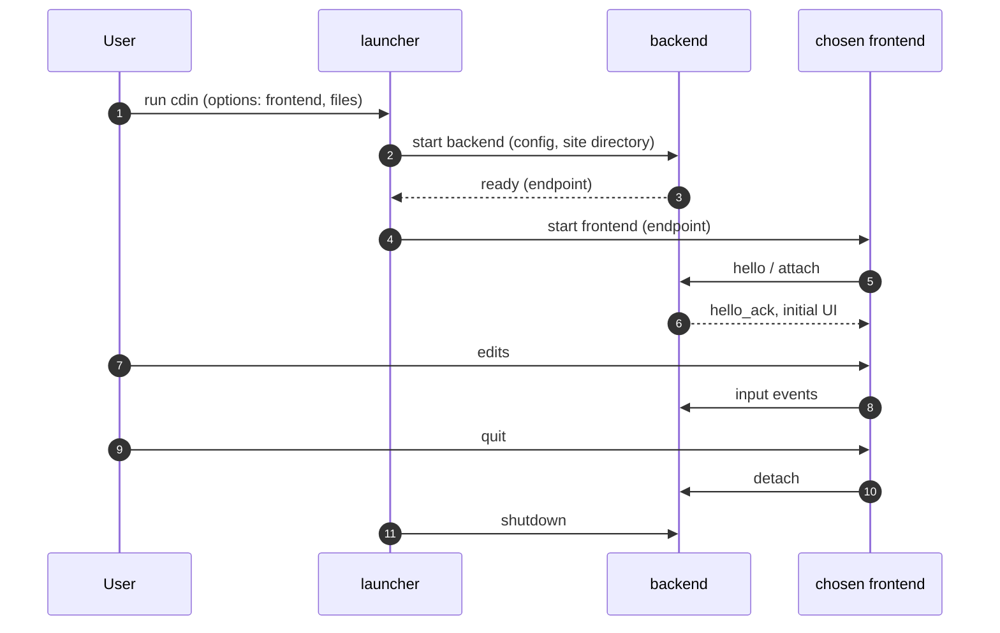
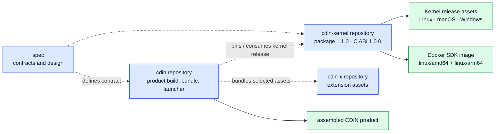

# cdin: the composition root

`cdin` is the point where the components of CDIN are assembled, built, bundled and launched. It contains no domain logic.

## 1. Purpose

- Build every component for every supported platform.
- Bundle the runtime, the mandatory set from `cdin-x`, and frontends into a runnable product.
- Release (packaging, installers, workflows) and developer tooling (benchmarks, checks, size and memory measurements).
- Launch: choose a frontend, start the backend, attach.

## 2. Is and is not

| Is | Is not |
|---|---|
| The only place that depends on everything | A place where kernel, runtime, backend or frontend logic is reimplemented |
| Build files, release workflows, installer scripts, launcher | Depended on by any component |
| The home of tooling that checks the include-direction rules | A shared-code repository (ARCH-005) |

## 3. Requirements

- **ROOT-001** `ACCEPTED` The composition root MUST NOT reimplement kernel, runtime, frontend or backend logic (ARCH-001). — *Verify:* INSPECT
- **ROOT-002** `PROPOSED` No component MAY depend on the composition root (ARCH-045). — *Verify:* STATIC
- **ROOT-003** `EXISTING` The build can produce the binary alone (`make bin`) or a runnable tree (`make`, which assembles `data/`). — *Verify:* INTEG — *Anchor:* `mk/bundle.mk`
- **ROOT-004** `EXISTING` The only build-time knowledge of `cdin-x` is the path variable `CDINX_DIR`; the default is a sibling checkout (`../cdin-x`). Nothing is fetched at build or run time. — *Verify:* INTEG — *Anchor:* `mk/bundle.mk`, `scripts/assemble_data.py`
- **ROOT-005** `EXISTING` The `bare` build target produces a tree with the core, fonts and themes and no plugins, used to measure startup and idle behaviour without any extension. — *Verify:* INTEG — *Anchor:* `mk/bundle.mk` (`bare`)
- **ROOT-006** `PROPOSED` The launcher selects a frontend by name and passes it the backend's endpoint (in-process or serialized transport). Adding a frontend MUST NOT require changing the backend. — *Verify:* INTEG
- **ROOT-007** `PROPOSED` The composition root MUST check ABI compatibility of the components it assembles (ABI-020) and refuse an incompatible set at build or start. — *Verify:* INTEG
- **ROOT-008** `PROPOSED` Include-direction rules (ARCH-046) are enforced by static tooling in the implementation repositories; the Spec repository only reports document inventory metadata. — *Verify:* STATIC
- **ROOT-009** `EXISTING` Product release workflows for Linux, Windows and macOS and the website deployment are defined in the `cdin` repository. — *Verify:* INSPECT — *Anchor:* `.github/workflows/`
- **ROOT-010** `PROPOSED` The standalone `cdin-kernel` repository is consumed by `cdin` as a pinned version (a release or a submodule at a tag), never as a floating branch. — *Verify:* INSPECT

## 4. Existing layout mapped here

| Existing | Role |
|---|---|
| `Makefile`, `mk/*.mk` | build orchestration (`platform`, `version`, `config`, `build`, `test`, `check`, `install`, `bundle`) |
| `scripts/_cdin/*.py`, `scripts/*.py` | install, update, uninstall, build, bench, size and measurement tooling |
| `Dockerfile`, `docker-compose.yml` | containerized builds |
| `.github/` | CI, release, issue and PR templates |
| `psx.yml` | project-structure configuration |
| `docs/` | documentation of the product (the specification lives in the `spec` repository) |

The tooling stays here; it depends on the layout of `src/` and on the Makefile, so a separate scripts repository would break whenever the layout changes. (Rationale in [ADR-0001](../adr/ADR-0001-repository-topology.md).)

## 5. Launch sequence

*Caption: `PROPOSED`. Today the GUI and backend are one process and the launcher is `src/main.c`.*

## 6. Build and release boundaries

*Caption: repository responsibility map, not a claim that every release asset has been published. The `cdin-kernel` 1.1.0 source snapshot contains a tag-triggered multi-architecture Docker publishing workflow, but a successful push to a named public Docker Hub repository was not verified as part of this Spec review.*
