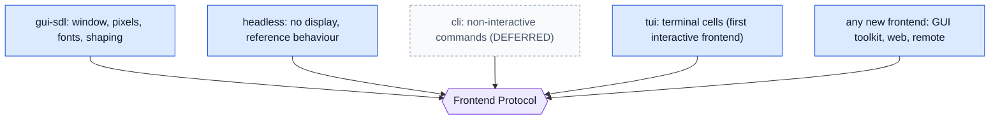

# Frontends

A frontend presents the editor and collects input for one environment: an SDL window, a terminal, a command line, a headless test harness, later perhaps a web page. It speaks the [Frontend Protocol](../architecture/frontend-protocol.md) and nothing else. Frontends are **peers**; none is privileged. The semantic and deterministic-CBOR wire contract is accepted as Protocol 1.0.0 by ADR-0018 and ADR-0020. The shared Frontend Core provides the client API; Backend provides the reference C codec and protocol server.

## 1. Responsibilities

1. Input: translate environment events (keys, mouse, text, paste, resize, focus) into protocol messages.
2. **Visual layout**: wrapping, tab expansion, shaping (including Persian), bidi reordering, scroll position in the environment's own units.
3. Drawing: pixels (GUI) or cells (TUI) from the semantic UI model.
4. Environment services requested by the backend: clipboard, dialogs, cursor, window title.
5. Capability declaration (`hello`).

A frontend **does not**: own documents, selections, commands or keymaps; interpret keybindings; speak to the kernel, runtime or OS services of the backend.

## 2. The family

*Caption: `ACCEPTED` target family. The headless adapter is the protocol reference; TUI is the first interactive target; CLI remains deferred. This does not claim that the TUI has shipped.*

### Request and render flow

```mermaid
flowchart LR
    ENV["Window / terminal / test driver"] --> INPUT["Input adapter<br/>keys, text, paste, resize"]
    INPUT --> FP{{"Frontend Protocol"}}
    FP <--> BE["Backend protocol server"]
    BE --> MODEL["Semantic UI model<br/>from runtime"]
    MODEL --> LAYOUT["Frontend layout<br/>wrapping, shaping, bidi, scroll"]
    LAYOUT --> RENDER["Pixels / terminal cells / test trace"]
    classDef comp fill:#dbeafe,stroke:#1d4ed8,color:#0f172a
    classDef contract fill:#ede9fe,stroke:#6d28d9,color:#0f172a
    classDef external fill:#f1f5f9,stroke:#64748b,color:#0f172a
    class ENV external
    class INPUT,BE,MODEL,LAYOUT,RENDER comp
    class FP contract
```

The protocol carries **semantic state and intent**, not toolkit objects or pixels. The frontend may cache derived layout, but it must invalidate that cache against document versions and may discard it without losing canonical document state. Protocol 1.0.0 fixes the four-byte big-endian length prefix, deterministic CBOR envelope and message schemas. Frontend Core supplies the shared client API; Backend supplies the reference codec and server (ADR-0018).

## 3. Requirements

- **FE-001** `ACCEPTED` Frontends are peers; the GUI MUST NOT use any private backend call the protocol cannot express (see [frontend-protocol.md](../architecture/frontend-protocol.md)). — *Verify:* INSPECT, STATIC
- **FE-002** `ACCEPTED` A frontend depends only on the Frontend Protocol and its own toolkit; it MUST NOT include kernel, runtime or backend headers (ARCH-043). — *Verify:* STATIC
- **FE-003** `ACCEPTED` Every frontend MUST declare its capabilities and MUST implement the mandatory `core` namespace; features outside the declared capabilities are never sent to it. — *Verify:* CONF, INTEG
- **FE-004** `ACCEPTED` Visual layout state (wrapping, shaping, pixel or cell scroll) is private to the frontend and disposable: discarding it MUST NOT lose editor state (PROTO-001). — *Verify:* INTEG
- **FE-005** `ACCEPTED` A frontend MUST discard cached line content whose version is older than one it holds (PROTO-023) and MUST re-request after `view.invalidate`. — *Verify:* CONF
- **FE-006** `ACCEPTED` Text shaping and bidi are performed by the frontend, using its own font machinery. The Persian-aware text pipeline that exists today in Lua (`data/core/text/`) is the starting point for the GUI frontend and is not part of the kernel (RT-009). — *Verify:* INSPECT
- **FE-007** `ACCEPTED` The headless frontend is the reference for protocol behaviour: it records every received message and can replay scripted input. It has no display and no dependencies beyond the protocol. — *Verify:* INTEG, CONF
- **FE-008** `DEFERRED` The `cli` frontend: a non-interactive frontend that attaches to a session to run commands and print results. — *Verify:* INSPECT
- **FE-009** `ACCEPTED` The TUI is the first interactive frontend target. It is a full-screen, Neovim-like terminal editor using cell units and a capability subset; it is not the non-interactive CLI. Plugin canvas is unavailable unless a frontend explicitly advertises and implements the optional canvas capability. — *Verify:* INSPECT, INTEG

- **FE-010** `ACCEPTED` Ship one `cdin-editor/frontend` repository with peer adapters for `core`, `gui-sdl`, `tui` and `headless`. The shared core owns protocol/client abstractions and common non-rendering utilities; each frontend owns its own rendering and layout implementation. — *Verify:* INSPECT, STATIC
- **FE-011** `ACCEPTED` The TUI is the first interactive frontend target and is a full-screen terminal editor with a Neovim-like interaction model. A non-interactive command runner remains a separate `cli` target and stays `DEFERRED`. — *Verify:* INSPECT, INTEG
- **FE-012** `ACCEPTED` GUI and TUI MUST NOT be forced through one shared rendering pipeline. They share the semantic protocol and reusable non-presentation contracts only; GUI pixels/font metrics and terminal cells/layout remain adapter-owned. — *Verify:* INSPECT, STATIC
- **FE-013** `ACCEPTED` Ordinary plugin UI is expressed through declarative widgets. Free-form drawing is an optional `canvas` capability; frontends without it MUST degrade gracefully or report that the plugin surface is unavailable. — *Verify:* INSPECT, INTEG
- **FE-014** `ACCEPTED` Runtime owns UI policy and semantic state in PUC Lua 5.4. Native C owns protocol encoding/decoding, platform event integration, input adapters and frontend rendering backends. Neither Runtime nor a frontend accesses private Kernel symbols or handles. — *Verify:* INSPECT, STATIC
- **FE-015** `ACCEPTED` A central capability registry defines capability names and their semantics. A frontend's requested capabilities are distinct from the capabilities actually accepted for a session; only capabilities implemented by both peers may be advertised as active or used. — *Verify:* CONF, INTEG
- **FE-016** `ACCEPTED` Frontends send key identity/action/modifier information through `input.key` and committed text (including IME output) separately through `input.text`. Frontends do not resolve editor keymaps or commands; Runtime owns keymap interpretation. — *Verify:* CONF, INTEG
- **FE-017** `ACCEPTED` The semantic UI model permits a nullable `active_view` on a layout leaf and defines `ui.options` as a typed options map rather than an unstructured bag. The initial option keys are `title:text`, `tab_width:uint` (1..64), `wrap:bool`, `line_numbers:bool`, `relative_line_numbers:bool`, `cursor_shape:text` (`block`, `bar` or `underline`) and `cursor_blink:bool`. — *Verify:* CONF, INSPECT
- **FE-018** `ACCEPTED` Frontends own text presentation: UTF-8 decoding for display, grapheme-aware visual navigation, shaping, bidirectional reordering, wrapping, tab expansion and scroll geometry. Logical document positions remain byte offsets; TUI layout uses terminal cells and MUST map visual actions back to logical byte positions. — *Verify:* INTEG, INSPECT
- **FE-019** `ACCEPTED` The interactive TUI event loop MUST multiplex terminal input, Backend readiness/messages, resize and termination events without busy-waiting. It MUST restore raw mode, cursor and screen state on normal exit, handled errors and catchable termination signals routed through its cleanup path, and MUST provide deterministic startup/teardown. No cleanup guarantee is made for uncatchable termination (for example `SIGKILL`) or power loss. — *Verify:* INTEG, SAN

## 4. gui-sdl

- **FE-020** `ACCEPTED` `gui-sdl` owns every use of SDL. After migration SDL appears in no other component (ARCH-042). — *Verify:* STATIC
- **FE-021** `EXISTING` The pre-extraction `cdin` monolith contains the legacy SDL window, system-service, main-loop and platform code listed by these anchors. This is migration evidence only; it does not claim that the separate `frontend` repository or its `gui-sdl` target has already been extracted. — *Verify:* STATIC — *Anchor:* `src/core/window.c`, `src/api/system.c`, `src/main.c`, `src/ui/renderer.c`
- **FE-022** `EXISTING` The pre-extraction `cdin` renderer contains a cached command-list/render-cache implementation. This is legacy migration evidence only, not proof of a current standalone `gui-sdl` frontend. — *Verify:* INSPECT — *Anchor:* `src/ui/renderer.h`, `src/ui/renderer_cache.c`
- **FE-023** `ACCEPTED` SDL-specific features (window controls, title-bar hit regions, native dialogs) become capabilities (`hit_regions`, `dialogs`) so another GUI toolkit can implement them or decline. — *Verify:* INSPECT, INTEG

## 5. Rewriting a frontend

A frontend can be replaced by a different implementation, in a different language, provided it passes the protocol conformance vectors ([conformance.md](../testing/conformance.md)). It may use the shared client API in `cdin-editor/frontend` or implement the accepted wire contract independently; it must not depend on Backend internals.

## 6. State owned

Window or terminal handle; input device state; visual layout caches; fonts and glyph caches; capability set. Nothing that must survive a frontend restart.
