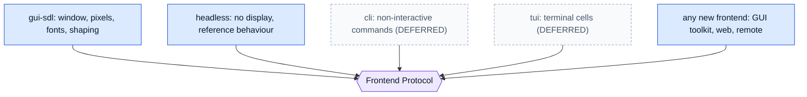

# Frontends

A frontend presents the editor and collects input for one environment: an SDL window, a terminal, a command line, a headless test harness, later perhaps a web page. It speaks the [Frontend Protocol](../architecture/frontend-protocol.md) and nothing else. Frontends are **peers**; none is privileged.

## 1. Responsibilities

1. Input: translate environment events (keys, mouse, text, paste, resize, focus) into protocol messages.
2. **Visual layout**: wrapping, tab expansion, shaping (including Persian), bidi reordering, scroll position in the environment's own units.
3. Drawing: pixels (GUI) or cells (TUI) from the semantic UI model.
4. Environment services requested by the backend: clipboard, dialogs, cursor, window title.
5. Capability declaration (`hello`).

A frontend **does not**: own documents, selections, commands or keymaps; interpret keybindings; speak to the kernel, runtime or OS services of the backend.

## 2. The family

*Caption: `PROPOSED`. Adding a frontend means writing one more box on the left; nothing on the right changes.*

## 3. Requirements

- **FE-001** `PROPOSED` Frontends are peers; the GUI MUST NOT use any private backend call the protocol cannot express (see [frontend-protocol.md](../architecture/frontend-protocol.md)). — *Verify:* INSPECT, STATIC
- **FE-002** `PROPOSED` A frontend depends only on the Frontend Protocol and its own toolkit; it MUST NOT include kernel, runtime or backend headers (ARCH-043). — *Verify:* STATIC
- **FE-003** `PROPOSED` Every frontend MUST declare its capabilities and MUST implement the mandatory `core` namespace; features outside the declared capabilities are never sent to it. — *Verify:* CONF, INTEG
- **FE-004** `PROPOSED` Visual layout state (wrapping, shaping, pixel or cell scroll) is private to the frontend and disposable: discarding it MUST NOT lose editor state (PROTO-001). — *Verify:* INTEG
- **FE-005** `PROPOSED` A frontend MUST discard cached line content whose version is older than one it holds (PROTO-023) and MUST re-request after `view.invalidate`. — *Verify:* CONF
- **FE-006** `PROPOSED` Text shaping and bidi are performed by the frontend, using its own font machinery. The Persian-aware text pipeline that exists today in Lua (`data/core/text/`) is the starting point for the GUI frontend and is not part of the kernel (RT-009). — *Verify:* INSPECT
- **FE-007** `PROPOSED` The headless frontend is the reference for protocol behaviour: it records every received message and can replay scripted input. It has no display and no dependencies beyond the protocol. — *Verify:* INTEG, CONF
- **FE-008** `DEFERRED` The `cli` frontend: a non-interactive frontend that attaches to a session to run commands and print results. — *Verify:* INSPECT
- **FE-009** `DEFERRED` The `tui` frontend: cell units, a subset of capabilities, plugin canvas limited to cell drawing. — *Verify:* INSPECT

## 4. gui-sdl

- **FE-020** `PROPOSED` `gui-sdl` owns every use of SDL. After migration SDL appears in no other component (ARCH-042). — *Verify:* STATIC
- **FE-021** `EXISTING` Today the SDL code lives in `src/core/window.c`, `src/api/system.c` (window, events, clipboard, dialogs, hit regions), `src/main.c`, `src/loop/` and `src/platform/`, with a very small amount in the renderer (`src/ui/renderer.c`). These are the pieces `gui-sdl` takes over or are rewritten behind the protocol. — *Verify:* STATIC — *Anchor:* `src/core/window.c`, `src/api/system.c`, `src/main.c`, `src/ui/renderer.c`
- **FE-022** `EXISTING` The renderer already behaves as a cached command list (rectangles, text, clip) with a render cache, which suits a software or GPU backend inside `gui-sdl`. — *Verify:* INSPECT — *Anchor:* `src/ui/renderer.h`, `src/ui/renderer_cache.c`
- **FE-023** `PROPOSED` SDL-specific features (window controls, title-bar hit regions, native dialogs) become capabilities (`hit_regions`, `dialogs`) so another GUI toolkit can implement them or decline. — *Verify:* INSPECT, INTEG

## 5. Rewriting a frontend

A frontend can be replaced by a different implementation, in a different language, provided it passes the protocol conformance vectors ([conformance.md](../testing/conformance.md)). The only shared artifact is the protocol; whether a client library for it exists as a repository is [OD-23](../adr/open-decisions.md).

## 6. State owned

Window or terminal handle; input device state; visual layout caches; fonts and glyph caches; capability set. Nothing that must survive a frontend restart.
