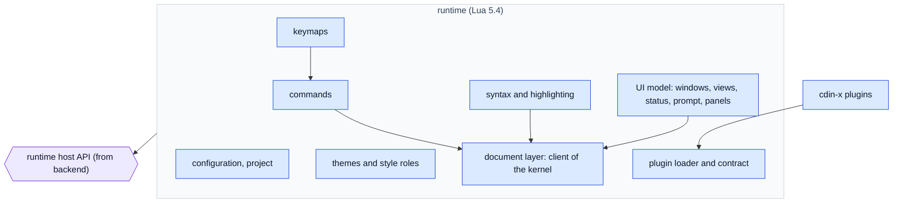

# Runtime

The runtime (`cdin-runtime`) is the **policy layer**: the Lua 5.4 application that is "the editor" from a user's point of view, and the host environment that extensions run in. It executes scripts and customizable behaviours.

## 1. Responsibilities

1. Commands and their registry.
2. Keymaps: resolving raw keys to commands (frontends never interpret keys, PROTO-004).
3. Configuration and project handling.
4. Themes and styles as data (style roles) delivered to frontends.
5. Syntax definitions and highlighting (outside the kernel).
6. The plugin loader and the extension contract's implementation.
7. The **UI model**: views, window layout, status line, prompt, panels.
8. Views: logical editing surfaces owning selections and logical scroll anchors.

## 2. What it is not

The runtime is **not** a document store: it keeps no independent copy of document content or undo history (KERNEL-005, ARCH-050). It does not draw, shape text or know SDL.

## 3. Structure

*Caption: `PROPOSED` structure; the existing Lua core already follows this shape (`data/core/`).*

## 4. Requirements

- **RT-001** `PROPOSED` The runtime is Lua 5.4. Other languages are not part of this phase. — *Verify:* INSPECT
- **RT-002** `EXISTING` Globals are forbidden at run time: the first thing the editor loads is a strict module that errors on any undeclared global. — *Verify:* INTEG — *Anchor:* `data/core/runtime/strict.lua`, `docs/architecture/overview.md`
- **RT-003** `PROPOSED` The runtime MUST NOT hold an independent copy of document content or undo/redo history (ARCH-050, KERNEL-005). — *Verify:* INSPECT
- **RT-004** `PROPOSED` The runtime reaches documents only through the runtime host API provided by the backend. It never loads or links the kernel (ARCH-041). — *Verify:* STATIC
- **RT-005** `EXISTING` The Lua state is single-threaded; workers never touch it (ARCH-025). — *Verify:* SAN — *Anchor:* `AGENTS.md §2.3`
- **RT-006** `PROPOSED` The runtime produces the UI model and sends updates to the backend; the backend relays them as Frontend Protocol messages. The runtime does not know which frontends are attached, only the capabilities in force. — *Verify:* INSPECT, INTEG
- **RT-007** `PROPOSED` The runtime owns keymaps and commands. Frontends send raw keys only (PROTO-004). — *Verify:* INSPECT
- **RT-008** `PROPOSED` Selections and logical scroll anchors are owned by views in the runtime (ARCH-051). The runtime stores opaque selection snapshots in undo units through the kernel (UNDO-020). — *Verify:* INSPECT, CONF
- **RT-009** `PROPOSED` Syntax highlighting, text shaping and bidi processing are outside the kernel. Highlighting is a runtime concern consuming kernel change events; shaping and bidi are frontend concerns. — *Verify:* INSPECT, STATIC
- **RT-010** `PROPOSED` The runtime host API is a versioned contract with the same compatibility discipline as the ABI: documented behaviour only, additive within a major version. — *Verify:* INSPECT
- **RT-011** `PROPOSED` Errors from kernel statuses map one-to-one onto Lua errors with a stable table (code, message, details) (ERR-020). — *Verify:* INSPECT, INTEG
- **RT-012** `PROPOSED` The runtime declares the ABI and protocol versions it requires and the extension-contract version it provides (ABI-020, EXT-040). — *Verify:* INTEG
- **RT-013** `EXISTING` Plugins are directories with `init.lua` or single `.lua` files returning a table with `init(core, config)` and optional `unload()`. — *Verify:* INTEG — *Anchor:* `docs/architecture/extension-contract.md` ("The plugin protocol")
- **RT-014** `EXISTING` The Lua C binding gives every C object reachable from Lua one owner and an explicit `close()` with `__gc` as backstop. — *Verify:* SAN — *Anchor:* `src/lua/handle.c`, `AGENTS.md §2.5`

## 5. Runtime host API (summary)

The Lua-visible environment the runtime and plugins can rely on. It is **partially existing**: tables such as `system`, `renderer`, `search`, `fs`, `path` are registered today in `src/api/api.c`. The target splits and extends them.

| Table (target) | Provided by | Status |
|---|---|---|
| `fs`, `path` | backend OS services | `EXISTING` names (`src/api/api.c`) |
| `doc` | backend, forwarding to kernel | `PROPOSED` (new) |
| `search` | backend, forwarding to kernel search | `PROPOSED` (replaces current `search`) |
| `ui` | backend protocol relay (declarative widgets, canvas capability) | `PROPOSED` (replaces direct `renderer` drawing, see [ADR-0011](../adr/ADR-0011-extension-ui.md)) |
| `system` (OS part) | backend OS services | `EXISTING` names, to be split |
| `renderer` | frontend-private (gui-sdl) during transition | `EXISTING`; retired with shims |

## 6. Transition rules

- **RT-020** `PROPOSED` Every Lua API that is removed or changed during migration stays as a shim that logs one deprecation per process (ARCH-027). — *Verify:* INTEG
- **RT-021** `PROPOSED` During M2 the document layer (`data/core/doc/`) becomes a thin client of the kernel; behaviour visible through the extension contract does not change. — *Verify:* INTEG — see [migration.md](../architecture/migration.md)
