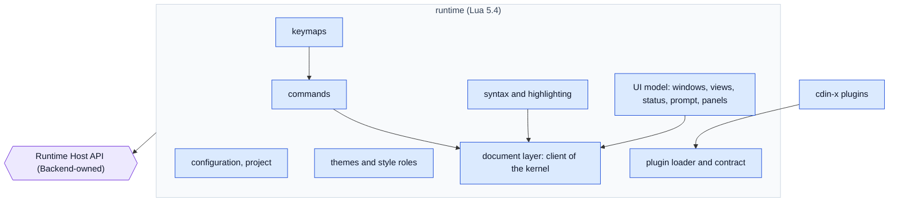

# Runtime

The runtime (`cdin-runtime`) is the **policy layer**: the PUC Lua 5.4 application that implements editor policy and hosts extensions. It executes commands and customizable behaviours. Runtime is already a separately extracted repository with provisional package releases; this does not imply that its Runtime Host API or Extension Contract is stable. The current Runtime source candidate is `1.0.0-rc.1`; the Backend-provided Runtime Host API is frozen at stable version `1.0.0`. The candidate is not a stable package release until the gates in section 8 pass.

## 1. Responsibilities

1. Commands and their registry.
2. Keymaps: resolving raw keys to commands (frontends never interpret keys, PROTO-004).
3. Configuration and project handling.
4. Themes and styles as data (style roles) delivered to frontends.
5. Syntax definitions and highlighting (outside the kernel).
6. The plugin loader and the extension contract's implementation.
7. The **UI model**: views, window layout, status line, prompt, panels.
8. Views: logical editing surfaces owning selections and logical scroll anchors.

## 2. What it is not

The runtime is **not** a document store: it keeps no independent copy of document content or undo history (KERNEL-005, ARCH-050). It does not draw, shape text or know SDL.

## 3. Structure

*Caption: accepted ownership structure. The Runtime Host API and native bridge are Backend-owned; PUC Lua 5.4 C API is the sole supported v1 bridge under [ADR-0019](../adr/ADR-0019-runtime-bridge.md). The Runtime package is extracted, while stable Host API release and production integration remain separate gates.*

## 4. Requirements

- **RT-001** `ACCEPTED` Runtime v1 MUST use PUC Lua 5.4 and the PUC Lua 5.4 C API bridge defined by ADR-0019. LuaJIT, alternate Lua runtimes and multi-language bridge frameworks are not v1 compatibility targets; a future change requires a new ADR and separately versioned compatibility target. — *Verify:* INSPECT, INTEG
- **RT-002** `EXISTING` Globals are forbidden at run time: the first thing the editor loads is a strict module that errors on any undeclared global. — *Verify:* INTEG — *Anchor:* `data/core/runtime/strict.lua`, `docs/architecture/overview.md`
- **RT-003** `ACCEPTED` Runtime MUST NOT own or retain canonical document bytes, document versions, snapshots or undo/redo history. Authoritative document state and history remain in Kernel. Runtime MAY retain transient read results and derived disposable caches only when associated with a specific document version and invalidated or rebuilt after version changes or resynchronization. Runtime document objects are clients/metadata wrappers around opaque Backend Host handles. — *Verify:* INSPECT, INTEG
- **RT-004** `ACCEPTED` Runtime MUST access document operations only through the versioned Runtime Host API supplied by Backend. Runtime MUST NOT include, link or load the Kernel ABI, inspect Kernel structs, call Kernel symbols or own Kernel handles. Backend's private Kernel adapter is the only layer permitted to call the public Kernel C ABI. Extensions MUST NOT access Backend-private or Kernel-private interfaces. — *Verify:* STATIC
- **RT-005** `EXISTING` The Lua state is single-threaded; workers never touch it (ARCH-025). — *Verify:* SAN — *Anchor:* `AGENTS.md §2.3`
- **RT-006** `ACCEPTED` Runtime owns semantic editor UI state and publishes complete versioned UI-model snapshots through the Host API. Backend validates and projects snapshots into Frontend Protocol messages atomically per client/flush group, and owns queueing, backpressure, sequence numbers, acknowledgements, resynchronization and per-client delivery. Runtime MUST NOT encode Protocol frames, select transports or manage Frontend connections. Frontends own geometry, rendering and visual presentation. Runtime may consume only the effective capability set exposed by Backend; requested or merely registered capabilities are not active capabilities. — *Verify:* INSPECT, INTEG
- **RT-007** `ACCEPTED` Runtime owns command registration/execution, keymap resolution, editor command policy and command context. Frontends MUST send key events and committed text as distinct input event classes; they MUST NOT resolve editor keymaps or invoke Runtime command implementations directly. Runtime resolves key events to commands and applies policy through document/view Host services. This requirement does not prescribe a universal default keymap or built-in command catalogue. — *Verify:* INSPECT, INTEG
- **RT-008** `ACCEPTED` Runtime views own logical selections and logical scroll anchors represented as canonical byte offsets. Kernel stores opaque selection snapshots per the undo contract; it does not own view state or persistent Runtime anchors. Runtime transforms view positions from complete Kernel change notifications and MUST resynchronize from an authoritative snapshot when notification history is incomplete, truncated or otherwise insufficient. Frontends own visual cursor/selection mapping and visual scroll state. — *Verify:* INSPECT, CONF, INTEG
- **RT-009** `ACCEPTED` Runtime owns syntax definitions, tokenization/highlighting policy and semantic style roles. Frontends own text decoding for display, grapheme-based visual navigation, shaping, bidi, wrapping, tab expansion and rendering. Kernel owns canonical bytes and published byte/position conversion primitives. Runtime MUST NOT infer canonical document offsets from rendered or decoded display strings. — *Verify:* INSPECT, STATIC
- **RT-010** `ACCEPTED` Runtime Host API is a separately versioned compatibility contract provided by Backend. Only documented behavior is contractual. Within a stable major version, additive compatible methods/capabilities may use a minor increment and compatible corrections a patch increment; breaking changes require a major increment. A `0.x` Host API remains provisional and does not promise stable compatibility. Host API `1.0.0` is the frozen stable contract defined in [Runtime Host API 1.0.0](../contracts/runtime-host-api.md). Its compatibility rule is same-major and minimum-minor; additive 1.x minors are compatible, breaking changes require a major increment. — *Verify:* INSPECT
- **RT-011** `PROPOSED` Kernel statuses MUST retain their stable status identity and typed details when surfaced to Lua. Human-readable messages MUST NOT be used as compatibility keys. Known Kernel statuses MUST NOT be collapsed into a generic internal error. The stable status identity and typed-detail representation are defined by [Runtime Host API 1.0.0](../contracts/runtime-host-api.md); production adapter conformance vectors remain a verification gate. — *Verify:* INSPECT, INTEG, CONF
- **RT-012** `ACCEPTED` Runtime package metadata MUST declare its package version, required Runtime Host API compatibility range and Extension Contract version/range it provides. Backend detects and enforces Kernel ABI compatibility and negotiates/enforces Frontend Protocol compatibility; Runtime MUST NOT independently negotiate either. Backend exposes only validated compatibility descriptors and effective capabilities to Lua. — *Verify:* INSPECT, INTEG
- **RT-013** `EXISTING` The legacy plugin entry shape is a directory with `init.lua` or a single `.lua` file returning a table with `init(core, config)` and optional `unload()`. — *Verify:* INTEG — *Anchor:* `docs/architecture/extension-contract.md` ("The plugin protocol")
- **RT-014** `EXISTING` The Lua C binding gives every C object reachable from Lua one owner and an explicit `close()` with `__gc` as backstop. — *Verify:* SAN — *Anchor:* `src/lua/handle.c`, `AGENTS.md §2.5`
- **RT-015** `ACCEPTED` Runtime v1 loader MUST resolve only explicit extension roots/catalog entries supplied by CDIN composition or the selected bundle; it MUST NOT perform remote fetch/clone or unrestricted filesystem discovery. A loaded extension MUST execute under Runtime-owned lifecycle, capability and cleanup controls and MUST NOT receive Kernel handles, native pointers or Backend-private APIs. Path traversal outside declared roots MUST be rejected. Duplicate precedence, dependency/cycle handling, module isolation, metadata schema and unload-failure semantics remain open implementation details and MUST NOT be inferred from this requirement. — *Verify:* INTEG
- **RT-016** `ACCEPTED` Every native C object reachable from Lua MUST have one Backend-owned lifetime authority and an explicit deterministic `close()`; `__gc` is a best-effort backstop only. Release MUST be at most once. Lua callbacks, allocation and GC MUST NOT execute while a Kernel lock is held. — *Verify:* SAN, INTEG

## 5. Runtime host API (summary)

The Lua-visible environment the runtime and plugins can rely on. The legacy integrated implementation registers tables such as `system`, `renderer`, `search`, `fs` and `path` in `src/api/api.c`; the target contract separates Runtime policy APIs from Backend Host services. These legacy names are not a promise that all current tables survive unchanged.

| Table (target) | Provided by | Status |
|---|---|---|
| `fs`, `path` | backend OS services | `EXISTING` names (`src/api/api.c`) |
| `doc` | backend, forwarding to kernel | `PROPOSED` (new) |
| `search` | backend, forwarding to kernel search | `PROPOSED` (replaces current `search`) |
| `ui` | backend protocol relay (declarative widgets, canvas capability) | `PROPOSED` (replaces direct `renderer` drawing, see [ADR-0011](../adr/ADR-0011-extension-ui.md)) |
| `system` (OS part) | backend OS services | `EXISTING` names, to be split |
| `renderer` | frontend-private (gui-sdl) during transition | `EXISTING`; retired with shims |

## 6. Native boundary and language bridge

The stable native document boundary is the Kernel public C ABI, called only by Backend's private Kernel adapter. Runtime never links or loads the Kernel ABI. Backend creates and owns `lua_State`, registers native Host callbacks and enforces the Runtime owner thread. Runtime and extension code execute only on that owner thread. Worker threads and Kernel notification wakeups may signal the Backend loop but MUST NOT enter Lua or invoke Lua callbacks directly.

PUC Lua 5.4 C API is the only supported Runtime v1 bridge, as accepted in [ADR-0019](../adr/ADR-0019-runtime-bridge.md), which resolves OD-32. LuaJIT FFI and MetaCall are not v1 alternatives. Backend owns native userdata and opaque Host handles; Runtime receives structured values and opaque Host-level identities only. Extensions never receive native pointers, Kernel handles or Backend-private objects. Lua allocation, GC and callbacks MUST NOT execute while a Kernel lock is held. Changing the bridge requires a new ADR and compatibility target.

## 7. Version ownership

| Version axis | Owner / enforcement point | Meaning |
|---|---|---|
| Runtime package version | Runtime repository | Version of the Runtime source/package; does not imply Host API stability. |
| Runtime Host API version | Backend provides and advertises | Compatibility contract between Backend and Runtime. |
| Kernel ABI version | Backend Kernel adapter detects/enforces | Native Kernel boundary; Runtime does not negotiate it. |
| Frontend Protocol version | Backend/Frontend session layer negotiates/enforces | Wire/session compatibility; Runtime does not negotiate it. |
| Extension Contract version | Runtime provides; extension loader validates | Compatibility boundary between Runtime and extensions. |

## 8. Runtime v1 scope and transition rules

Runtime v1 is the policy and extension host over Kernel, Backend and Frontend; it is not a claim that the complete CDIN product or every Frontend target is production complete. Its acceptance boundary includes PUC Lua 5.4, Backend-owned bridge/Host boundary, Kernel-owned document truth, versioned Host API, deterministic status identity and typed Lua error mapping (with production adapter conformance pending RT-011), commands/keymaps, Runtime-owned logical views and semantic UI model, Backend atomic projection/Protocol delivery, Frontend rendering, explicit extension lifecycle/capability isolation and a tested Host-backed document client. Stable Runtime 1.0.0 publication additionally requires live native Backend→Lua Runtime→Kernel integration, native lifecycle/error-mapping conformance, and closure or explicit scoping of RT-013, RT-020 and RT-021.

Regex until Kernel support, Kernel anchors, search normalization profiles, hot-swap/state transfer, cross-document parallel mutation, complete GUI/TUI/Headless product delivery, non-interactive CLI and concrete socket/named-pipe transport implementations are not Runtime v1 responsibilities. Their status remains governed by the relevant Open Decisions and component contracts.

- **RT-020** `PROPOSED` A compatibility shim MUST be provided only for a legacy Lua API explicitly listed in an owner-approved migration inventory as deprecated-but-supported. Each deprecated API identity MUST emit at most one warning per process with a stable replacement reference. APIs that cannot be preserved without violating accepted ownership boundaries MUST be listed as intentionally removed with migration guidance; they MUST NOT be emulated through private renderer, Kernel or transport access. The inventory and transition window remain prerequisites for acceptance. — *Verify:* INTEG
- **RT-021** `PROPOSED` During migration, Runtime's document layer MUST preserve behavior observable through the approved extension contract and editor commands, except for explicitly approved/documented changes in the migration inventory. Runtime document objects remain thin clients over Backend Host handles; Kernel owns document bytes, versions, snapshots and history. Undocumented private fields and internal implementation identity are not compatibility promises. Acceptance requires a black-box inventory and parity tests for every retained public operation. — *Verify:* INTEG — see [migration.md](../architecture/migration.md)

### Runtime v1 verification gates

Before a stable Runtime 1.0.0 release, the integrated test suite MUST exercise the real PUC Lua 5.4 bridge and Kernel lifecycle, including owner-thread enforcement, Host API compatibility checks, document create/read/edit/version/undo/redo/close, notification overflow/resynchronization, typed status propagation, userdata cleanup/failure injection, atomic UI projection, per-client ACK/backpressure and shutdown. Fake Host tests are useful unit tests but do not replace the live native integration gate.
