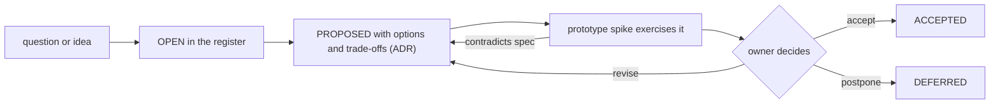

# The specification (this repository)

How this repository works, so that it stays correct against real code instead of becoming paper.

## 1. Purpose

- Hold the architecture and contracts of CDIN in one authoritative place.
- Record decisions and open questions explicitly (ADRs and the Open Decisions Register).
- Describe how every requirement will be verified.
- Report honestly what was inspected, what is decided and what is not.

It is **design only**: no implementation, no test runner, no code beyond non-normative sketches.

## 2. Requirements on the specification itself

- **SPEC-001** `ACCEPTED` The specification MUST be written in English first. — *Verify:* INSPECT
- **SPEC-002** `ACCEPTED` This repository contains design and architecture only; no implementation. — *Verify:* INSPECT
- **SPEC-003** `PROPOSED` Every normative requirement has a stable ID and a named verification method ([conventions.md](../reference/conventions.md)). — *Verify:* STATIC
- **SPEC-004** `PROPOSED` Every `EXISTING` statement carries a code anchor; a statement whose anchor no longer matches is a recorded contradiction. — *Verify:* INSPECT
- **SPEC-005** `PROPOSED` Unresolved items appear only in the Open Decisions Register, never as requirements. — *Verify:* STATIC
- **SPEC-006** `PROPOSED` Diagrams and prose agree; a diagram never shows `OPEN` behaviour as settled. — *Verify:* INSPECT
- **SPEC-007** `PROPOSED` No history or date is invented. A claim about the state of any repository names the snapshot it was drawn from ([status.md](../reference/status.md)). — *Verify:* INSPECT
- **SPEC-008** `PROPOSED` No test is reported as passing unless it was run. The specification currently reports none run. — *Verify:* INSPECT

## 3. Versioning of the specification

- **SPEC-010** `PROPOSED` The specification has a semantic version recorded in [status.md](../reference/status.md). MAJOR increments when an `ACCEPTED` requirement changes meaning; MINOR when requirements are added or promoted; PATCH for editorial fixes. — *Verify:* INSPECT
- **SPEC-011** `PROPOSED` A component states the specification version it claims to conform to (ARCH-014). A conformance claim is meaningful only for requirements that were `ACCEPTED` at that version. — *Verify:* INSPECT
- **SPEC-012** `PROPOSED` Requirement IDs are permanent. A withdrawn requirement keeps its ID, with a note, and is never reused. — *Verify:* STATIC

## 4. Change process

*Caption: the life of a decision.*

- **SPEC-020** `PROPOSED` Only the project owner moves a decision to `ACCEPTED` or `DEFERRED`. — *Verify:* INSPECT
- **SPEC-021** `PROPOSED` A change to an `ACCEPTED` requirement requires an ADR describing the change, its reason and its consequences. — *Verify:* INSPECT
- **SPEC-022** `PROPOSED` A spec change MUST be committed before or together with the code change that depends on it, never after. — *Verify:* INSPECT

## 5. Implementation feedback gates

This is how the specification stays honest against real code although it contains none.

- **SPEC-030** `PROPOSED` Before a component's `PROPOSED` requirements are promoted, a **prototype spike** MUST exercise them against real code: a throwaway implementation of the riskiest parts, run against the planned conformance vectors. — *Verify:* INSPECT
- **SPEC-031** `PROPOSED` The spike's findings are written back: either the specification is confirmed, or the contradicting requirement returns to `PROPOSED` with a note and an ADR. — *Verify:* INSPECT
- **SPEC-032** `PROPOSED` Each phase of [migration.md](../architecture/migration.md) begins with a spike and ends with a gate; the gates are listed there. — *Verify:* INSPECT
- **SPEC-033** `PROPOSED` The riskiest parts to spike first, in order: handle and generation scheme and the FIFO acceptance point (ABI and concurrency); the replace primitive with undo and the version check; region classification under edits (text model); notification queue overflow; the protocol handshake and one `view.lines` round trip; regular-expression step limits. — *Verify:* INSPECT

## 6. Traceability

- **SPEC-040** `PROPOSED` [status.md](../reference/status.md) lists, per area, the count of requirements by status and the count with a recorded verification run. — *Verify:* INSPECT
- **SPEC-041** `PROPOSED` The matrix in [test-matrix.md](../testing/test-matrix.md) maps each requirement group to its verification methods and to the planned conformance-vector families. — *Verify:* INSPECT

## 7. Repository layout and flow

The repository carries a git-flow configuration (`.gix/config`) with `main`, `develop`, `feature/`, `bugfix/`, `release/` and `hotfix/` branches. This specification follows it: day-to-day edits on `feature/` or `bugfix/` branches into `develop`; releases tag `main`. (`EXISTING`, anchor: `.gix/config` in this repository.)
