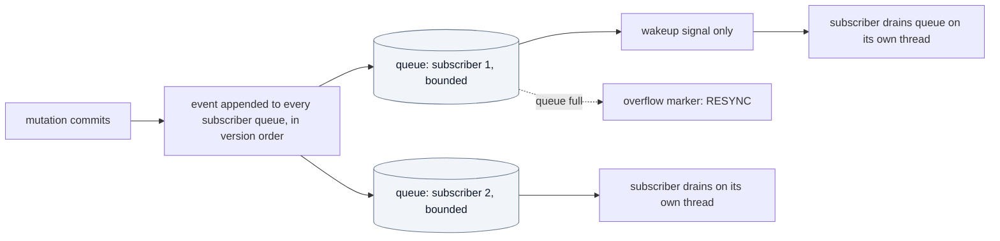
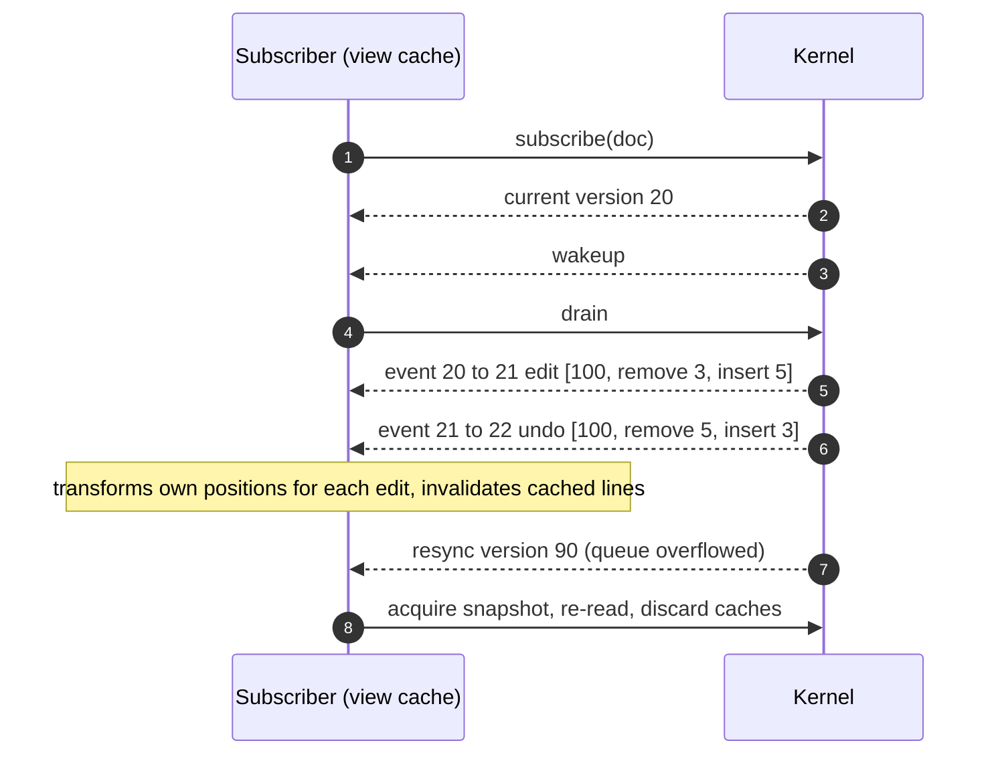

# Change notifications

How clients learn what changed.

## 1. Accepted properties

- **NOTIF-001** `ACCEPTED` Notifications MUST be ordered. — *Verify:* CONF
- **NOTIF-002** `ACCEPTED` Notifications MUST identify the versions before and after the change. — *Verify:* CONF
- **NOTIF-003** `ACCEPTED` Notifications MUST describe the logical change. — *Verify:* CONF
- **NOTIF-004** `ACCEPTED` Notifications MUST NOT depend on the internal storage structure. — *Verify:* CONF, STATIC

## 2. Delivery model

*Caption: `PROPOSED` queue-based delivery. No client code runs while the kernel holds its lock.*

- **NOTIF-005** `PROPOSED` For each document and each subscriber, events are delivered in version order, each exactly once, unless the queue overflows (NOTIF-007). — *Verify:* CONF
- **NOTIF-006** `PROPOSED` Notifications are delivered through per-subscriber queues. The kernel MAY invoke a *wakeup callback* when a queue becomes non-empty; that callback MUST do nothing except signal (ABI-016). The subscriber drains its queue on a thread of its choosing. — *Verify:* CONF, SAN
- **NOTIF-007** `PROPOSED` Each queue is bounded by a configured size. When it would overflow, the kernel drops the *details* of pending events and replaces them by one `RESYNC` marker carrying the current version. A subscriber receiving `RESYNC` MUST discard cached state for the document and re-read from a snapshot. Events are never dropped without that marker. — *Verify:* CONF, PERF (answers open item 8, [OD-08](../adr/open-decisions.md))
- **NOTIF-009** `PROPOSED` Subscribing returns the current version with the subscription, so a subscriber can synchronize a snapshot and the event stream with no gap or duplicate: events delivered are exactly those with `from_version >=` the returned version. — *Verify:* CONF
- **NOTIF-010** `PROPOSED` A subscriber MAY unsubscribe at any time. Pending events are discarded. Closing a document delivers `closed` to each subscriber before the subscription ends (DOC-031). — *Verify:* CONF

## 3. Payload

- **NOTIF-008** `PROPOSED` A change event contains: document id; `from_version`; `to_version`; `kind` (`edit`, `batch`, `transaction`, `undo`, `redo`, `reload`); and an ordered list of edits `{start, removed length, inserted length}`, each expressed in the coordinates of the document state just before that edit. The event does not include inserted bytes by default; clients read them from a snapshot at `to_version`. An event MAY include them if the subscription asked for payload and it is below a size limit. — *Verify:* CONF
- **NOTIF-011** `PROPOSED` `to_version` is exactly `from_version + 1` for every non-`RESYNC` event (DOC-011). — *Verify:* CONF
- **NOTIF-012** `PROPOSED` Other event kinds: `closed`, `history_evicted` (count), `resync` (current version), `saved_state_changed`. — *Verify:* CONF

*Caption: `PROPOSED` subscriber flow including the overflow case.*

## 4. Relationship to other components

- The backend is the kernel's only subscriber in the target architecture. It translates kernel events into `view.invalidate` messages for frontends ([frontend-protocol.md](../architecture/frontend-protocol.md), PROTO-023).
- **NOTIF-020** `PROPOSED` The kernel MUST NOT know whether a subscriber is a view, a highlighter or a frontend (KERNEL-006). — *Verify:* INSPECT

## 5. Existing behaviour

- **EXISTING** The current Lua document exposes three change hooks that plugins and views rely on ("The three hooks"). These are runtime-level hooks, derived from kernel events in the target design; their contract stays with the extension contract. — *Anchor:* `docs/architecture/internals.md` ("The three hooks"), `docs/architecture/extension-contract.md` ("Document hooks")
