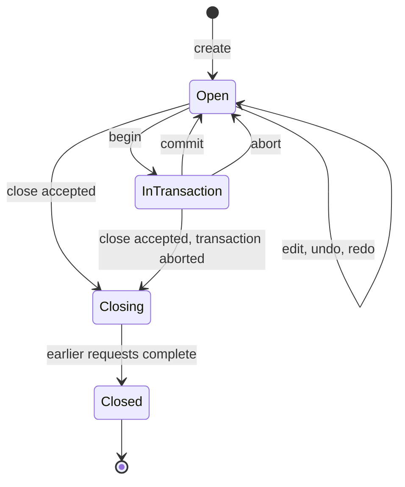

# Document model

## 1. Document

A **document** is an independent unit of text owned by the kernel with: an identity, a content (bytes, see [text-model.md](text-model.md)), a version, an undo/redo history, and a set of subscribers.

- **DOC-001** `ACCEPTED` The kernel MUST support multiple independent documents at once. — *Verify:* CONF
- **DOC-002** `ACCEPTED` Each document has its own identity, its own version, and its own undo/redo history. Operations on one document MUST NOT affect another. — *Verify:* CONF
- **DOC-003** `ACCEPTED` Creating and closing a document are explicit operations. — *Verify:* CONF
- **DOC-004** `ACCEPTED` Using an invalid or closed handle MUST fail with a specific error (`INVALID_HANDLE`). — *Verify:* CONF, SAN

## 2. Handles and identity

- **DOC-005** `PROPOSED` A document handle is a 64-bit value composed of a slot index and a generation. A generation is never reused for the same slot within the process lifetime, so a stale handle can never alias a newer document. — *Verify:* CONF
- **DOC-006** `PROPOSED` The kernel MUST detect handle misuse in constant time and report `INVALID_HANDLE`. — *Verify:* CONF, FUZZ
- **DOC-007** `PROPOSED` Handles are values: copying a handle does not extend a document's life. Only `close` ends it. — *Verify:* INSPECT

## 3. Version

- **DOC-010** `PROPOSED` A version is an unsigned 64-bit integer, per document, starting at a defined initial value on creation. — *Verify:* CONF
- **DOC-011** `PROPOSED` The version increases by exactly one for each committed change to content, including undo, redo and transaction commit (not for each tentative edit inside a transaction). It never decreases and is never reused. — *Verify:* CONF
- **DOC-012** `PROPOSED` An operation that changes no content (for example replacing a range with identical bytes after validation) still counts as a change only if it modifies content; a request that is a no-op by definition returns success without a new version. The exact no-op definition is `PROPOSED` as: empty range and empty bytes. — *Verify:* CONF
- **DOC-013** `PROPOSED` Every result and notification that depends on content carries the version it describes. — *Verify:* CONF

## 4. Creation and loading

- **DOC-020** `PROPOSED` A document is created empty or from a byte buffer. The kernel never reads files (KERNEL-007). Loading from a file is the caller's job (see [data.md](../components/data.md)). — *Verify:* INSPECT, CONF
- **DOC-021** `PROPOSED` Creating from bytes preserves them exactly: no BOM stripping, no normalization of line endings, no replacement of invalid UTF-8 (TEXT-001 to TEXT-005). — *Verify:* CONF, FUZZ
- **DOC-022** `PROPOSED` Loading a large buffer is a request that can be cancelled and is bounded by the document-size limit; exceeding it fails with `LIMIT_EXCEEDED` and creates nothing. — *Verify:* CONF
- **DOC-023** `PROPOSED` Reloading a document's content from new bytes (for example after an external change) is an explicit operation that publishes a new version and a `reload` notification and clears or preserves undo history as the request states. The default is to clear. — *Verify:* CONF

## 5. Lifecycle and in-flight requests

- **DOC-030** `PROPOSED` `close` is itself an ordered request. Requests accepted before it complete first; requests accepted after it fail with `INVALID_HANDLE`. — *Verify:* CONF (closes the proposed answer to open items 6 and 20, [OD-06](../adr/open-decisions.md), [OD-20](../adr/open-decisions.md))
- **DOC-031** `PROPOSED` Closing a document aborts an active transaction on it (TXN-009), releases its undo history, and delivers a final `closed` notification to each subscriber. — *Verify:* CONF
- **DOC-032** `PROPOSED` Snapshots acquired before `close` remain readable until released; the document's memory is freed when the last snapshot is released. Mutation through such a snapshot is impossible. — *Verify:* CONF, SAN

## 6. Saved-state marker

- **DOC-040** `PROPOSED` The kernel keeps a *clean marker*: the caller can mark the current state as saved, and ask whether the current state differs from it. The marker is tied to a position in undo history, so undoing back to the saved state reports not-modified. — *Verify:* CONF
- **DOC-041** `PROPOSED` A caller-supplied opaque 64-bit metadata value per document is stored and returned; the kernel does not interpret it. — *Verify:* CONF

## 7. State diagram

*Caption: `PROPOSED` document states.*

## 8. Multi-document behaviour

- **DOC-050** `PROPOSED` Mutations execute synchronously and serially according to the kernel lock/linearization order, with ordering metadata attached to accepted mutations (CONC-002, CONC-003). ABI 1.0.0 does not promise FIFO by wall-clock arrival. Executing mutations of *different* documents in parallel is not part of this phase; it is recorded as [OD-27](../adr/open-decisions.md). Immutable snapshot readers retain a stable view; ordinary document reads synchronize through the configured caller lock and may briefly wait for a mutation to finish (CONC-005). — *Verify:* CONF, SAN
