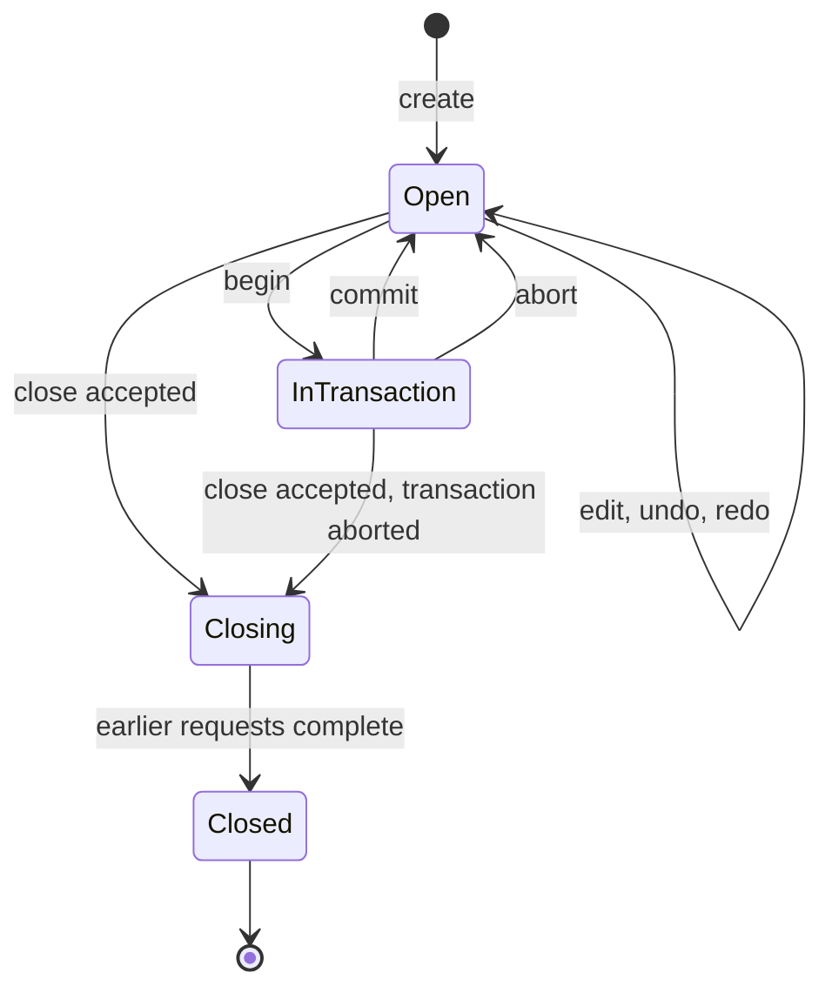

# Document model

## 1. Document

A **document** is an independent unit of text owned by the kernel with: an identity, a content (bytes, see [text-model.md](text-model.md)), a version, an undo/redo history, and a set of subscribers.

- **DOC-001** `ACCEPTED` The kernel MUST support multiple independent documents at once. — *Verify:* CONF
- **DOC-002** `ACCEPTED` Each document has its own identity, its own version, and its own undo/redo history. Operations on one document MUST NOT affect another. — *Verify:* CONF
- **DOC-003** `ACCEPTED` Creating and closing a document are explicit operations. — *Verify:* CONF
- **DOC-004** `ACCEPTED` Using an invalid or closed handle MUST fail with a specific error (`INVALID_HANDLE`). — *Verify:* CONF, SAN

## 2. Handles and identity

- **DOC-005** `ACCEPTED` A document handle is a 64-bit value composed of a slot index and a generation. A generation is never reused for the same slot within the process lifetime, so a stale handle can never alias a newer document. — *Verify:* CONF
- **DOC-006** `ACCEPTED` The kernel MUST detect handle misuse in constant time and report `INVALID_HANDLE`. — *Verify:* CONF, FUZZ
- **DOC-007** `ACCEPTED` Handles are values: copying a handle does not extend a document's life. Only `close` ends it. — *Verify:* INSPECT

## 3. Version

- **DOC-010** `ACCEPTED` A version is an unsigned 64-bit integer, per document, starting at a defined initial value on creation. — *Verify:* CONF
- **DOC-011** `ACCEPTED` The version increases by exactly one for each committed change to content, including undo, redo and transaction commit (not for each tentative edit inside a transaction). It never decreases and is never reused. — *Verify:* CONF
- **DOC-012** `ACCEPTED` The exact no-op in ABI 1.1.0 is an empty range with zero inserted bytes. It succeeds without a version increment. A non-empty replacement request is a mutation even when the replacement bytes happen to equal the removed bytes. — *Verify:* CONF, INSPECT
- **DOC-013** `ACCEPTED` Mutation results report their resulting version; search results report the version of the pinned content searched; notifications report `from_version` and `to_version`; and snapshots pin a fixed version. Live-document byte reads and derived line/position queries use the state visible during that call; callers can query `cdin_text_version` separately or use a snapshot when they need a stable version across multiple reads. — *Verify:* CONF, INSPECT

## 4. Creation and loading

- **DOC-020** `ACCEPTED` A document is created empty or from a byte buffer. The kernel never reads files (KERNEL-007). Loading from a file is the caller's job (see [data.md](../components/data.md)). — *Verify:* INSPECT, CONF
- **DOC-021** `ACCEPTED` Creating from bytes preserves them exactly: no BOM stripping, no normalization of line endings, no replacement of invalid UTF-8 (TEXT-001 to TEXT-005). — *Verify:* CONF, FUZZ
- **DOC-022** `PROPOSED` Loading a large buffer is a request that can be cancelled and is bounded by the document-size limit; exceeding it fails with `LIMIT_EXCEEDED` and creates nothing. — *Verify:* CONF
- **DOC-023** `ACCEPTED` Reload is an explicit byte-buffer operation. A successful reload publishes a new document version and a `reload` notification and clears the document's undo/redo history. `CDIN_RELOAD_KEEP_HISTORY` is unsupported in ABI 1.1.0; the request flags MUST be zero. — *Verify:* CONF, INSPECT

## 5. Lifecycle and in-flight requests

- **DOC-030** `ACCEPTED` Close is serialized with other API calls by the configured caller lock (or by the caller when no lock pair is supplied). A call that enters before close may complete; a call that resolves the handle after close returns `INVALID_HANDLE`. ABI 1.1.0 makes no FIFO promise based on wall-clock arrival or thread scheduling. — *Verify:* CONF, SAN
- **DOC-031** `ACCEPTED` Closing a document aborts and rolls back its active transaction, releases its undo/redo history and emits a final `closed` notification to each current subscriber. The subscriber handle remains drainable until it is explicitly unsubscribed. — *Verify:* CONF, SAN
- **DOC-032** `ACCEPTED` A snapshot pins an immutable content block and remains readable after its source document is closed, until the snapshot is released. A snapshot cannot mutate the document. — *Verify:* CONF, SAN

## 6. Saved-state marker

- **DOC-040** `ACCEPTED` The kernel exposes a clean/saved-state marker tied to an undo-history unit. Undoing back to that unit reports clean; if the marker's unit is evicted or made unreachable, the document remains modified until marked clean again. — *Verify:* CONF
- **DOC-041** `ACCEPTED` A caller-supplied opaque 64-bit metadata value per document is stored and returned; the kernel does not interpret it. — *Verify:* CONF

## 7. State diagram

*Caption: `PROPOSED` document states.*

## 8. Multi-document behaviour

- **DOC-050** `ACCEPTED` Mutations execute synchronously and serially at the kernel's lock/linearization point. The accepted sequence identifies that order; it is not a wall-clock FIFO guarantee. ABI 1.1.0 has no internal mutation executor, and mutations to different documents are not promised to run in parallel. Snapshot reads remain stable; ordinary reads synchronize with the caller lock. — *Verify:* CONF, SAN
