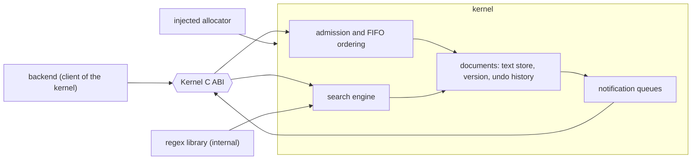
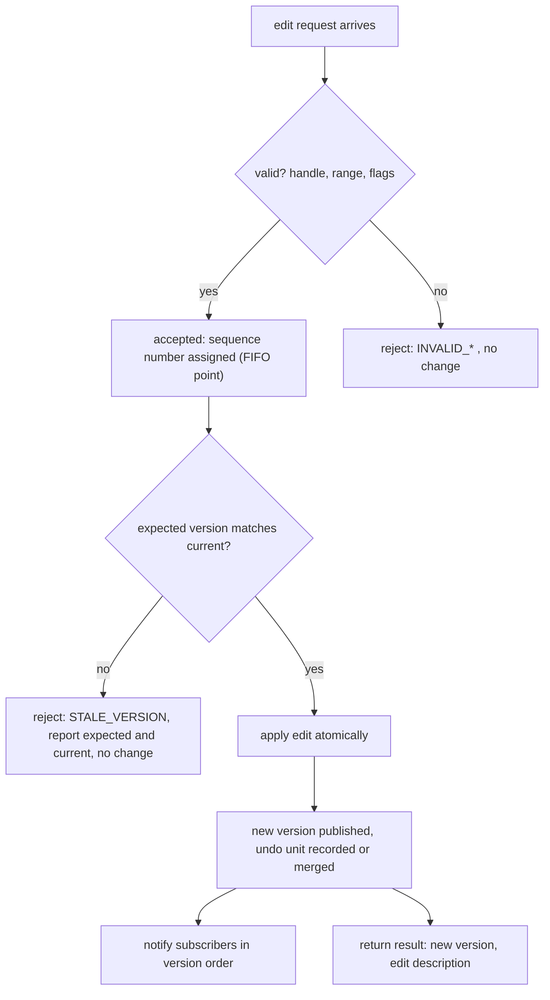

# Kernel overview

The kernel (`cdin-kernel`) is a **generic text engine**. It owns the canonical state of documents and the operations on them. It is independent of GUI, TUI, runtime and operating-system details, and it does not know who its clients are.

Status: scope items are `ACCEPTED`; mechanisms are `PROPOSED` where marked.

## 1. Responsibilities

The kernel is responsible for:

1. the document model and canonical content;
2. basic text-editing operations;
3. the position and range contract;
4. undo and redo;
5. edit transactions;
6. document versioning;
7. change notification;
8. document lifecycle;
9. admission and ordering of edit requests;
10. the advanced search engine.

The kernel is **not** responsible for display logic, layout, scrolling, rendering, file I/O, syntax highlighting, text shaping, bidi reordering, key handling, commands, selections, or anything specific to a frontend, to Lua or to the operating system.

## 2. Context

*Caption: components of the kernel (`PROPOSED` internal structure; the external boundary is the contract). The internal text store is not part of any public contract (KERNEL-012).*

## 3. Requirements

- **KERNEL-001** `ACCEPTED` The kernel is a generic text engine and MUST NOT depend on GUI, TUI, runtime or operating-system details. — *Verify:* STATIC, INSPECT
- **KERNEL-002** `ACCEPTED` The kernel owns the canonical state of every document. — *Verify:* INSPECT
- **KERNEL-003** `ACCEPTED` The kernel provides the responsibilities listed in section 1. — *Verify:* CONF, INSPECT
- **KERNEL-004** `ACCEPTED` Display logic, layout, scrolling and rendering MUST NOT be placed in the kernel. — *Verify:* STATIC, INSPECT
- **KERNEL-005** `ACCEPTED` No other component MAY keep an independent copy of canonical document content or of undo/redo history. A derived, disposable cache (for example visible lines held by a frontend) is permitted and MUST be invalidated by version. — *Verify:* INSPECT
- **KERNEL-006** `ACCEPTED` The kernel MUST NOT know the identity, kind or number of its clients. The Lua document layer is simply one client of the ABI. — *Verify:* INSPECT, STATIC
- **KERNEL-007** `PROPOSED` The kernel is deterministic: it MUST NOT read the clock, the environment or the filesystem, and MUST NOT perform I/O. Time-dependent policies (for example grouping typing by elapsed time) belong to the caller. — *Verify:* STATIC, CONF
- **KERNEL-008** `PROPOSED` The kernel allocates only through an allocator injected at creation (ABI-017). — *Verify:* SAN, INSPECT
- **KERNEL-009** `PROPOSED` The kernel never terminates the process because of caller input or resource exhaustion; all failures are statuses (ABI-007, ERR-004, ERR-005). — *Verify:* FUZZ, SAN
- **KERNEL-010** `PROPOSED` Regular expressions are provided by a third-party engine hidden behind an internal interface. The public API MUST NOT expose that engine's types or syntax identifiers. Selection of the engine is open ([OD-09](../decisions/open-decisions.md), [ADR-0009](../decisions/ADR-0009-regex-engine.md)). — *Verify:* STATIC, CONF
- **KERNEL-011** `ACCEPTED` The kernel is implemented in C11. Its public boundary is the C ABI and does not require C. — *Verify:* INSPECT
- **KERNEL-012** `ACCEPTED` The internal text structure (a piece table or piece tree is preferred) MUST NOT be visible in or relied on by any public API or contract. Different implementations MUST behave identically through the contract. — *Verify:* CONF, STATIC
- **KERNEL-013** `PROPOSED` Resource limits (maximum document size, maximum undo memory, maximum live snapshots, maximum open documents, maximum search steps) are set at creation. At a limit the operation fails with `LIMIT_EXCEEDED`; nothing is silently dropped (ARCH-021). — *Verify:* CONF, PERF
- **KERNEL-014** `PROPOSED` The kernel MUST be usable from a single thread with no thread of its own, and MUST be correct when called from many (CONC-001). It MAY use internal threads only if documented and bounded. — *Verify:* SAN, INSPECT

## 4. Document map

| Topic | Document |
|---|---|
| Document model, identity, handles, version, lifecycle | [document-model.md](document-model.md) |
| Bytes, UTF-8, line endings | [text-model.md](text-model.md) |
| Positions and ranges | [positions-and-ranges.md](positions-and-ranges.md) |
| Edit operations and version checks | [editing-operations.md](editing-operations.md) |
| Transactions | [transactions.md](transactions.md) |
| Undo and redo | [undo-redo.md](undo-redo.md) |
| Notifications | [change-notifications.md](change-notifications.md) |
| Search | [search-engine.md](search-engine.md) |
| Concurrency, ABI, errors | [concurrency.md](../architecture/concurrency.md), [abi-and-compatibility.md](../architecture/abi-and-compatibility.md), [error-model.md](../architecture/error-model.md) |

## 5. Editing lifecycle at a glance

*Caption: `PROPOSED` flow. Behaviour at the validation and version-check steps is `ACCEPTED` (EDIT-004, EDIT-006); acceptance-point placement is CONC-004.*
