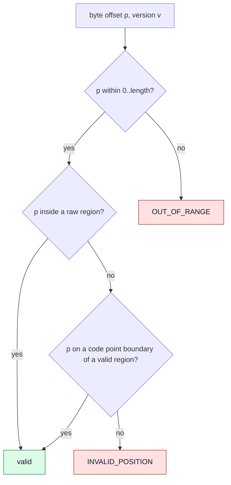

# Positions and ranges

Four different notions of "where" that MUST NOT be conflated.

| Notion | Meaning | Owner |
|---|---|---|
| **Byte offset** | Count of bytes from the start of the document | kernel (canonical) |
| **Code point** | A Unicode scalar value, valid regions only | kernel (conversion) |
| **Grapheme cluster** | A user-perceived character, relative to a pinned Unicode version | kernel (boundary queries) |
| **Visual column** | Where something lands on a screen after tab expansion, shaping, bidi, wrapping | frontend only |

- **POS-001** `ACCEPTED` Byte offset, code point, grapheme cluster and visual column are distinct concepts and MUST NOT be treated as equivalent. — *Verify:* INSPECT, CONF
- **POS-002** `ACCEPTED` The position model combines: Unicode code points for valid text; byte offsets for addressing and exact conversion; byte-level addressing for raw or invalid regions; grapheme clusters as a separate concept for user-facing behaviour. — *Verify:* INSPECT, CONF
- **POS-003** `ACCEPTED` Contracts MUST document position conversion at multibyte boundaries, in invalid regions, at the end of the document, and after the document changes. — *Verify:* INSPECT

## 1. Canonical position

- **POS-010** `PROPOSED` The canonical position in the kernel API is an unsigned 64-bit **byte offset**. A **range** is a half-open interval `[start, end)` of byte offsets with `start <= end`. — *Verify:* CONF
- **POS-011** `PROPOSED` The offset equal to the document length is valid (end of document). Greater is `OUT_OF_RANGE`. — *Verify:* CONF
- **POS-012** `PROPOSED` Every position and range is relative to a specific version. A request carrying a position MAY also carry the version it was computed against (EDIT-003). — *Verify:* CONF
- **POS-013** `PROPOSED` Line and column are *derived* values: the line number is the count of line terminators before the offset; the column is a byte offset within the line. They are never stored as authority and never used as input to an edit. — *Verify:* CONF

## 2. Validity of a position

*Caption: `PROPOSED` validity rules for an edit position.*

- **POS-020** `PROPOSED` In a valid region, an edit position MUST fall on a code point boundary. A position inside a multibyte sequence fails with `INVALID_POSITION`; the kernel does not round it. — *Verify:* CONF
- **POS-021** `PROPOSED` Inside a raw region any byte offset is a valid edit position. — *Verify:* CONF
- **POS-022** `PROPOSED` Read ranges MAY start or end at any byte offset (reading bytes has no boundary requirement); the returned data states whether it begins or ends inside a multibyte sequence. — *Verify:* CONF

## 3. Conversions

- **POS-030** `PROPOSED` The kernel provides: byte offset to code-point index and back; byte offset to line and in-line byte offset and back; next and previous code-point boundary; next and previous grapheme boundary. — *Verify:* CONF
- **POS-031** `PROPOSED` Code-point conversion is defined only for valid regions. A conversion that touches a raw region treats each raw byte as one unit and says so in the result. — *Verify:* CONF
- **POS-032** `PROPOSED` Grapheme-boundary queries use the Unicode version pinned for the kernel release ([ADR-0010](../adr/ADR-0010-unicode-version.md)). The version is queryable. — *Verify:* CONF
- **POS-033** `PROPOSED` Raw bytes are each treated as their own grapheme for boundary queries. — *Verify:* CONF
- **POS-034** `PROPOSED` Conversions are relative to a snapshot or a stated version; a conversion requested for a stale version fails with `STALE_VERSION` rather than answering for the new content. — *Verify:* CONF

## 4. Visual column and layout

- **POS-040** `ACCEPTED` Visual column is not defined by the kernel. (Layout and rendering are excluded, KERNEL-004.) — *Verify:* INSPECT, STATIC

## 5. Positions across edits

Clients holding positions (views, selections, search results) need to adjust them when a document changes.

- **POS-050** `PROPOSED` Change notifications describe every edit precisely enough for a client to transform its own positions (see [change-notifications.md](change-notifications.md), NOTIF-008). — *Verify:* CONF
- **POS-051** `PROPOSED` Whether the kernel also offers a position-mapping helper (anchors or markers with a bias) is open ([OD-28](../adr/open-decisions.md)). Clients MUST NOT assume it exists. — *Verify:* INSPECT
- **POS-052** `PROPOSED` The kernel never transforms a stale position automatically (EDIT-004). — *Verify:* CONF

## 6. Existing behaviour

- **EXISTING** The current Lua text pipeline separates UTF-8 handling, bidi and shaping, with a documented order ("the order, which is the whole point"). Those parts concern visual columns and display, not canonical positions. — *Anchor:* `docs/architecture/internals.md` ("The text pipeline"), `data/core/text/utf8.lua`, `bidi.lua`, `shaper.lua`
