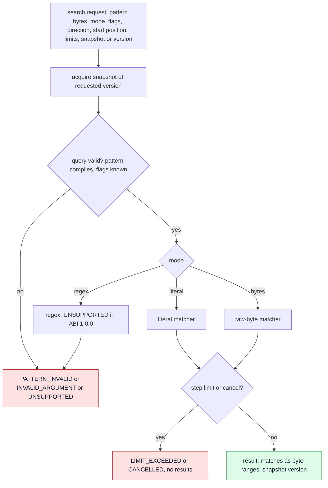

# Search engine

Advanced search is part of the kernel, not UI logic of a search box (`ACCEPTED`).

## 1. Required capabilities (`ACCEPTED`)

- **SEARCH-001** `ACCEPTED` Literal search. — *Verify:* CONF
- **SEARCH-002** `ACCEPTED` Case-sensitive and case-insensitive search. — *Verify:* CONF
- **SEARCH-003** `ACCEPTED` Forward and backward search. — *Verify:* CONF
- **SEARCH-004** `DEFERRED` Regular-expression search is not part of Kernel ABI 1.0.0; `CDIN_SEARCH_REGEX` returns `CDIN_UNSUPPORTED` and its feature bit is not advertised. Keep this requirement ID reserved; do not claim regex support until a later ABI explicitly adds and tests it. — *Verify:* CONF
- **SEARCH-005** `ACCEPTED` Unicode text, including Persian. — *Verify:* CONF
- **SEARCH-006** `ACCEPTED` Multiline search. — *Verify:* CONF
- **SEARCH-007** `ACCEPTED` Results identify the document version they were computed against. — *Verify:* CONF
- **SEARCH-008** `ACCEPTED` Behaviour on documents containing invalid UTF-8 is defined. — *Verify:* CONF

## 2. Query and result model

*Caption: `PROPOSED` search lifecycle. Regex is deferred; edge cases for raw-byte adjacency remain open (OD-11).*

- **SEARCH-010** `PROPOSED` A search runs on a snapshot (CONC-005): it never blocks mutation and never sees partial state. The result carries the snapshot's version. — *Verify:* CONF, SAN
- **SEARCH-011** `PROPOSED` Results are byte ranges `[start, end)` (POS-010). The API supports "find next from position" and "find all with a limit", both returning at most a configured number of matches per call with a continuation position. — *Verify:* CONF
- **SEARCH-012** `PROPOSED` Searching is not the place that adjusts for later edits: the caller maps results across subsequent versions using change events (POS-050) or re-runs the search. — *Verify:* INSPECT
- **SEARCH-013** `PROPOSED` Every search accepts a cancellation token and a resource limit counted in steps (KERNEL-007). Exceeding the limit returns `LIMIT_EXCEEDED`; a cancelled search returns `CANCELLED`. Partial results are returned only when the request asks for them, and are marked partial. — *Verify:* CONF
- **SEARCH-014** `ACCEPTED` ABI 1.0.0 exposes `literal`, `bytes`, and a reserved `regex` mode value; `literal` and `bytes` are supported, while `regex` returns `UNSUPPORTED`. — *Verify:* CONF

## 3. Matching rules

### Case

- **SEARCH-020** `PROPOSED` Case-insensitive matching is Unicode-aware, locale-independent, and uses simple case folding by default, relative to the pinned Unicode version ([ADR-0010](../adr/ADR-0010-unicode-version.md)). Full case folding is a separate explicit option. — *Verify:* CONF

### Persian and Arabic letters

- **SEARCH-021** `ACCEPTED` The system MUST NOT automatically treat different Arabic and Persian letters as equivalent. For example Persian `ی` (U+06CC) and Arabic `ي` (U+064A) are different letters unless an explicit option says otherwise. — *Verify:* CONF
- **SEARCH-022** `ACCEPTED` Unicode normalization, removal of diacritics (for example Arabic marks), character folding and language-specific equivalences MUST be separate, explicit capabilities, never implied by the case flag. — *Verify:* CONF
- **SEARCH-023** `PROPOSED` Such capabilities are expressed as named options in the request (for example `normalize=nfc`, `ignore_marks`, `fold_profile=<name>`). All are off by default. The set offered in the first version is an open scope item ([OD-29](../adr/open-decisions.md)). — *Verify:* CONF
- **SEARCH-024** `PROPOSED` Each such option is defined by a published table or algorithm tied to the pinned Unicode version, so two implementations agree. — *Verify:* CONF

### Multiline

- **SEARCH-030** `PROPOSED` A literal query MAY contain line terminators. Regex multiline behaviour is deferred. Searching never normalizes line endings (TEXT-003, ARCH-020). — *Verify:* CONF
- **SEARCH-031** `PROPOSED` In multiline mode `^` matches at the start of the document and after each line terminator; `$` matches at the end of the document and before each line terminator. A CRLF pair is one terminator and is never split by an anchor. `.` does not match a line terminator unless a dotall flag is set. — *Verify:* CONF
- **SEARCH-032** `PROPOSED` For a literal query whose text contains `\n` (LF), whether it matches CRLF or CR terminators is controlled by an explicit option `any_newline`; default is exact bytes. — *Verify:* CONF

### Invalid UTF-8

- **SEARCH-040** `PROPOSED` `literal` mode is Unicode-aware and matches only inside valid regions: a match MUST lie entirely within one valid region (it may span several adjacent valid regions only if nothing between them is raw). — *Verify:* CONF
- **SEARCH-041** `PROPOSED` `bytes` mode matches the exact byte sequence anywhere, including inside valid regions and across region boundaries. — *Verify:* CONF
- **SEARCH-042** `PROPOSED` A search over a document that has raw regions reports, in its result, whether any raw region was skipped by a Unicode-aware mode, so UIs can warn. — *Verify:* CONF

## 4. Regular-expression engine

- **SEARCH-050** `PROPOSED` If regex is accepted for a later ABI, use an existing portable library rather than writing one from scratch; the library and syntax subset are not chosen. See [ADR-0009](../adr/ADR-0009-regex-engine.md). — *Verify:* INSPECT
- **SEARCH-051** `PROPOSED` The contract MUST specify: supported syntax (a documented subset that the engine guarantees), invalid-pattern errors (`PATTERN_INVALID` with a position), zero-length match behaviour, multiline mode, resource limits, and cancellation. — *Verify:* CONF, INSPECT
- **SEARCH-052** `PROPOSED` Catastrophic patterns are bounded by the step limit (SEARCH-013), not by the clock. — *Verify:* CONF, FUZZ
- **SEARCH-053** `PROPOSED` Zero-length matches: a find-all MUST advance by one code point (or one raw byte) after a zero-length match to guarantee progress. — *Verify:* CONF

## 5. Existing behaviour

- **EXISTING** The supplied `cdin` snapshot has a small native search module and Lua document search; these remain migration references and are not the ABI 1.0.0 kernel implementation. — *Anchor:* `src/search/find.c`, `data/core/doc/search.lua`
