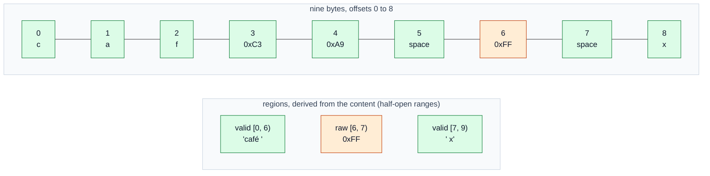

# Text model

What a document's content is, and what the kernel promises about it: bytes first, Unicode second.

## 1. Content is bytes

- **TEXT-001** `ACCEPTED` The model MUST support valid UTF-8, and MUST preserve the original bytes of regions that are invalid UTF-8. — *Verify:* CONF, FUZZ
- **TEXT-002** `ACCEPTED` The model MUST support LF, CRLF and CR line endings and any mixture of them in one document. — *Verify:* CONF
- **TEXT-003** `ACCEPTED` The kernel MUST NOT implicitly normalize line endings. — *Verify:* CONF
- **TEXT-004** `ACCEPTED` Invalid UTF-8 MUST NOT be destructively converted to U+FFFD; the original bytes MUST NOT be discarded. — *Verify:* CONF, FUZZ
- **TEXT-005** `ACCEPTED` Contracts MUST describe load, read, edit and serialization behaviour for each of these cases. — *Verify:* INSPECT

The existing project rule says the same: the buffer stores bytes, nothing is sanitized or rewritten on load, a decoder substitutes only for display (ARCH-020, `AGENTS.md §2.6`).

## 2. Regions

A document's bytes are, at any moment, partitioned into **valid regions** (well-formed UTF-8) and **raw regions** (maximal runs that are not).

- **TEXT-010** `PROPOSED` Region classification is a pure function of the current content. It is derived, not stored as authority, and is recomputed or incrementally maintained after every edit. — *Verify:* CONF, FUZZ
- **TEXT-011** `PROPOSED` Because classification is derived, an edit can change the classification of neighbouring bytes. Example: inserting a continuation byte after a stray lead byte can turn a raw region into a valid character. The kernel MUST report such effects consistently through its queries and MUST NOT rely on cached classification being stale. — *Verify:* CONF, FUZZ
- **TEXT-012** `PROPOSED` The definition of "maximal run of invalid bytes" follows the Unicode "maximal subpart" practice for ill-formed sequences, so that two implementations classify identically. The exact definition is stated in the conformance vectors. — *Verify:* CONF (boundary detail tracked in [OD-11](../adr/open-decisions.md))
- **TEXT-013** `PROPOSED` Inserting bytes through the API stores exactly those bytes; the kernel does not validate or reject invalid UTF-8 in inserted data. — *Verify:* CONF

*Caption: example classification. The raw byte 0xFF is kept exactly; neighbouring valid text is unaffected.*

## 3. Line endings

- **TEXT-020** `PROPOSED` A line terminator is exactly one of: LF (0x0A), CRLF (0x0D 0x0A) treated as one unit, or CR (0x0D) not followed by LF. A CR and an LF that are adjacent form one CRLF terminator, never two. — *Verify:* CONF
- **TEXT-021** `PROPOSED` The line index (which byte offsets start lines) is derived from content, maintained by the kernel, and consistent with TEXT-020 after every edit, including edits that join or split a CRLF pair. — *Verify:* CONF, FUZZ
- **TEXT-022** `PROPOSED` The kernel can report, for a document, whether it uses a single terminator style or a mixture, without changing any byte. Choosing a style for saving is the caller's decision. — *Verify:* CONF
- **TEXT-023** `PROPOSED` A final line without a terminator is a normal case and is not altered. — *Verify:* CONF

## 4. Other byte-level rules

- **TEXT-030** `PROPOSED` A byte-order mark is ordinary content. Detecting or stripping it is a persistence concern for the caller (see [data.md](../components/data.md)); the kernel never removes or adds one. — *Verify:* CONF (follows ARCH-020)
- **TEXT-031** `PROPOSED` NUL bytes are ordinary content. — *Verify:* CONF
- **TEXT-032** `PROPOSED` No normalization of Unicode (NFC, NFD) is ever applied to content. Normalization is an explicit, optional feature of *search* only ([search-engine.md](search-engine.md)). — *Verify:* CONF
- **TEXT-033** `PROPOSED` Maximum document size and maximum single-edit size are creation-time limits (KERNEL-013). — *Verify:* CONF

## 5. Reading content

- **TEXT-040** `PROPOSED` Content is read from a snapshot by byte range, by line range or by iteration in bounded chunks. Reading never allocates a copy of the whole document unless the caller asks for one. — *Verify:* PERF, CONF
- **TEXT-041** `PROPOSED` A read returns bytes exactly as stored, along with the version, and MAY return region information for the returned range. — *Verify:* CONF
- **TEXT-042** `PROPOSED` Serializing a document to a caller-provided sink produces the exact stored bytes. A byte-for-byte round trip load→serialize is the identity for every input. — *Verify:* CONF, FUZZ
