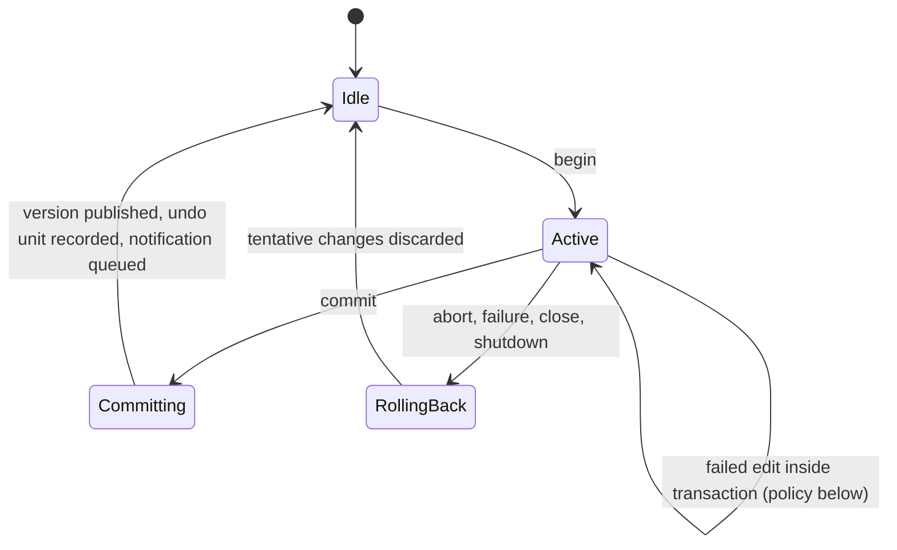
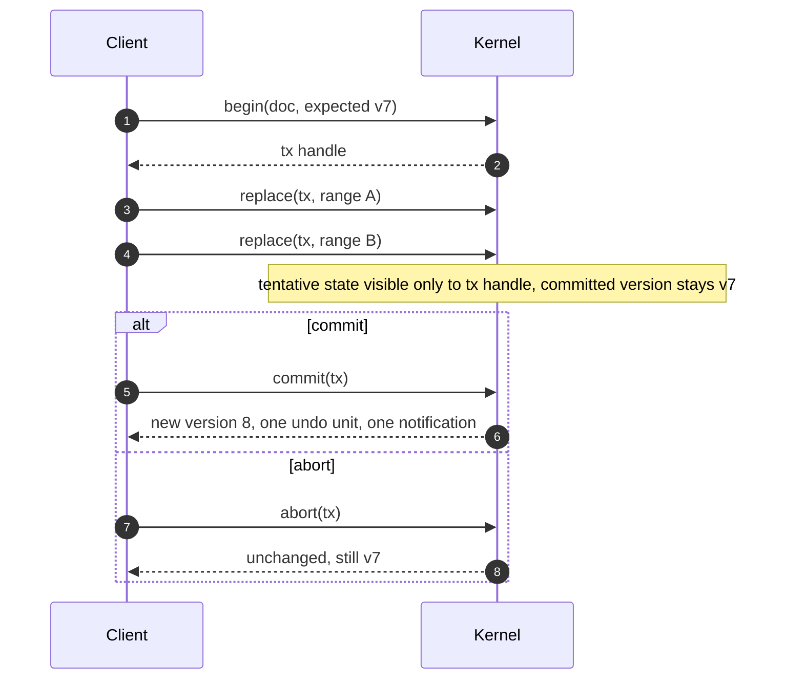

# Transactions

A transaction groups several edits into one logical operation with one undo unit and one change notification.

## 1. Accepted model

- **TXN-001** `ACCEPTED` An independent edit is one undo unit. — *Verify:* CONF
- **TXN-002** `ACCEPTED` An explicit transaction groups several edits into one logical operation. — *Verify:* CONF
- **TXN-003** `ACCEPTED` A committed transaction creates one undo unit. — *Verify:* CONF
- **TXN-004** `ACCEPTED` Commit publishes one logical change notification. — *Verify:* CONF
- **TXN-005** `ACCEPTED` Abort, or failure, rolls the transaction's changes back. A transaction MUST NOT require a full copy of the document per operation. — *Verify:* CONF, PERF
- **TXN-006** `ACCEPTED` Grouping of consecutive typing is controlled (see [undo-redo.md](undo-redo.md)). — *Verify:* CONF

## 2. Lifecycle

*Caption: `PROPOSED` transaction states per document.*

*Caption: `PROPOSED` transaction flow.*

## 3. Proposed details

- **TXN-010** `PROPOSED` `begin` carries an expected version (or "any"). A mismatch fails with `STALE_VERSION` and no transaction starts. — *Verify:* CONF
- **TXN-011** `PROPOSED` Edits inside a transaction are validated against the transaction's own tentative state. A failed edit inside a transaction leaves the transaction active with the failed edit unapplied; the caller may abort. — *Verify:* CONF
- **TXN-012** `PROPOSED` The document version does not change while a transaction is active; it increases by exactly one at commit (DOC-011). A transaction that applied no content change commits without a new version and produces no undo unit. — *Verify:* CONF
- **TXN-013** `PROPOSED` Rollback is performed from an inverse log of the transaction's own edits and costs time proportional to the size of the transaction, not of the document. — *Verify:* PERF, CONF
- **TXN-014** `PROPOSED` A transaction is identified by a handle (index plus generation). Using a handle after commit or abort returns `INVALID_HANDLE`. — *Verify:* CONF
- **TXN-015** `PROPOSED` The committed change notification describes the transaction as a sequence of edits in order, plus the aggregate range changed, so a client may either replay or invalidate. — *Verify:* CONF
- **TXN-016** `PROPOSED` Failure in the kernel during commit (for example `NO_MEMORY`) rolls the transaction back completely and reports the failure; the document remains at the last committed version. — *Verify:* CONF (with an injected failing allocator)

## 4. Interaction with other writers and readers

- **TXN-007** `PROPOSED` While a transaction is active on a document, mutation requests on that document not belonging to the transaction fail with `BUSY`. Other documents are unaffected. Alternative (queueing) is recorded in [OD-21](../adr/open-decisions.md). — *Verify:* CONF
- **TXN-008** `PROPOSED` Reads by other callers during an active transaction see the last committed version. Only the transaction's handle may read tentative content (CONC-012). — *Verify:* CONF
- **TXN-009** `PROPOSED` Closing the document or shutting the kernel down aborts the active transaction and rolls it back (CONC-021, DOC-031). — *Verify:* CONF

## 5. Nesting

- **TXN-020** `PROPOSED` Nested transactions are not supported in the first version. `begin` on a document with an active transaction fails with `INVALID_STATE` (or `BUSY` for a different caller). — *Verify:* CONF
- **TXN-021** `DEFERRED` Nested transactions with partial rollback, and savepoints. Revisit with [OD-03](../adr/open-decisions.md). — *Verify:* INSPECT

## 6. Why not queue behind a transaction

A transaction can be long-lived (a refactoring across many ranges). If other writers were silently queued behind it, one slow client could stall every other writer on the document without anyone knowing why. Rejecting with `BUSY` is explicit and makes the contention visible and testable.
