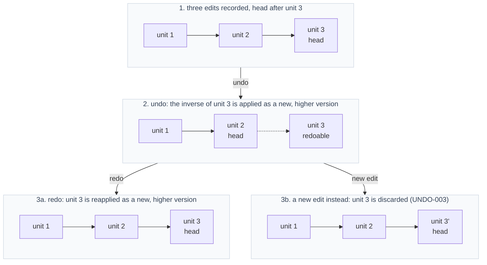
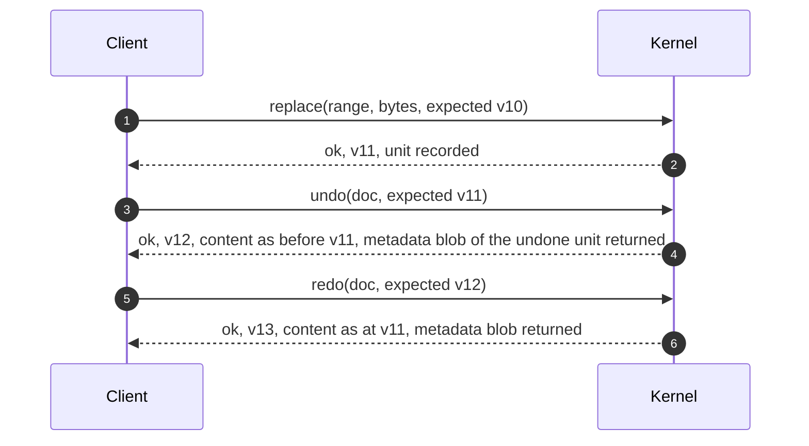

# Undo and redo

## 1. Model

Each document has its own undo/redo history (DOC-002). The history is a sequence of **undo units**. A unit is created by an independent edit, a committed transaction, or a batch replace.

- **UNDO-001** `ACCEPTED` Undo/redo history is per document and owned by the kernel. No other component keeps a second history (KERNEL-005). — *Verify:* CONF, INSPECT
- **UNDO-002** `PROPOSED` Undo and redo are ordinary mutations: each applies the inverse (or forward) edits of one unit, publishes exactly one new version (DOC-011) and one notification of kind `undo` or `redo`. Versions never go backwards: after undo the version is higher than before it. — *Verify:* CONF
- **UNDO-003** `PROPOSED` History is linear. A new edit after one or more undos discards the redo units. Tree-shaped history is `DEFERRED`. — *Verify:* CONF
- **UNDO-004** `PROPOSED` Undo with nothing to undo (and redo with nothing to redo) returns `INVALID_STATE` without a version change. — *Verify:* CONF

*Caption: `PROPOSED` linear history behaviour.*

*Caption: `PROPOSED` versions increase through undo and redo.*

## 2. Grouping consecutive typing

Open item 4 asked for a controlled policy. The kernel must stay deterministic (KERNEL-007), so it cannot use elapsed time.

- **UNDO-010** `PROPOSED` Every edit request MAY carry a **coalesce key** (an opaque 64-bit value, 0 meaning none). If the immediately preceding undo unit has the same non-zero key, was produced by the same document, and no other mutation or undo/redo has intervened, the new edit is merged into that unit. — *Verify:* CONF
- **UNDO-011** `PROPOSED` Which edits share a key, and when a key changes (pause, cursor movement, word boundary), is policy owned by the caller (runtime). The kernel never reads time. — *Verify:* INSPECT
- **UNDO-012** `PROPOSED` A merged unit is undone as one and produces one notification of kind `undo`. — *Verify:* CONF
- **UNDO-013** `PROPOSED` Merging never crosses a transaction boundary: a committed transaction is always its own unit. — *Verify:* CONF

## 3. Caller metadata (selections)

Selection state is owned by the view and not the kernel (ARCH-051), yet undo should be able to restore where the cursor was.

- **UNDO-020** `PROPOSED` Each undo unit stores up to two opaque caller blobs: *before* (state to restore on undo) and *after* (state to restore on redo). The kernel stores them without interpreting them and returns the right one with the result of undo or redo. — *Verify:* CONF
- **UNDO-021** `PROPOSED` The blobs count toward the undo memory limit (UNDO-030). Their maximum size is a creation-time limit. — *Verify:* CONF
- **UNDO-022** `PROPOSED` For merged units the *before* blob is that of the first edit and the *after* blob is that of the last. — *Verify:* CONF

## 4. Bounds

- **UNDO-030** `PROPOSED` The undo history has a configured memory cap. When the cap is exceeded the oldest units are evicted first, and the document reports how many units were evicted (a counter and a notification). History is never silently truncated. — *Verify:* CONF, PERF (ARCH-021)
- **UNDO-031** `PROPOSED` A single unit larger than the cap is still recorded as the only unit; the cap evicts older units but never the newest. If even that cannot be recorded, the edit fails with `LIMIT_EXCEEDED` and changes nothing. — *Verify:* CONF
- **UNDO-032** `PROPOSED` The history stores inverse information proportional to edit size (not document copies), consistent with TXN-005. — *Verify:* PERF

## 5. Clean marker

- **UNDO-040** `PROPOSED` The saved-state marker (DOC-040) refers to a point in the history. If the marker's unit is evicted (UNDO-030), the document is reported as modified until marked saved again. — *Verify:* CONF

## 6. Undo and the selection (ownership summary)

Selection and undo interplay (open item 5) is resolved as follows (`PROPOSED`): the *view* owns selections; the *kernel* owns history; the opaque blobs (UNDO-020) are the only coupling; the kernel never inspects them. See [ADR-0007](../adr/ADR-0007-selection-ownership.md).

## 7. Existing behaviour

- **EXISTING** The current Lua document has an undo mechanism and a documented section on it. Its grouping behaviour is the baseline to compare when writing the first conformance vectors. — *Anchor:* `docs/architecture/internals.md` ("Undo"), `data/core/doc/init.lua`
