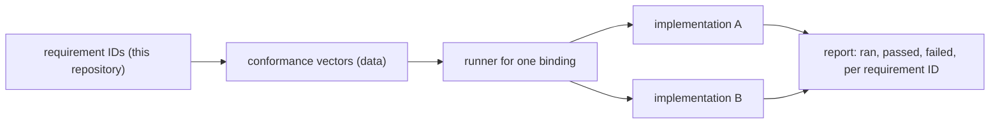

# Conformance and verification design

This document defines a language-neutral conformance approach. The Spec repository contains no executable runner, while the separate `cdin-kernel` repository already has a C vector parser/runner, vector corpus and regression tests for its ABI 1.0.0 surface. Kernel results are recorded in [implementation status](../kernel/implementation-status.md); protocol and whole-editor tests remain planned.

## 1. Principles

- **TEST-001** `ACCEPTED` Conformance tests MUST be independent of the internal text structure (piece table, piece tree or other) and usable for several kernel implementations. — *Verify:* INSPECT
- **TEST-002** `PROPOSED` A conformance vector is a data-driven case: a named scenario of operations and expected observable outcomes, expressed against the **public contract only** (ABI operations, protocol messages). It names the requirement IDs it covers. — *Verify:* INSPECT
- **TEST-003** `PROPOSED` Vectors are language-neutral data, plus a thin runner per contract written once per binding (for the kernel: a C runner over the ABI; for the protocol: a runner over the serialized transport). The specification will define the vector format; the runner is implementation work. — *Verify:* INSPECT
- **TEST-004** `PROPOSED` No test is reported as passing unless it was run. Reports state what was run, where, on which implementation version. — *Verify:* INSPECT
- **TEST-005** `PROPOSED` A requirement with no planned vector and a method of `CONF` is a defect of the specification and is listed in [status.md](../reference/status.md). — *Verify:* STATIC

*Caption: the target verification pipeline. The kernel implementation provides its own runner and vectors; protocol and integrated-editor stages remain future work.*

## 2. Vector families

| Family | Targets | Covers |
|---|---|---|
| `doc.lifecycle` | kernel | DOC-001 to DOC-050: multiple documents, handles, generations, close ordering, versions, clean marker |
| `text.bytes` | kernel | TEXT-001 to TEXT-042: preservation of valid and invalid UTF-8, BOM, NUL, round trip |
| `text.eol` | kernel | LF, CRLF, CR, mixed; join and split of CRLF; line index |
| `pos.convert` | kernel | byte to code point, line, grapheme; multibyte boundaries; raw regions; end of document |
| `edit.replace` | kernel | replace, batch replace, atomicity, limits |
| `edit.version` | kernel | stale version rejection, atomicity with mutation (EDIT-004, EDIT-006) |
| `txn` | kernel | begin, commit, abort, rollback, `BUSY`, nesting rejection |
| `undo` | kernel | linear history, coalescing, metadata blobs, caps, clean marker |
| `notif` | kernel | order, exactly-once, versions, overflow and resync, subscribe-and-snapshot |
| `search.literal`, `search.bytes` | kernel | supported literal/byte modes, case behavior, Persian letter distinctness, multiline literal matching, invalid UTF-8, configured limits; regex is explicitly unsupported in ABI 1.0.0. Cancellation is not advertised by the current ABI |
| `conc` | kernel | caller serialization, sequence/linearization semantics, snapshot immutability, shutdown behavior; no wall-clock FIFO or queued shutdown modes |
| `abi` | kernel | struct size, unknown flags, version and feature queries, buffer-size pattern |
| `proto.handshake` | protocol | hello, capabilities, version mismatch |
| `proto.updates` | protocol | flush atomicity, backpressure, versioned lines, invalidation |
| `proto.input` | protocol | raw key and text events, resize, focus, paste |
| `ext.contract` | runtime | the existing extension contract's behaviour (to be derived from the contract document and the current Lua tests) |

## 3. Scenario shape (illustrative, non-normative)

Shown as prose steps so no format is fixed.

> **edit.version / stale-rejected**
> 1. Create a document from bytes `"abc"`; note version `v0`.
> 2. Replace range `[1,2)` with `"X"` expecting `v0` → expect success, new version `v1`, content `"aXc"`.
> 3. Replace range `[0,1)` with `"Z"` expecting `v0` → expect `STALE_VERSION`, expected `v0`, current `v1`.
> 4. Read content → expect `"aXc"`, version `v1` (no change from the rejected request).
> Covers: EDIT-004, EDIT-006, ERR-002, ERR-010.

> **text.bytes / invalid-preserved**
> 1. Create a document from bytes `0x61 0xFF 0x62`.
> 2. Read the whole content → expect exactly those three bytes.
> 3. Query regions → expect valid `[0,1)`, raw `[1,2)`, valid `[2,3)`.
> 4. Serialize → expect exactly `0x61 0xFF 0x62`.
> Covers: TEXT-001, TEXT-004, TEXT-010, TEXT-042.

> **search.literal / persian-distinct**
> 1. Create a document containing Persian `ی` (U+06CC) and Arabic `ي` (U+064A) in separate words.
> 2. Literal search for `ی` with default options → only the Persian occurrences match.
> 3. No default option normalizes or equates those letters; an optional named folding profile remains a separate open decision.
> Covers: SEARCH-021, SEARCH-022, SEARCH-023.

## 4. Non-conformance methods

- **TEST-010** `PROPOSED` **Fuzzing**: the kernel ABI input boundary (struct sizes, flags, ranges, arbitrary byte strings), the vector parser, protocol decoder when implemented, and line-ending/region classifiers. Regex fuzzing applies only if a future ABI adds regex. Targets run under sanitizers. — *Verify:* FUZZ
- **TEST-011** `PROPOSED` **Sanitizers**: address and undefined-behaviour sanitizers on every test run; thread sanitizer on all `conc` vectors. — *Verify:* SAN
- **TEST-012** `PROPOSED` **Failure injection**: an allocator that fails after N allocations, to verify `NO_MEMORY` handling leaves state unchanged (ERR-005, TXN-016). The existing runtime already has allocation-failure hooks that serve as precedent. — *Verify:* CONF
- **TEST-013** `PROPOSED` **Performance budgets**: benchmarks with recorded baselines; a regression of more than 10% fails the phase, as the current project rule already states (`AGENTS.md §8`). Budgets are chosen by the 1 GB document case, not the 1 KB case. — *Verify:* PERF
- **TEST-014** `PROPOSED` **Include-direction check** (ARCH-046): a static check that fails on a forbidden include or link. — *Verify:* STATIC

## 5. The headless frontend as protocol reference

- **TEST-020** `PROPOSED` The headless frontend (FE-007) records every protocol message it receives and replays scripted input. It lets `proto.*` vectors run with no display. — *Verify:* INTEG
- **TEST-021** `PROPOSED` A second implementation of any component passes if it passes the same vectors; no vector may mention an implementation detail (ARCH-004). — *Verify:* INSPECT

## 6. Existing assets to mine for vectors

- **EXISTING** C tests exist in `tests/c/` (allocator, base, font, handle, job, logger, renderer cache, main, a Lua harness and a soak target), Lua unit and integration tests in `tests/lua/`, benchmarks in `tests/bench/`, and fuzz corpora for end-of-line, path and UTF-8 in `tests/fuzz/corpus/`. They are sources of cases and corpora for the first vectors; they are not conformance vectors themselves. — *Anchor:* `tests/c/`, `tests/lua/`, `tests/bench/`, `tests/fuzz/corpus/`
- **EXISTING** The Lua scripts `scripts/test_commands.lua`, `scripts/test_workflows.lua`, `scripts/test_site_dir.lua` exercise runtime behaviour and are sources for `ext.contract` vectors. — *Anchor:* `scripts/test_*.lua`
- **EXISTING** The memory and performance discipline (accounting allocator, no steady-state allocation, benchmark baselines) is already project rule. — *Anchor:* `AGENTS.md §8`

## 7. Reporting

- **TEST-030** `PROPOSED` A verification report lists, per requirement ID: method, vector family, implementation and version, date run, result. A requirement with no entry is *unverified*, and is reported as such. — *Verify:* INSPECT

## 8. Executed implementation evidence

The Spec repository contains no executable product-test runner by design. The separate `cdin-kernel` ABI 1.0.0 repository contains the executable vector parser/runner, data-driven vectors and C regression tests. The synchronization record in [kernel implementation status](../kernel/implementation-status.md) and the release report gives exact commands and results run against the supplied kernel snapshot. Planned Frontend Protocol, backend integration, runtime and GUI/TUI/CLI integration vectors remain unimplemented and must not be reported as passing.
